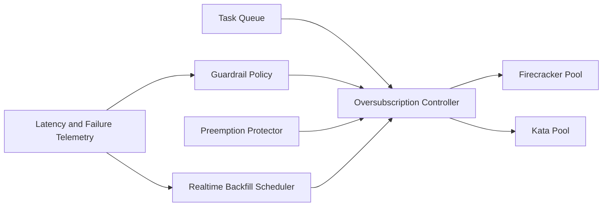

# Firecracker/Kata Oversubscription Guardrails 选型 FAQ（Cycle 1872）

## 1) 3 分钟结论
- **核心问题：** 过度超配（oversubscription）会在沙箱高峰引发抢占抖动与尾延迟失控。
- **推荐方案：** “分层超配比 + 抢占保护阈值 + 实时回填调度”护栏模型。
- **目标：** 在提高资源利用率的同时，守住隔离稳定性与 P95/P99 时延上限。

## 2) Q1 / Q2 / Q3
### Q1：为什么单一超配倍率不可取？
1) CPU 与内存压力曲线不一致；
2) 任务类型对抖动容忍度差异大；
3) 峰值故障会把单一倍率放大为全局风险。

### Q2：生产级 guardrails 如何落地？
- **分层超配比：** 按租户等级与任务类型设置不同超配上限；
- **抢占保护：** 核心会话设最小保留份额与抢占阈值；
- **回填调度：** 低优先级任务在空闲窗口回填；
- **熔断策略：** 尾延迟超阈值时自动降载与扩容触发。

### Q3：上线判据是什么？
- 在目标超配比下 P95/P99 延迟可控；
- 会话失败率与策略误杀率未显著上升；
- 扩缩容策略在压力测试中稳定。

## 3) 架构图

## 4) 选型矩阵
| 维度 | 固定超配比 | 分层护栏超配（推荐） |
|---|---:|---:|
| 资源利用率 | 中 | 高 |
| 尾延迟可控性 | 低 | 高 |
| 隔离稳定性 | 中 | 高 |
| 实施复杂度 | 低 | 中 |
| 运维可观测性 | 中 | 高 |

## 5) 证据与复算口径
- 证据文件：
  - `workshops/azure-agent-infra/evidence/cycle-1872-benchmark.json`
  - `workshops/azure-agent-infra/evidence/cycle-1872-latency.csv`
  - `workshops/azure-agent-infra/evidence/cycle-1872-throughput.csv`
  - `workshops/azure-agent-infra/evidence/cycle-1872-policy.csv`
- 标签：`measured / synthetic / anonymized_reported`。
- validation7：六段结构、7-card CSP、cycle-topic 对齐、验证链可回放。

## 6) 生产检查清单
- [ ] 分层超配比已按租户/任务类型建模。
- [ ] 抢占保护阈值与最小份额压测通过。
- [ ] 回填调度与熔断联动策略演练通过。
- [ ] 尾延迟超阈值自动降载策略可触发。
- [ ] FAQ/H5/SVG/7-card/evidence 轮次一致。
