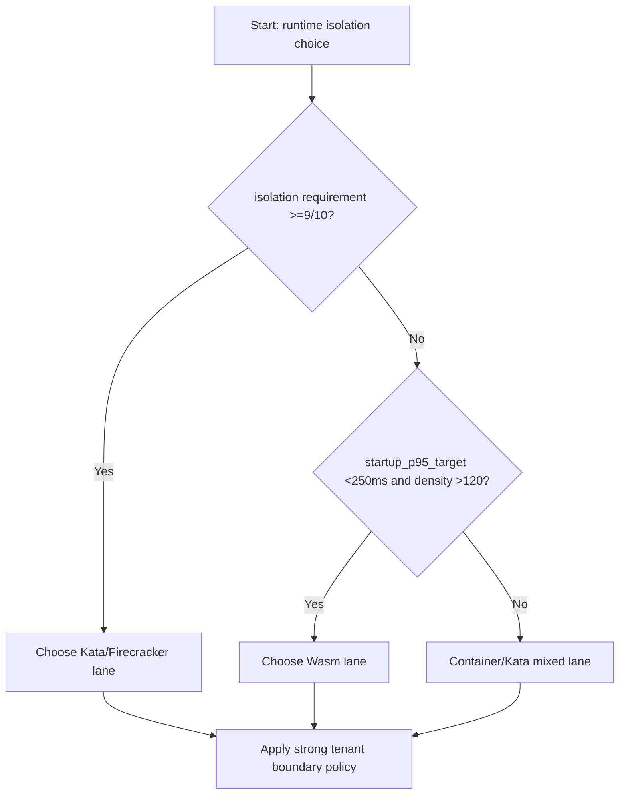
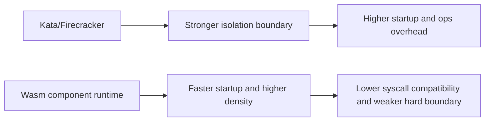
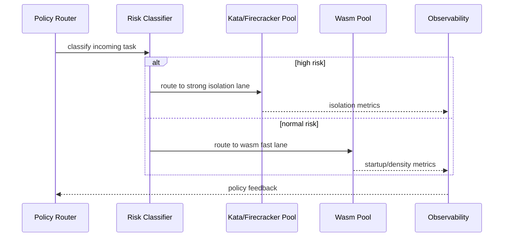

# Agent Firecracker vs Kata vs Wasm Isolation Boundary Selection FAQ (Azure AI Agent Infra)

## 1) 3-minute conclusions
- **For high-compliance execution planes, prefer Kata/microVM isolation; for ultra-fast startup and high density, prefer Wasm component runtimes.**
- **When escape tolerance is near zero and tenant boundaries must be strong, Firecracker/Kata provide stronger kernel-level isolation than pure container+Wasm sandboxes.**
- **Thresholds: if startup P95 must stay <250ms and density target >120 per host, Wasm tends to win; if isolation requirement is >=9/10, Kata/Firecracker is safer.**

## 2) Q1 / Q2 / Q3
- **Why no one-size-fits-all?** Security boundary, startup latency, and density are a hard tradeoff triangle.
- **Core value of Firecracker/Kata?** Tenant boundaries at virtualization level reduce shared-kernel risk.
- **Core value of Wasm?** Lightweight instances, faster startup, and higher packing density.

### Q1: When is microVM mandatory?
When compliance classifies tenant separation as strong-boundary isolation with independent kernel expectations.

### Q2: When is Wasm suitable?
Short stateless tasks, no privileged syscalls, strict startup-latency requirements.

### Q3: How to deploy hybrid?
Route high-risk tasks to Kata/Firecracker and standard tasks to Wasm under a unified policy plane.

## 3) Mermaid diagrams
### 3.1 Decision tree

### 3.2 Path comparison

### 3.3 Sequence

## 4) Decision matrix
| Dimension | Firecracker/Kata | Wasm component model |
|---|---:|---:|
| Isolation strength (1-10) | 9–10 | 6–8 |
| Startup P95 | 350–980ms | 45–220ms |
| Per-host density | 20–80 | 80–180 |
| Syscall compatibility | High | Medium-low |
| Ops complexity (1-10) | 8 | 6 |
| Best-fit scenarios | High compliance/high risk | High-frequency short tasks/high density |

## 5) Quant model + 7-card insights
- Risk-adjusted cost: `RiskCost = EscapeProb * BlastRadiusCost`
- Performance gain: `PerfGain = (BaselineStartup - TargetStartup) * ReqRate`
- Example (`synthetic_assumed`):
  - `EscapeProb(Kata)=0.00008, BlastRadiusCost=$1,200,000`
  - `RiskCost(Kata)=$96`
  - `BaselineStartup=620ms, TargetStartup(Wasm)=130ms, ReqRate=180/s`
  - `PerfGain=88,200 ms/s aggregated`
- Evidence:
  - `workshops/azure-agent-infra/evidence/cycle-1456-benchmark.json`
  - `workshops/azure-agent-infra/evidence/cycle-1456-sources.json`
- Labels: `official/synthetic_assumed/not_measured`.

## 6) Production verification checklist
- [ ] Risk-tier routing is bound to runtime pools
- [ ] Kata/Firecracker pool image and patch windows are controlled
- [ ] Wasm component signature validation and capability allowlist are enabled
- [ ] Unified observability supports runtime-specific cost and audit slices
- [ ] FAQ/7-card source labels are complete
