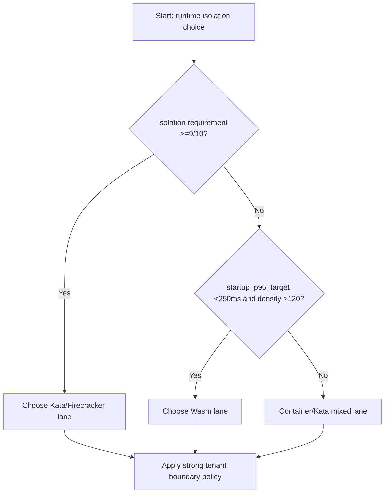
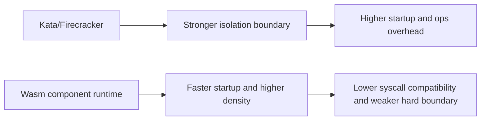
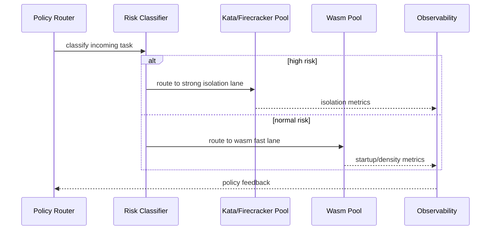

# Agent Firecracker vs Kata vs Wasm Isolation Boundary 选型 FAQ（Azure AI Agent Infra）

## 1) 3 分钟结论
- **高合规执行面（金融/政务）优先 Kata/微虚拟机隔离，若侧重极低冷启动与高密度可优先 Wasm 组件模型。**
- **当越权逃逸容忍度接近零且需强租户边界，Firecracker/Kata 的内核级隔离优于纯容器 + Wasm 沙箱。**
- **生产分界线：若启动 P95 必须 <250ms 且同机实例密度目标 >120，Wasm 路径更优；若隔离强度要求 ≥9/10，Kata/Firecracker 路径更稳。**

## 2) Q1 / Q2 / Q3
- **为什么不是“一种技术打天下”？**：安全边界、启动时延、资源密度天然是三角取舍。
- **Firecracker/Kata 的核心价值？**：把租户边界下沉到虚拟化边界，降低内核共享风险。
- **Wasm 的核心价值？**：实例轻量、启动快、密度高，适合高频短任务。

### Q1：什么时候必须选微虚拟机？
当租户间数据隔离被审计要求定义为“强边界隔离”且需独立内核。

### Q2：什么时候可选 Wasm？
函数式短任务、无特权系统调用、对极低启动时延敏感。

### Q3：如何做混合部署？
高风险任务进 Kata/Firecracker，普通任务走 Wasm；统一策略平面做路由。

## 3) Mermaid 图
### 3.1 决策树

### 3.2 路径对比

### 3.3 时序

## 4) 决策矩阵
| 维度 | Firecracker/Kata | Wasm 组件模型 |
|---|---:|---:|
| 隔离强度（1-10） | 9–10 | 6–8 |
| 启动 P95 | 350–980ms | 45–220ms |
| 实例密度（同机） | 20–80 | 80–180 |
| syscall 兼容性 | 高 | 中低 |
| 运维复杂度（1-10） | 8 | 6 |
| 推荐场景 | 高合规/高风险 | 高频短任务/高密度 |

## 5) 定量算例与 7-Card 洞察
- 单位风险成本：`RiskCost = EscapeProb * BlastRadiusCost`
- 单位性能收益：`PerfGain = (BaselineStartup - TargetStartup) * ReqRate`
- 示例（`synthetic_assumed`）：
  - `EscapeProb(Kata)=0.00008, BlastRadiusCost=$1,200,000`
  - `RiskCost(Kata)=$96`
  - `BaselineStartup=620ms, TargetStartup(Wasm)=130ms, ReqRate=180/s`
  - `PerfGain=88,200 ms/s aggregated`
- 证据：
  - `workshops/azure-agent-infra/evidence/cycle-1456-benchmark.json`
  - `workshops/azure-agent-infra/evidence/cycle-1456-sources.json`
- 标签：`official/synthetic_assumed/not_measured`。

## 6) 生产核验 Checklist
- [ ] 风险分级路由策略与运行时池绑定已落地
- [ ] Kata/Firecracker 池独立镜像与补丁窗口可控
- [ ] Wasm 组件签名校验与能力白名单已启用
- [ ] 统一观测面可按运行时维度拆账与审计
- [ ] FAQ/7-Card 全字段来源标签完整
