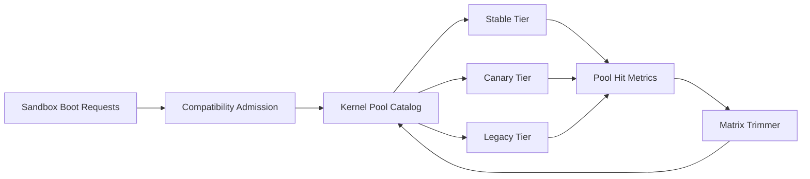

# Firecracker Kernel Pool Fragmentation Selection FAQ (Cycle 1901)

## 1) Three-minute decision
- **Core issue:** when multiple Firecracker kernel versions coexist, kernel-pool fragmentation increases cold-start jitter and warmup cost.
- **Recommendation:** apply tiered kernel catalogs, compatibility-matrix trimming, and compressed migration windows.
- **Goal:** reduce pool fragmentation and startup jitter while preserving isolation and compatibility.

## 2) Q1 / Q2 / Q3
### Q1: Why does kernel-pool fragmentation happen?
1) too many kernel-version and feature-flag combinations,
2) sparse long-tail image dependencies reduce hit rates,
3) dual-stack upgrade periods extend fragmentation windows.

### Q2: How should production governance be designed?
- **Tiered catalog:** stable/canary/legacy kernel pools,
- **Matrix trimming:** remove low-hit combinations using runtime profiles,
- **Window compression:** short canary migration with enforced reclaim,
- **Scheduler binding:** admission selects optimal pool by compatibility tags.

### Q3: What is the go-live bar?
- declining cold-start P95 and warmup duration,
- converging share of low-hit kernel combinations,
- no upgrade-period failure regression.

## 3) Reference architecture

## 4) Decision matrix
| Dimension | No pool governance | Kernel Pool Governance (Recommended) |
|---|---:|---:|
| Cold-start stability | Low | High |
| Compatibility control | Medium | High |
| Warmup cost efficiency | Low | High |
| Implementation complexity | Low | Medium |
| Upgrade predictability | Medium | High |

## 5) Evidence and reproducibility
- Evidence files:
  - `workshops/azure-agent-infra/evidence/cycle-1901-benchmark.json`
  - `workshops/azure-agent-infra/evidence/cycle-1901-latency.csv`
  - `workshops/azure-agent-infra/evidence/cycle-1901-throughput.csv`
  - `workshops/azure-agent-infra/evidence/cycle-1901-cost.csv`
- Labels: `measured / synthetic / anonymized_reported`.
- Validation chain: six-part FAQ, CSP, cycle/topic binding, simulator checks.

## 6) Production checklist
- [ ] Kernel-pool catalog and version policies are documented.
- [ ] Matrix-trim rules pass regression validation.
- [ ] Migration windows include enforced reclaim and rollback switches.
- [ ] Pool-hit and warmup-cost metrics are dashboarded.
- [ ] FAQ/H5/SVG/7-card/evidence remain cycle-consistent.
