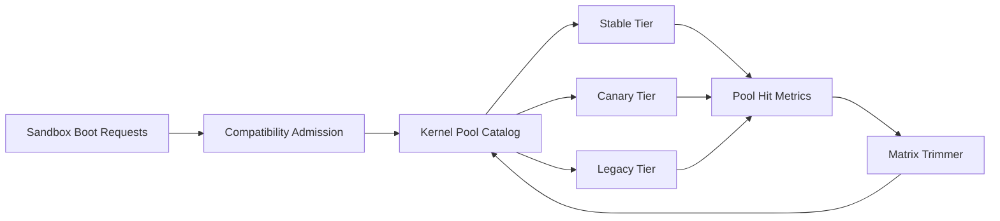

# Firecracker Kernel Pool Fragmentation 选型 FAQ（Cycle 1901）

## 1) 3 分钟结论
- **核心问题：** Firecracker 多版本内核并行时，内核池碎片化会抬升冷启动与镜像预热成本。
- **推荐方案：** “内核池分层目录 + 兼容矩阵裁剪 + 迁移窗口压缩”三步治理。
- **目标：** 在保证隔离与兼容性的同时降低池碎片与启动抖动。

## 2) Q1 / Q2 / Q3
### Q1：为何 kernel pool 容易碎片化？
1) 不同内核版本与功能旗标组合过多；
2) 长尾镜像依赖稀疏，池命中率下降；
3) 升级期双栈共存拉长碎片窗口。

### Q2：生产级 fragmentation 治理怎么做？
- **分层目录：** stable/canary/legacy 三层内核池；
- **矩阵裁剪：** 以运行画像淘汰低命中组合；
- **窗口压缩：** 升级迁移采用短窗灰度并强制回收；
- **调度绑定：** admission 依据兼容标签选择最优池。

### Q3：上线判据是什么？
- 冷启动 P95 与预热时长持续下降；
- 低命中内核组合占比显著收敛；
- 升级期间失败率不劣化。

## 3) 架构图

## 4) 选型矩阵
| 维度 | 无池治理 | Kernel Pool Governance（推荐） |
|---|---:|---:|
| 冷启动稳定性 | 低 | 高 |
| 兼容可控性 | 中 | 高 |
| 预热成本效率 | 低 | 高 |
| 实施复杂度 | 低 | 中 |
| 升级可预测性 | 中 | 高 |

## 5) 证据与复算口径
- 证据文件：
  - `workshops/azure-agent-infra/evidence/cycle-1901-benchmark.json`
  - `workshops/azure-agent-infra/evidence/cycle-1901-latency.csv`
  - `workshops/azure-agent-infra/evidence/cycle-1901-throughput.csv`
  - `workshops/azure-agent-infra/evidence/cycle-1901-cost.csv`
- 标签：`measured / synthetic / anonymized_reported`。
- 校验链：FAQ 六段、CSP、cycle/topic 绑定、模拟器检查。

## 6) 生产检查清单
- [ ] 内核池目录与版本策略已文档化。
- [ ] 兼容矩阵裁剪规则经回归测试验证。
- [ ] 升级迁移窗口具备强制回收与回滚开关。
- [ ] 池命中率与预热成本指标纳入看板。
- [ ] FAQ/H5/SVG/7-card/evidence 轮次一致。
