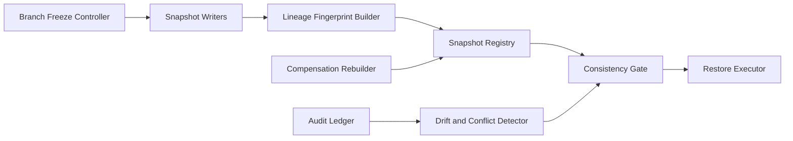

# Firecracker Snapshot Lineage Consistency Selection FAQ (Cycle 1882)

## 1) Three-minute decision
- **Core issue:** under high-frequency incremental snapshots, lineage breaks can cause inconsistent restore points and cross-node rollback failures.
- **Recommendation:** lineage fingerprint verification, branch freeze windows, and consistency-gated restore.
- **Goal:** keep snapshot evolution traceable, verifiable, and recoverable.

## 2) Q1 / Q2 / Q3
### Q1: Why is snapshot version tagging alone insufficient?
1) versions do not encode full parent-child integrity,
2) concurrent branch writes can hide conflicts,
3) cross-node replication lag amplifies lineage skew.

### Q2: How should production lineage consistency be designed?
- **Fingerprint chain:** each snapshot stores parent fingerprint plus state hash,
- **Branch freeze:** temporarily freeze risky branches during release windows,
- **Consistency gate:** restore must pass lineage continuity checks,
- **Conflict repair:** broken chains enter compensation rebuild flow.

### Q3: What is the go-live bar?
- materially lower lineage-break rate,
- sufficient pre-restore validation coverage,
- compensation rebuild completes in-window with passing regression.

## 3) Reference architecture

## 4) Decision matrix
| Dimension | Version tracking only | Lineage consistency guardrails (Recommended) |
|---|---:|---:|
| Chain-break detection | Low | High |
| Restore reliability | Medium | High |
| Conflict repair efficiency | Low | Medium-high |
| Implementation complexity | Low | Medium |
| Audit traceability | Medium | High |

## 5) Evidence and reproducibility
- Evidence files:
  - `workshops/azure-agent-infra/evidence/cycle-1882-benchmark.json`
  - `workshops/azure-agent-infra/evidence/cycle-1882-latency.csv`
  - `workshops/azure-agent-infra/evidence/cycle-1882-throughput.csv`
  - `workshops/azure-agent-infra/evidence/cycle-1882-policy.csv`
- Labels: `measured / synthetic / anonymized_reported`.
- validation7 enforces six-part structure, CSP-safe 7-card output, strict cycle-topic alignment, and replayable checks.

## 6) Production checklist
- [ ] Lineage fingerprint fields and parent-child checks are active.
- [ ] Branch-freeze window policy passes stress tests.
- [ ] Consistency gate blocks invalid restore chains.
- [ ] Conflict compensation rebuild flow passes drills.
- [ ] FAQ/H5/SVG/7-card/evidence remain cycle-consistent.
