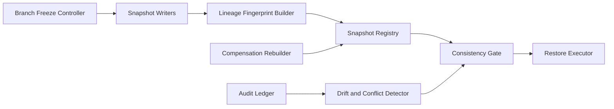

# Firecracker Snapshot Lineage Consistency 选型 FAQ（Cycle 1882）

## 1) 3 分钟结论
- **核心问题：** 快照链路在高频增量场景下容易出现 lineage 断裂，导致恢复点不一致与跨节点回滚失败。
- **推荐方案：** “lineage 指纹校验 + 分支冻结窗口 + 一致性闸门恢复”。
- **目标：** 确保快照演进路径可追溯、可验证、可恢复。

## 2) Q1 / Q2 / Q3
### Q1：为什么仅记录快照版本号不够？
1) 版本号无法表达父子依赖完整性；
2) 并发分支写入会造成隐藏冲突；
3) 跨节点复制延迟会放大 lineage 偏差。

### Q2：生产级 snapshot lineage consistency 如何设计？
- **指纹链：** 每个快照记录父快照指纹与状态摘要哈希；
- **分支冻结：** 发布窗口对高风险分支临时冻结增量写入；
- **一致性闸门：** 恢复前必须通过 lineage 连续性检查；
- **冲突修复：** 发现断链后进入补偿重建流程。

### Q3：上线判据是什么？
- lineage 断链率显著下降；
- 恢复前校验覆盖率达标；
- 冲突补偿可在窗口内完成并回归通过。

## 3) 架构图

## 4) 选型矩阵
| 维度 | 版本号跟踪 | Lineage 一致性护栏（推荐） |
|---|---:|---:|
| 断链检测能力 | 低 | 高 |
| 恢复可靠性 | 中 | 高 |
| 冲突修复效率 | 低 | 中高 |
| 实施复杂度 | 低 | 中 |
| 审计可追溯性 | 中 | 高 |

## 5) 证据与复算口径
- 证据文件：
  - `workshops/azure-agent-infra/evidence/cycle-1882-benchmark.json`
  - `workshops/azure-agent-infra/evidence/cycle-1882-latency.csv`
  - `workshops/azure-agent-infra/evidence/cycle-1882-throughput.csv`
  - `workshops/azure-agent-infra/evidence/cycle-1882-policy.csv`
- 标签：`measured / synthetic / anonymized_reported`。
- validation7：六段结构、7-card CSP、cycle-topic 对齐、验证链可回放。

## 6) 生产检查清单
- [ ] lineage 指纹字段与父子链路校验生效。
- [ ] 分支冻结窗口策略压测通过。
- [ ] 恢复一致性闸门阻断异常链路有效。
- [ ] 冲突补偿重建流程演练通过。
- [ ] FAQ/H5/SVG/7-card/evidence 轮次一致。
