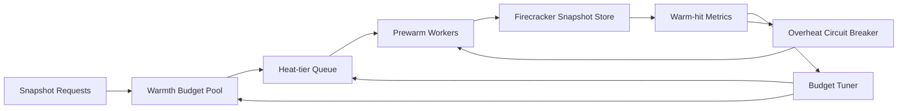

# Firecracker Snapshot Warmth Budget Selection FAQ (Cycle 1905)

## 1) Three-minute decision
- **Core issue:** without warmth-budget governance, snapshot prewarming can overconsume IO/memory and degrade warm-pool efficiency at scale.
- **Recommendation:** combine prewarm budget pools, heat-tier queues, and overheat circuit fallback.
- **Goal:** preserve warm-hit gains and cold-start improvements within bounded resource cost.

## 2) Q1 / Q2 / Q3
### Q1: Why does snapshot warmth drift out of control?
1) repeated hot-image prewarm jobs create resource contention,
2) low-hit snapshots still consume warm-pool budget,
3) prewarm workers compete with online traffic.

### Q2: How should production warmth budgets be designed?
- **Budget pool:** set regional and tenant caps for snapshot prewarm resources,
- **Heat tiers:** prioritize by hit rate and recent access frequency,
- **Overheat circuit:** pause low-value prewarm tasks under pressure,
- **Feedback tuning:** reallocate budgets by observed cold-start gains.

### Q3: What is the go-live bar?
- stable warm-hit rate at target levels,
- sustained cold-start P95 reduction,
- prewarm cost remains under budget limits.

## 3) Reference architecture

## 4) Decision matrix
| Dimension | Unbudgeted prewarm | Warmth Budget Control (Recommended) |
|---|---:|---:|
| Warm-hit stability | Low | High |
| Cold-start benefit | Medium | High |
| Resource cost control | Low | High |
| Implementation complexity | Low | Medium |
| Operational explainability | Medium | High |

## 5) Evidence and reproducibility
- Evidence files:
  - `workshops/azure-agent-infra/evidence/cycle-1905-benchmark.json`
  - `workshops/azure-agent-infra/evidence/cycle-1905-latency.csv`
  - `workshops/azure-agent-infra/evidence/cycle-1905-throughput.csv`
  - `workshops/azure-agent-infra/evidence/cycle-1905-cost.csv`
- Labels: `measured / synthetic / anonymized_reported`.
- Validation chain: six-part FAQ, CSP, cycle/topic binding, simulator checks.

## 6) Production checklist
- [ ] Warmth budget caps are versioned by tenant policy.
- [ ] Heat-tier rules pass regression validation.
- [ ] Overheat breaker thresholds and recovery are load-tested.
- [ ] Warmth benefit and cost dashboards are alertable.
- [ ] FAQ/H5/SVG/7-card/evidence remain cycle-consistent.
