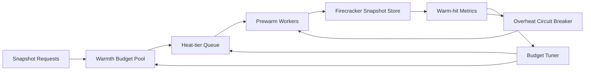

# Firecracker Snapshot Warmth Budget 选型 FAQ（Cycle 1905）

## 1) 3 分钟结论
- **核心问题：** Snapshot 预热若不做预算治理，容易在高并发时抢占 IO/内存，导致暖池收益递减。
- **推荐方案：** “预热预算池 + 热度分级队列 + 过热熔断回退”三段式控制。
- **目标：** 在限定资源成本下维持 snapshot 暖池命中率与冷启动收益。

## 2) Q1 / Q2 / Q3
### Q1：为什么 snapshot warmth 会失控？
1) 热门镜像短时间重复预热放大资源争用；
2) 低命中快照仍占据暖池配额；
3) 预热任务与在线请求相互挤压。

### Q2：生产级 warmth budget 怎么设计？
- **预算池：** 按区域/租户设定 snapshot 预热资源上限；
- **热度分级：** 依据命中率和最近访问频率分配优先级；
- **过热熔断：** 达到阈值后暂停低价值预热任务；
- **反馈调参：** 按冷启动收益动态调整预算分配。

### Q3：上线判据是什么？
- 暖池命中率保持目标并且稳定；
- 冷启动 P95 持续下降；
- 预热成本不突破预算上限。

## 3) 架构图

## 4) 选型矩阵
| 维度 | 无预算预热 | Warmth Budget Control（推荐） |
|---|---:|---:|
| 暖池命中稳定性 | 低 | 高 |
| 冷启动收益 | 中 | 高 |
| 资源成本可控性 | 低 | 高 |
| 实施复杂度 | 低 | 中 |
| 运维可解释性 | 中 | 高 |

## 5) 证据与复算口径
- 证据文件：
  - `workshops/azure-agent-infra/evidence/cycle-1905-benchmark.json`
  - `workshops/azure-agent-infra/evidence/cycle-1905-latency.csv`
  - `workshops/azure-agent-infra/evidence/cycle-1905-throughput.csv`
  - `workshops/azure-agent-infra/evidence/cycle-1905-cost.csv`
- 标签：`measured / synthetic / anonymized_reported`。
- 校验链：FAQ 六段、CSP、cycle/topic 绑定、模拟器检查。

## 6) 生产检查清单
- [ ] 预热预算池配额与租户策略已版本化。
- [ ] 热度分级规则通过回归验证。
- [ ] 过热熔断阈值与恢复条件已压测。
- [ ] 预热收益与成本看板具备告警。
- [ ] FAQ/H5/SVG/7-card/evidence 轮次一致。
