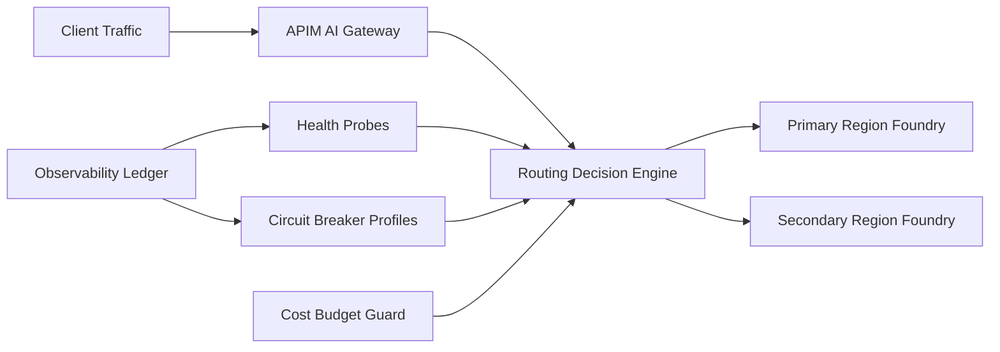

# Foundry Cross-Region Failover Routing Selection FAQ (Cycle 1845)

## 1) Three-minute decision
- **Core tradeoff:** primary-region routing is cheapest and fastest in steady state, but region jitter amplifies timeouts; blind full failover can spike spend and trigger capacity contention.
- **Recommendation:** APIM intelligent routing with cross-region health probes, tiered circuit breaking, and controlled failback.
- **Goal:** preserve success rate and bounded latency during incidents while keeping failover cost within budget.

## 2) Q1 / Q2 / Q3
### Q1: Why is single-region plus manual traffic switch insufficient?
1) manual reaction is slower than incident spread,
2) switching criteria are inconsistent and prone to over-shift,
3) failback without cooldown causes oscillation.

### Q2: What production-grade cross-region failover routing should be used?
- **Health probes:** continuous success-rate, P95, and error-cluster sampling,
- **Tiered breakers:** throttle on minor incidents, reroute on major incidents,
- **Controlled failback:** progressive return to primary after recovery,
- **Budget guard:** high-cost regions scale only under breaker conditions.

### Q3: How do we validate steady-state priority with safe failover?
- bounded success-rate degradation during incident windows,
- faster trigger and recovery times,
- request-unit cost within budget thresholds during failover.

## 3) Reference architecture

## 4) Decision matrix
| Dimension | Single-region manual switch | Intelligent failover routing (Recommended) |
|---|---:|---:|
| Incident recovery speed | Low | High |
| Success-rate stability | Low | High |
| Cost controllability | Medium | High |
| Implementation complexity | Low | Medium |
| Operational explainability | Low | High |

## 5) Evidence and reproducibility
- Evidence files:
  - `workshops/azure-agent-infra/evidence/cycle-1845-benchmark.json`
  - `workshops/azure-agent-infra/evidence/cycle-1845-latency.csv`
  - `workshops/azure-agent-infra/evidence/cycle-1845-throughput.csv`
  - `workshops/azure-agent-infra/evidence/cycle-1845-policy.csv`
- Labels: `measured / synthetic / anonymized_reported`.
- validation7 enforces bilingual six-part structure, CSP self-contained 7-card output, strict cycle-evidence alignment, and replayability.

## 6) Production checklist
- [ ] Probe windows and incident criteria are fixed.
- [ ] Tiered circuit-break and reroute policy is rehearsed.
- [ ] Failback cooldown and progressive return are validated.
- [ ] Cost-budget guard is enforced during failover.
- [ ] FAQ/H5/SVG/7-card align with cycle evidence.
