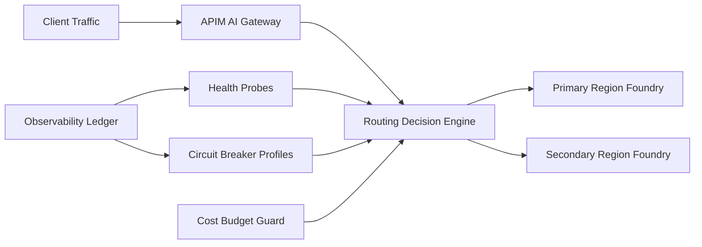

# Foundry 跨区故障切换路由选型 FAQ（Cycle 1845）

## 1) 3 分钟结论
- **核心矛盾：** 主区域模型吞吐最优但遇到区域抖动会放大超时，盲目全量切换又会导致成本跳升与容量争抢。
- **推荐：** APIM 智能路由 + 跨区健康探测 + 分级熔断与受控回切。
- **目标：** 在区域故障时维持成功率与时延上限，并把故障切换成本控制在预算内。

## 2) Q1 / Q2 / Q3
### Q1：为什么“单区域 + 人工切流”不够？
1) 人工响应慢于秒级故障扩散；
2) 切流判据不统一，容易过度切换；
3) 回切缺少冷却窗口，可能造成双向抖动。

### Q2：生产级跨区故障切换路由怎么做？
- **健康探测：** 连续采样成功率、P95 与错误簇特征；
- **分级熔断：** 轻故障限流、重故障切到次优区域；
- **受控回切：** 主区恢复后按比例渐进回流；
- **预算约束：** 高成本区域仅在熔断级别触发时放量。

### Q3：如何验证“稳态优先、故障可退”？
- 故障窗口内成功率下降幅度受控；
- 切换触发时间和恢复时间缩短；
- 切换期间单位请求成本在预算阈值内。

## 3) 架构图

## 4) 选型矩阵
| 维度 | 单区域人工切流 | 智能故障切换路由（推荐） |
|---|---:|---:|
| 故障恢复速度 | 低 | 高 |
| 成功率稳定性 | 低 | 高 |
| 成本可控性 | 中 | 高 |
| 实施复杂度 | 低 | 中 |
| 运维可解释性 | 低 | 高 |

## 5) 证据与复算口径
- 证据文件：
  - `workshops/azure-agent-infra/evidence/cycle-1845-benchmark.json`
  - `workshops/azure-agent-infra/evidence/cycle-1845-latency.csv`
  - `workshops/azure-agent-infra/evidence/cycle-1845-throughput.csv`
  - `workshops/azure-agent-infra/evidence/cycle-1845-policy.csv`
- 标签：`measured / synthetic / anonymized_reported`。
- validation7：双语六段结构、7-card CSP 自包含、轮次与 evidence 一致、可回放链路通过。

## 6) 生产检查清单
- [ ] 健康探测窗口与故障判据已固化。
- [ ] 分级熔断与跨区切换策略已演练。
- [ ] 回切冷却窗口与比例回流已验证。
- [ ] 成本预算守卫在切换期间生效。
- [ ] FAQ/H5/SVG/7-card 与 evidence 轮次一致。
