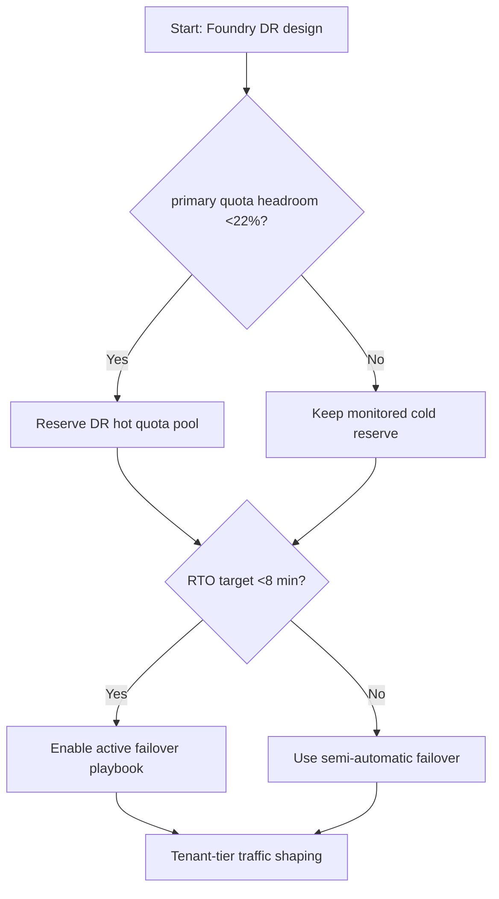
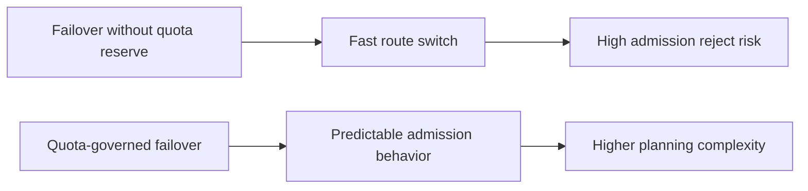
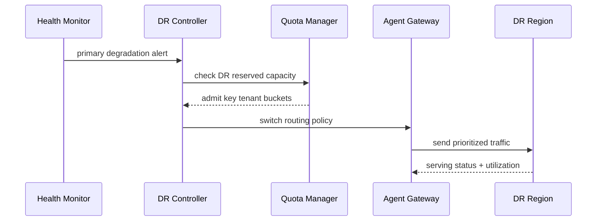

# Agent Foundry Multi-Region DR Quota Governance Selection FAQ (Azure AI Agent Infra)

## 1) 3-minute conclusions
- **When primary-region quota headroom is below 22% and failover RTO target is under 8 minutes, reserve a DR hot-quota pool upfront** instead of relying on emergency quota requests.
- **Failover is not a single action: it is quota admission, routing switch, and session recovery as one chained control loop.**
- **If monthly drills show quota admission reject >1% more than twice, increase DR reservation ratio immediately.**

## 2) Q1 / Q2 / Q3
- **Why does standby region fail to absorb traffic?** Quota shape mismatch (model/region/concurrency dimensions).
- **Why does cost spike after failover?** No traffic-tiering, so low-priority jobs contend with critical requests.
- **Minimum viable loop?** Tiered quota, drill replay, and automatic failback thresholds.

### Q1: When is dual-region hot standby mandatory?
Tier-0 availability with RTO <8 min and RPO <2 min.

### Q2: When is cold reserve acceptable?
Non-realtime batch workloads that tolerate hour-level recovery.

### Q3: How to avoid failover-driven throttling storms?
Pre-allocate DR token buckets for critical tenants and downgrade non-critical traffic.

## 3) Mermaid diagrams
### 3.1 Decision tree

### 3.2 Path comparison

### 3.3 Sequence

## 4) Decision matrix
| Dimension | Failover without quota governance | Quota-governed DR (Recommended) |
|---|---:|---:|
| RTO stability | Medium-low | High |
| Admission reject | 0.8%–3.5% | 0.1%–0.9% |
| Cost predictability | Low | Medium-high |
| Traffic tiering ability | Low | High |
| Ops complexity (1-10) | 4 | 8 |

## 5) Quant model + 7-card insights
- Quota safety margin: `Margin = (ReservedDRQuota - CriticalDemand) / CriticalDemand`
- Failover loss: `FailoverLoss = RejectedReq * LossPerReq`
- Example (`synthetic_assumed`):
  - `ReservedDRQuota=1.42M tok/min`
  - `CriticalDemand=1.18M tok/min`
  - `Margin=20.3%`
  - `RejectedReq=3,600/h, LossPerReq=$0.0011`
  - `FailoverLoss=$3.96/h`
- Evidence:
  - `workshops/azure-agent-infra/evidence/cycle-1453-benchmark.json`
  - `workshops/azure-agent-infra/evidence/cycle-1453-sources.json`
- Labels: `official/synthetic_assumed/not_measured`.

## 6) Production verification checklist
- [ ] Primary/DR model and concurrency quotas are aligned
- [ ] Tier-0/Tier-1 tenant DR token buckets are pre-provisioned
- [ ] Drill scripts cover failover, failback, and quota reclamation
- [ ] Observability includes reject, RTO, cost, and failback success rate
- [ ] Documentation/cards have complete source labeling
