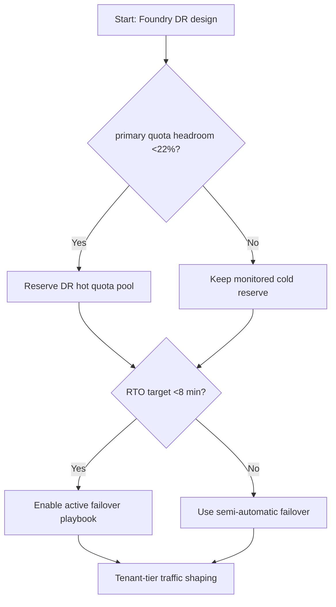
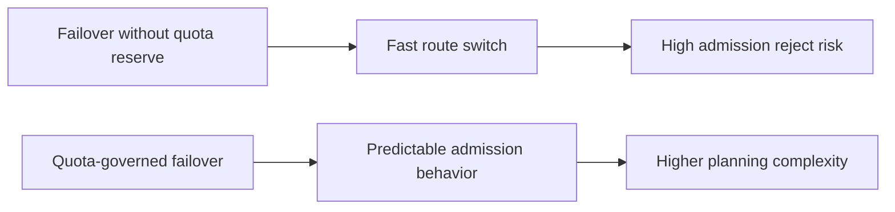
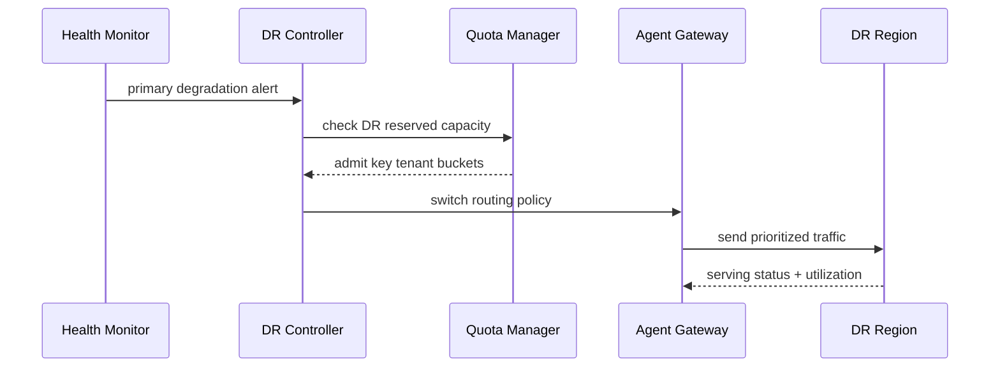

# Agent Foundry Multi-Region DR Quota Governance 选型 FAQ（Azure AI Agent Infra）

## 1) 3 分钟结论
- **当主区域可用配额余量 <22% 且跨区接管 RTO 目标 <8 分钟时，必须预留 DR 热备用配额池**，不能依赖故障时临时申请。
- **跨区容灾切换不是单次动作，而是“配额门禁 + 路由切换 + 会话恢复”三段联动。**
- **生产分界线：月度演练中若两次以上出现 quota admission reject >1%，应立即提升 DR 预留比例。**

## 2) Q1 / Q2 / Q3
- **为什么有备区却接不住流量？**：备区配额结构不匹配（模型/区域/并发维度不一致）。
- **为什么切换后成本会飙升？**：未做分级流量策略，低优先级任务与核心请求争抢 PTU。
- **最小闭环？**：分级配额、演练回放、自动回切阈值。

### Q1：什么时候必须双区热备？
高可用等级为 Tier-0 且 RTO <8 分钟、RPO <2 分钟时。

### Q2：什么时候可以冷备？
非实时批处理或容忍小时级恢复的任务。

### Q3：如何防止“容灾切换即限流风暴”？
提前为关键租户预分配 DR token bucket，并对非关键流量降级。

## 3) Mermaid 图
### 3.1 决策树

### 3.2 路径对比

### 3.3 时序

## 4) 决策矩阵
| 维度 | 无配额治理切换 | 配额治理容灾（推荐） |
|---|---:|---:|
| RTO 稳定性 | 中低 | 高 |
| admission reject | 0.8%–3.5% | 0.1%–0.9% |
| 成本可预测性 | 低 | 中高 |
| 流量分级能力 | 低 | 高 |
| 运维复杂度（1-10） | 4 | 8 |

## 5) 定量算例与 7-Card 洞察
- 配额安全边际：`Margin = (ReservedDRQuota - CriticalDemand) / CriticalDemand`
- 切换损失成本：`FailoverLoss = RejectedReq * LossPerReq`
- 示例（`synthetic_assumed`）：
  - `ReservedDRQuota=1.42M tok/min`
  - `CriticalDemand=1.18M tok/min`
  - `Margin=20.3%`
  - `RejectedReq=3,600/h, LossPerReq=$0.0011`
  - `FailoverLoss=$3.96/h`
- 证据：
  - `workshops/azure-agent-infra/evidence/cycle-1453-benchmark.json`
  - `workshops/azure-agent-infra/evidence/cycle-1453-sources.json`
- 标签：`official/synthetic_assumed/not_measured`。

## 6) 生产核验 Checklist
- [ ] 主备区模型配额与并发配额对齐
- [ ] Tier-0/Tier-1 租户 DR 令牌桶已预置
- [ ] 演练脚本覆盖切换、回切、配额回收
- [ ] 观测项包含 reject、RTO、成本、回切成功率
- [ ] 文档与卡片来源标注完整
