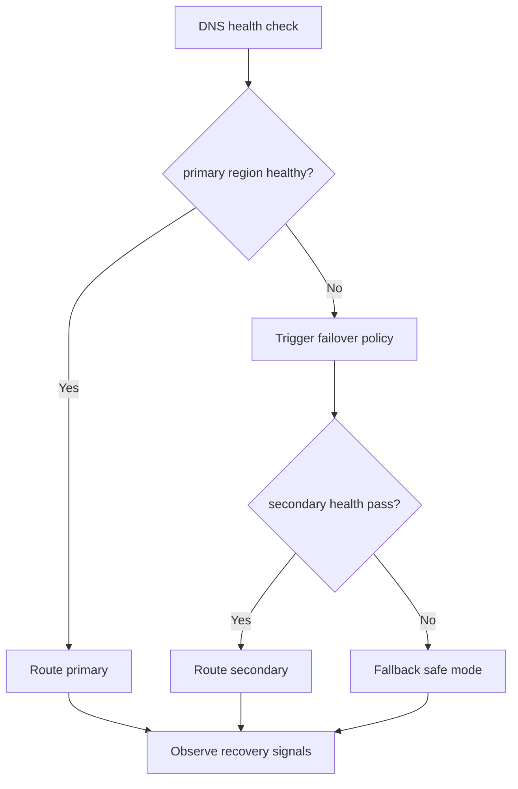
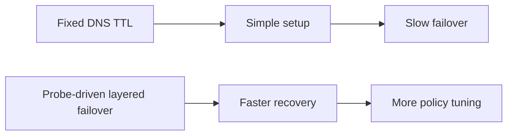
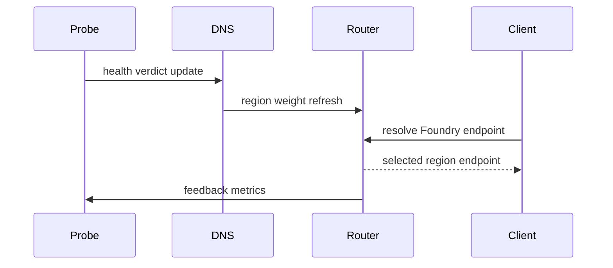

# Agent Foundry Private Link DNS Failover Selection FAQ (Azure AI Agent Infra)

## 1) 3-minute conclusions
- **For Foundry private access, slow DNS failover decisions during regional faults amplify session interruption.**
- **Use probe-driven layered DNS failover with hot/cold resolver strategy.**
- **Targets: `dns_failover_p95 <45s`, `session_drop_rate <0.8%`, `wrong_region_route=0`.**

## 2) Q1 / Q2 / Q3
- **Why failover is slow?** Private records TTL and probe updates drift out of sync.
- **Why not just shorten TTL globally?** It increases resolver amplification and control-plane load.
- **Minimum loop?** Probe arbitration, layered TTL, weighted regional fallback/restore.

### Q1: When to trigger cross-region failover?
When primary probes fail continuously beyond guard window.

### Q2: When to restore primary?
After sustained healthy probes and low drift in recovery window.

### Q3: How to evaluate gain?
Compare session drop reduction versus extra DNS overhead.

## 3) Mermaid diagrams
### 3.1 Decision tree

### 3.2 Path comparison

### 3.3 Sequence

## 4) Decision matrix
| Dimension | Fixed TTL | Probe-driven layered failover (Recommended) |
|---|---:|---:|
| Recovery speed | Medium-low | High |
| Session continuity | Medium | High |
| Ops complexity (1-10) | 4 | 8 |
| Wrong-route risk | Medium | Low |
| Scalability | Medium | High |

## 5) Quant model + 7-card insights
- Failover gain: `FailoverGain = BaselineFailoverP95 - NewFailoverP95`
- Drop rate: `DropRate = DroppedSessions / TotalSessions`
- Example (`synthetic_assumed`):
  - `BaselineFailoverP95=132s, NewFailoverP95=39s`
  - `FailoverGain=93s`
  - `DroppedSessions=41, TotalSessions=7,400`
  - `DropRate=0.55%`
- Evidence:
  - `workshops/azure-agent-infra/evidence/cycle-1476-benchmark.json`
  - `workshops/azure-agent-infra/evidence/cycle-1476-sources.json`
- Labels: `official/synthetic_assumed/not_measured`.

## 6) Production verification checklist
- [ ] Probe windows and failover thresholds are versioned
- [ ] Layered TTL and regional weights are auditable
- [ ] Restore conditions and anti-flap controls are replayable
- [ ] Wrong-region route alerts are wired in
- [ ] FAQ/7-card source labels are complete
