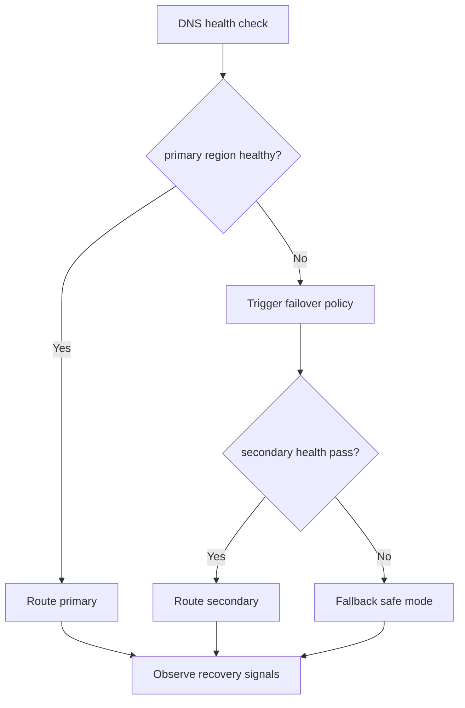
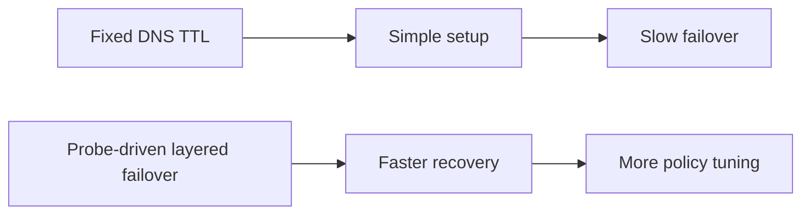
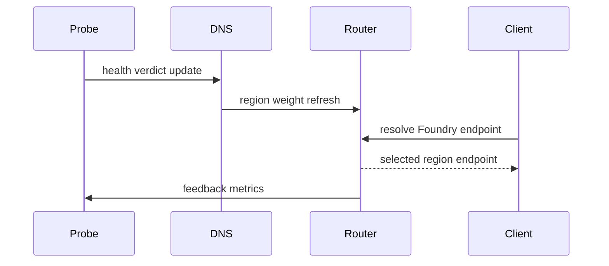

# Agent Foundry Private Link DNS Failover 选型 FAQ（Azure AI Agent Infra）

## 1) 3 分钟结论
- **Foundry 私网接入在跨区故障时，DNS failover 决策慢会直接放大会话中断。**
- **推荐“健康探针驱动的分层 DNS 失效切换 + 冷热备用解析策略”。**
- **目标阈值：`dns_failover_p95 <45s`、`session_drop_rate <0.8%`、`wrong_region_route=0`。**

## 2) Q1 / Q2 / Q3
- **为何切换慢？**：私网记录 TTL 与探针状态更新不同步。
- **为何不能仅缩短 TTL？**：会抬高解析放大与控制平面负担。
- **最小闭环？**：探针仲裁、分层 TTL、区域权重回切。

### Q1：何时触发跨区切换？
主区探针连续失败并超过保护窗口。

### Q2：何时回切主区？
稳定窗口内探针连续恢复且误差低于阈值。

### Q3：如何评估收益？
对比会话中断率与额外解析成本。

## 3) Mermaid 图
### 3.1 决策树

### 3.2 路径对比

### 3.3 时序

## 4) 决策矩阵
| 维度 | 固定 TTL | 探针驱动分层切换（推荐） |
|---|---:|---:|
| 故障恢复速度 | 中低 | 高 |
| 会话连续性 | 中 | 高 |
| 运维复杂度（1-10） | 4 | 8 |
| 误路由风险 | 中 | 低 |
| 扩展性 | 中 | 高 |

## 5) 定量算例与 7-Card 洞察
- 切换收益：`FailoverGain = BaselineFailoverP95 - NewFailoverP95`
- 中断率：`DropRate = DroppedSessions / TotalSessions`
- 示例（`synthetic_assumed`）：
  - `BaselineFailoverP95=132s, NewFailoverP95=39s`
  - `FailoverGain=93s`
  - `DroppedSessions=41, TotalSessions=7,400`
  - `DropRate=0.55%`
- 证据：
  - `workshops/azure-agent-infra/evidence/cycle-1476-benchmark.json`
  - `workshops/azure-agent-infra/evidence/cycle-1476-sources.json`
- 标签：`official/synthetic_assumed/not_measured`。

## 6) 生产核验 Checklist
- [ ] 探针判定窗口与切换阈值版本化
- [ ] 分层 TTL 与区域权重可审计
- [ ] 回切条件与防抖参数可回放
- [ ] wrong-region 路由告警已接入
- [ ] FAQ/7-Card 来源标签完整
