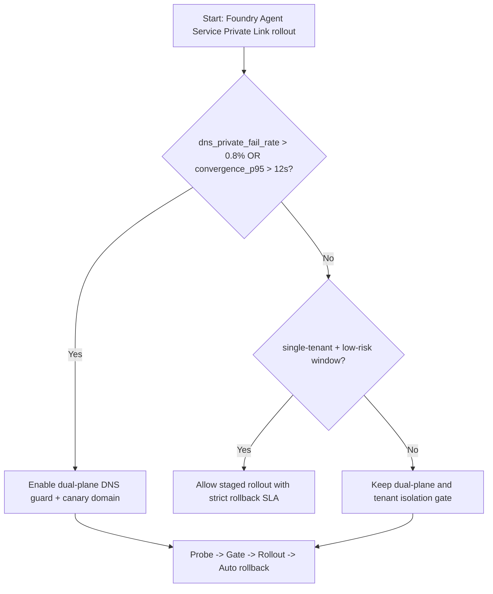
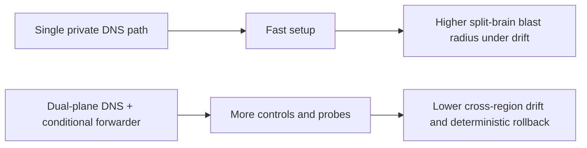
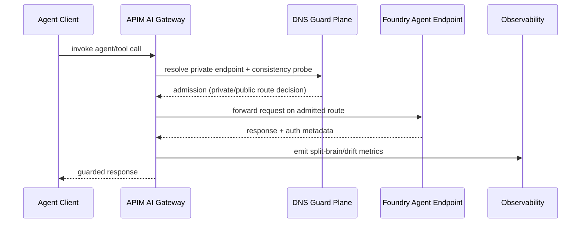

# Agent Foundry Agent Service Private Link DNS Split-Brain Selection FAQ (Azure AI Agent Infra)

## 1) 3-minute conclusions
- **When private-resolution failure exceeds 0.8% and cross-region DNS convergence P95 exceeds 12s, choose "dual-plane DNS + pre-admission probes" by default**, not a single private-DNS-only rollout.
- **When NXDOMAIN negative-cache events exceed 300/min and retry fanout exceeds 2.2x, split-brain (mixed private/public resolution) can inflate token/RPS cost by 18%+**; enforce negative-cache caps and canary domains.
- **Default production baseline for Foundry Agent Service: Private Endpoint + Private DNS Zone + conditional forwarders + dual-active health probes**; relax only in controlled maintenance windows.

## 2) Q1 / Q2 / Q3 (plain language first)
- **What is split-brain here?** Some nodes resolve Foundry through private paths while others resolve through public paths for the same logical endpoint.
- **Why does it fail hard?** DNS cache, negative cache, and forwarding chains drift independently, so policy decisions diverge and retries amplify.
- **Minimum safe loop?** Probe first -> canary rollout -> consistency gate -> automated rollback.

### Q1: When is a DNS consistency gate mandatory?
Enable it immediately when `dns_private_fail_rate > 0.8%` or `resolution_convergence_p95 > 12s`.

### Q2: When can dual-plane be skipped temporarily?
Only in single-tenant, single-region, low-concurrency rehearsal environments.

### Q3: How do we make this CFO/CTO-computable?
Model amplification from request volume, retry fanout, and per-call token cost; validate against cache-hit and negative-cache thresholds.

## 3) Mermaid (decision / path / sequence)
### 3.1 Decision tree

### 3.2 Path comparison

### 3.3 Sequence

## 4) Architecture parameters and decision matrix
| Dimension | Single private-DNS path | Dual-plane DNS + conditional forwarders (Recommended) |
|---|---:|---:|
| Private resolution fail threshold | Trips around 0.8% | 0.8% with controlled bypass |
| Cross-region convergence P95 | 12–20s variable | 6–10s controlled |
| NXDOMAIN cap (per min) | Amplifies after 300 | Suppressed around 150–220 |
| Retry fanout | 2.2x–3.1x | 1.2x–1.6x |
| Ops complexity (1-10) | 5 | 7 |
| Production default | ❌ | ✅ |

## 5) Recomputable formulas and 7-card insights
- Amplification: `Amplification = RequestRate * RetryFanout * MissPenalty`
- Incremental session cost: `ΔCost = (Amplification - Baseline) * TokenCostPerCall`
- Example (`synthetic_assumed`):
  - `RequestRate=4200/min, RetryFanout=2.4, MissPenalty=0.14`
  - `Amplification=1411 equivalent extra calls/min`
  - with `TokenCostPerCall=$0.00042`, `ΔCost≈$0.5926/min`
- Evidence pointers:
  - `workshops/azure-agent-infra/evidence/cycle-1446-benchmark.json`
  - `workshops/azure-agent-infra/evidence/cycle-1446-sources.json`
- Label boundaries: ratios/perf numbers are `synthetic_assumed`; official docs remain `official`; no claim as production-measured unless explicitly marked.

## 6) Production verification and troubleshooting checklist
- [ ] Private DNS Zone and conditional forwarders are health-checked in both directions
- [ ] APIM-to-Foundry private endpoint resolution is region-consistent
- [ ] NXDOMAIN threshold alerts are wired to automatic rollback
- [ ] Canary FQDN is isolated from primary FQDN, rollback is executable within 1 minute
- [ ] 7-card and FAQ references clearly separate `official/synthetic_assumed/not_measured`
