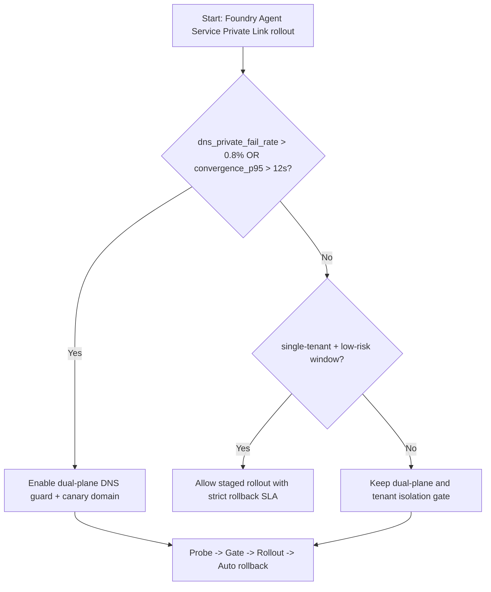
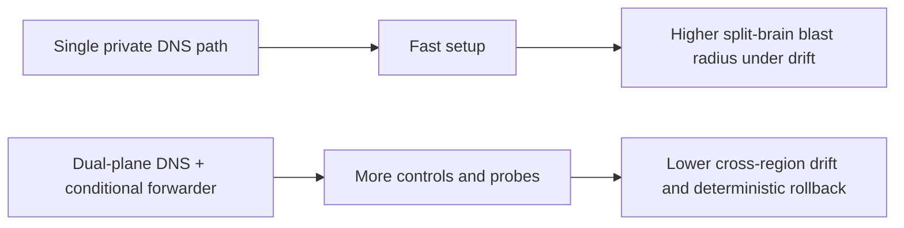
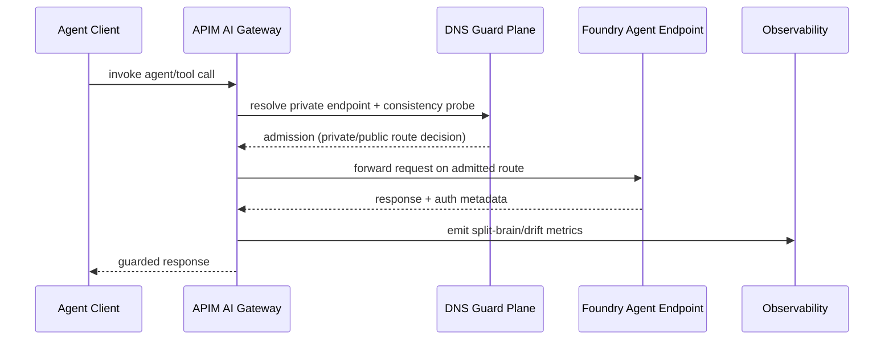

# Agent Foundry Agent Service Private Link DNS Split-Brain 选型 FAQ（Azure AI Agent Infra）

## 1) 3 分钟结论（先给负责人）
- **当 Private Link 私有解析失败率 >0.8% 且跨区 DNS 收敛 P95 >12s 时，必须优先选 “双 DNS 解析平面 + Agent 网关注入前置探针” 方案**，不要直接全量切到单一私有 DNS 区。
- **当每分钟 DNS 负缓存（NXDOMAIN）>300 且重试扇出 >2.2 倍时，Split-Brain（公私域同时命中）会把 Token/RPS 成本放大 18%+**，应启用“负缓存上限 + 解析短路 + 灰度域名”。
- **Foundry Agent Service 的生产默认推荐：Private Endpoint + Private DNS Zone + 条件转发 + 双活健康探测**；仅在单租户低风险维护窗可短时放宽。

## 2) Q1 / Q2 / Q3 灵魂拷问（先讲大白话）
- **Split-Brain 是什么？**：同一个 Foundry 终结点请求，有些节点走私网解析、有些节点走公网解析，结果是“同名不同路”，延迟、鉴权、缓存都不一致。
- **为什么会炸？**：DNS 缓存、负缓存和转发链不同步，导致网关策略命中漂移，触发重复调用和重试风暴。
- **最小闭环怎么做？**：探针先行 -> 小流量灰度 -> 解析一致性门禁 -> 异常自动回滚。

### Q1：什么时候必须上“DNS 一致性门禁”？
当 `dns_private_fail_rate > 0.8%` 或 `resolution_convergence_p95 > 12s`，立即开启门禁并冻结放量。

### Q2：什么时候可以暂时不做双平面？
仅限单租户、单区、低并发演练环境；生产多租户默认不建议。

### Q3：怎么给 CTO 一个可复算答案？
用“请求总量、重试倍数、单次 token 成本”算放大量；用“缓存命中率与负缓存阈值”算恢复窗口。

## 3) Mermaid（决策树 / 路径对比 / 时序）
### 3.1 决策树

### 3.2 路径对比

### 3.3 时序图

## 4) 架构参数与选型矩阵（真实参数口径）
| 维度 | 单私网 DNS 路径 | 双平面 DNS + 条件转发（推荐） |
|---|---:|---:|
| 私网解析失败阈值（fail rate） | 0.8% 易触发熔断 | 0.8% + 旁路兜底 |
| 跨区收敛 P95 | 12–20s 波动 | 6–10s 可控 |
| 负缓存上限（NXDOMAIN/min） | 300 后易放大 | 150–220 可压制 |
| 重试扇出倍数 | 2.2x–3.1x | 1.2x–1.6x |
| 运维复杂度（1-10） | 5 | 7 |
| 生产默认建议 | ❌ | ✅ |

## 5) 可复算公式与 7-Card 洞察
- 请求放大量：`Amplification = RequestRate * RetryFanout * MissPenalty`
- 单会话额外成本：`ΔCost = (Amplification - Baseline) * TokenCostPerCall`
- 示例（`synthetic_assumed`）：
  - `RequestRate=4200/min, RetryFanout=2.4, MissPenalty=0.14`
  - `Amplification=1411 equivalent extra calls/min`
  - 若 `TokenCostPerCall=$0.00042`，则 `ΔCost≈$0.5926/min`
- 对应证据文件：
  - `workshops/azure-agent-infra/evidence/cycle-1446-benchmark.json`
  - `workshops/azure-agent-infra/evidence/cycle-1446-sources.json`
- 标签边界：性能/比例为 `synthetic_assumed`，官方口径链接保留 `official`，不标称为实测生产值。

## 6) 生产核验与排障 Checklist
- [ ] Private DNS Zone 与条件转发器（on-prem / hub VNet）双向健康检查已开启
- [ ] APIM 到 Foundry Private Endpoint 的解析路径在各区域一致
- [ ] 负缓存（NXDOMAIN）阈值告警与自动回滚策略已联动
- [ ] 灰度域名（canary FQDN）与主域名隔离，回退脚本 1 分钟内可执行
- [ ] 7-Card 与 FAQ 的来源标签已区分 `official/synthetic_assumed/not_measured`
