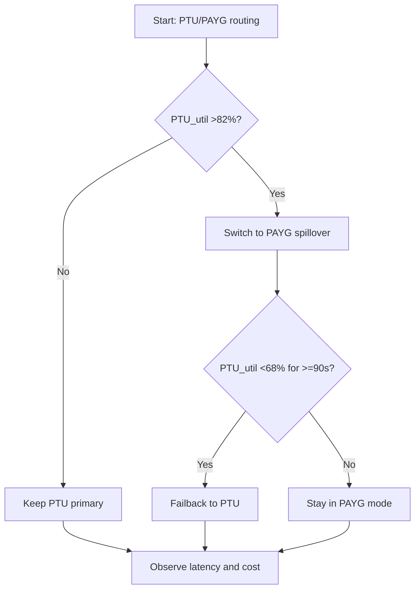
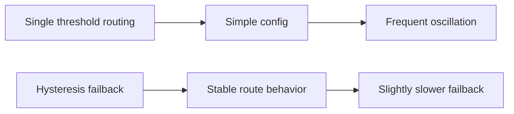
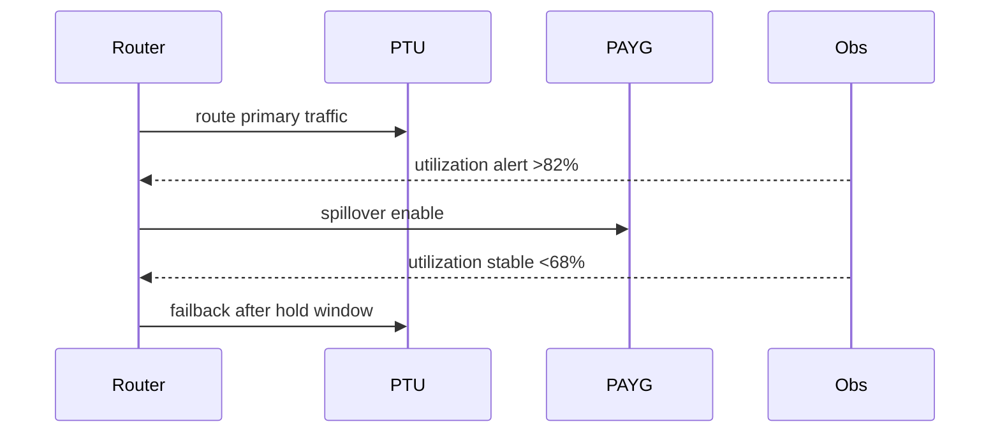

# Agent Foundry Router PTU PAYG Failback Hysteresis Selection FAQ (Azure AI Agent Infra)

## 1) 3-minute conclusions
- **When PTU utilization oscillates heavily between 75% and 88%, hysteresis failback is mandatory to prevent route flapping.**
- **PAYG spillover must use separate enter/exit thresholds, not a single symmetric cutoff.**
- **Targets: enter PAYG >82%, exit PAYG <68%, minimum hold window >=90s.**

## 2) Q1 / Q2 / Q3
- **Why flapping happens?** Single-threshold control repeatedly triggers near boundaries.
- **Why hysteresis?** It gives control loops time to absorb volatility.
- **Minimum loop?** Dual thresholds, hold window, tenant weighting.

### Q1: When is hysteresis mandatory?
When route switches exceed 12 per 10 minutes or P95 latency jitter exceeds 25%.

### Q2: When is single threshold acceptable?
Stable low-load dev environments without burst patterns.

### Q3: How to evaluate benefit?
Measure flapping reduction versus incremental PAYG cost.

## 3) Mermaid diagrams
### 3.1 Decision tree

### 3.2 Path comparison

### 3.3 Sequence

## 4) Decision matrix
| Dimension | Single threshold | Hysteresis failback (Recommended) |
|---|---:|---:|
| Route flaps | 8–20 / 10min | 1–6 / 10min |
| Latency stability | Medium | High |
| Cost controllability | Medium | High |
| Ops complexity (1-10) | 4 | 7 |

## 5) Quant model + 7-card insights
- Oscillation rate: `OscillationRate = SwitchCount / WindowMinutes`
- Cost delta: `DeltaCost = PAYGCost_new - PAYGCost_baseline`
- Example (`synthetic_assumed`):
  - `SwitchCount=18/10min -> 4/10min`
  - `OscillationRate` reduction `77.8%`
  - `DeltaCost=+$3.2/day`
- Evidence:
  - `workshops/azure-agent-infra/evidence/cycle-1460-benchmark.json`
  - `workshops/azure-agent-infra/evidence/cycle-1460-sources.json`
- Labels: `official/synthetic_assumed/not_measured`.

## 6) Production verification checklist
- [ ] Enter/exit thresholds and hold window configured
- [ ] Tenant-priority routing weights active
- [ ] Flap-rate and cost alerts linked
- [ ] Source labels complete
