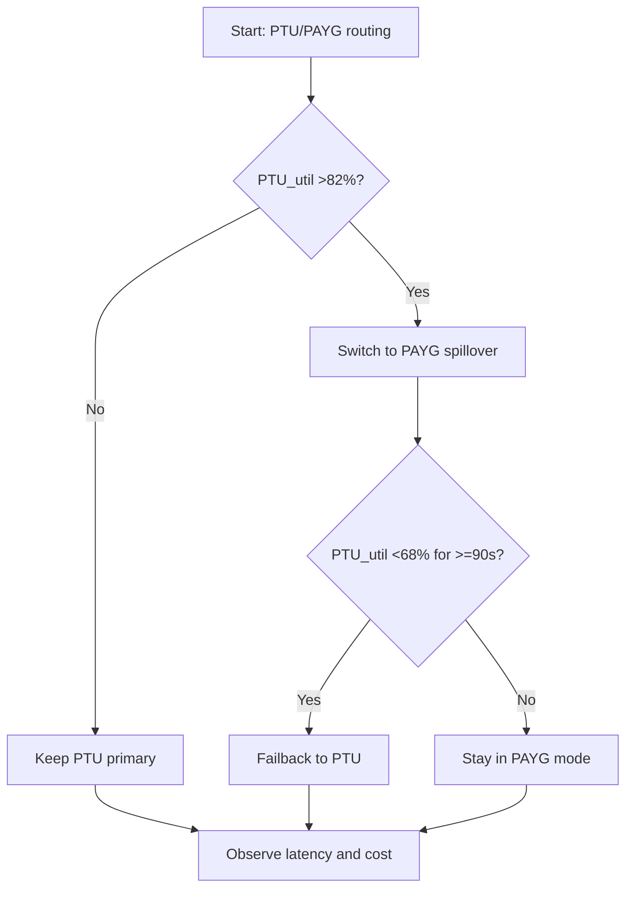
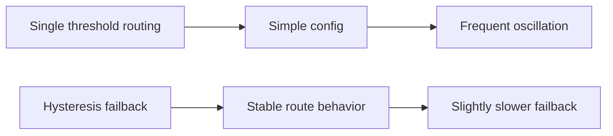
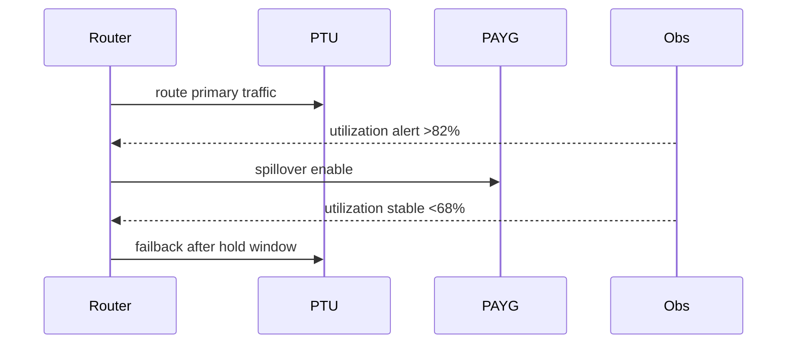

# Agent Foundry Router PTU PAYG Failback Hysteresis 选型 FAQ（Azure AI Agent Infra）

## 1) 3 分钟结论
- **当 PTU 利用率在 75%~88% 高频震荡时，必须设置回切滞回（hysteresis）避免路由抖动。**
- **PAYG 溢出要有进入阈值与退出阈值双门控，不能同值回切。**
- **生产阈值：进入 PAYG >82%，退出 PAYG <68%，最短保持窗口 >=90s。**

## 2) Q1 / Q2 / Q3
- **为什么会抖动？**：单阈值在临界点反复触发。
- **为什么需要滞回？**：给控制平面足够时间吸收波动。
- **最小闭环？**：双阈值、保持窗口、租户权重。

### Q1：何时必须启用滞回？
当 10 分钟内路由切换次数 >12 次或 P95 延迟抖动 >25%。

### Q2：何时可单阈值？
稳定低负载且无明显突发的开发环境。

### Q3：如何衡量收益？
比较切换抖动减少率与 PAYG 成本变化。

## 3) Mermaid 图
### 3.1 决策树

### 3.2 路径对比

### 3.3 时序

## 4) 决策矩阵
| 维度 | 单阈值 | 滞回回切（推荐） |
|---|---:|---:|
| 路由抖动频次 | 8–20 次/10 分钟 | 1–6 次/10 分钟 |
| 延迟稳定性 | 中 | 高 |
| 成本可控性 | 中 | 高 |
| 运维复杂度（1-10） | 4 | 7 |

## 5) 定量算例与 7-Card 洞察
- 抖动率：`OscillationRate = SwitchCount / WindowMinutes`
- 成本影响：`DeltaCost = PAYGCost_new - PAYGCost_baseline`
- 示例（`synthetic_assumed`）：
  - `SwitchCount=18/10min -> 4/10min`
  - `OscillationRate` 下降 `77.8%`
  - `DeltaCost=+$3.2/day`
- 证据：
  - `workshops/azure-agent-infra/evidence/cycle-1460-benchmark.json`
  - `workshops/azure-agent-infra/evidence/cycle-1460-sources.json`
- 标签：`official/synthetic_assumed/not_measured`。

## 6) 生产核验 Checklist
- [ ] 进入/退出阈值与保持窗口已配置
- [ ] 关键租户路由权重策略生效
- [ ] 抖动率与成本告警联动
- [ ] 文档来源标签完整
