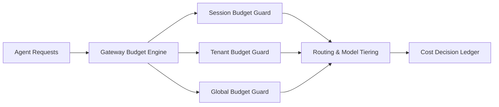

# Agent Gateway Cost Guardrails and Budget Enforcement Selection FAQ (Cycle 1770)

## 1) Three-minute decision
- **Cost blowups in agent gateways usually come from missing budget-enforcement paths, not just per-token pricing.**
- **Recommendation:** three-layer guardrails (session, tenant, global) with downgrade/tiering actions on breach.
- **Goal:** keep cost variance inside predictable finance envelopes without sacrificing critical workloads.

## 2) Core questions (Q1/Q2/Q3)
### Q1: Why per-token pricing alone is insufficient?
1) tool-call chains amplify total spend,
2) retries/fallbacks accumulate hidden cost,
3) multi-agent orchestration complicates attribution.

### Q2: How should the three layers divide responsibilities?
- session guard: prevent single-session runaway,
- tenant guard: keep fair quota discipline,
- global guard: cap platform-wide exposure.

### Q3: What to do after budget breach?
- degrade non-critical paths first,
- switch to lower-cost model tiers or summary mode,
- route critical workflows to human-confirm or delayed queues.

## 3) Reference architecture

## 4) Decision matrix
| Dimension | No unified budget enforcement | 3-layer guardrails (Recommended) |
|---|---:|---:|
| Cost predictability | Low | High |
| Tenant fairness | Low | High |
| Critical-path assurance | Medium | High |
| Implementation complexity | Low | Medium |
| Audit traceability | Medium | High |

## 5) Evidence and reproducibility
- Evidence files:
  - `workshops/azure-agent-infra/evidence/cycle-1770-benchmark.json`
  - `workshops/azure-agent-infra/evidence/cycle-1770-latency.csv`
  - `workshops/azure-agent-infra/evidence/cycle-1770-throughput.csv`
  - `workshops/azure-agent-infra/evidence/cycle-1770-cost.csv`
- Labels: `measured / synthetic / anonymized_reported`.
- validation7 requires bilingual structure, CSP self-contained cards, evidence consistency, and reproducibility trace.

## 6) Production checklist
- [ ] Session/tenant/global budget ceilings are hard-enforced.
- [ ] Over-budget degradations are explainable and reversible.
- [ ] Cost attribution maps to sessions and tool paths.
- [ ] Critical workloads have guaranteed fallback lanes.
- [ ] FAQ/H5/SVG/7-card references are cycle-aligned.
