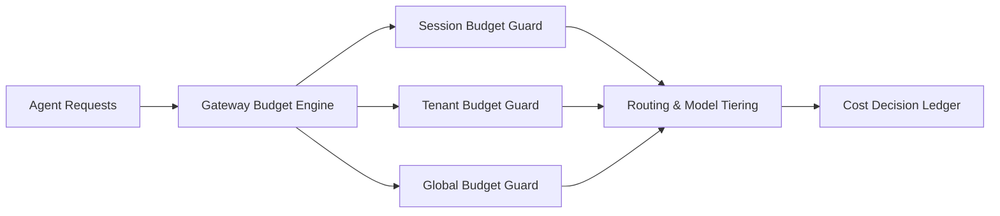

# Agent Gateway 成本护栏与预算执行选型 FAQ（Cycle 1770）

## 1) 3 分钟结论
- **Agent Gateway 的成本失控通常来自“无预算执行路径”，不是单次模型价格。**
- **推荐：** 会话级预算 + 租户级预算 + 全局预算三层护栏，超限即降级或切换模型档位。
- **目标：** 在不牺牲关键业务的前提下，把成本波动控制在财务可预测区间。

## 2) 关键问题（Q1/Q2/Q3）
### Q1：为什么只看每 token 成本不够？
1) 工具调用放大链路成本；
2) 重试与回退路径会叠加消耗；
3) 多代理协作导致成本归因困难。

### Q2：三层预算护栏如何分工？
- 会话级：防止单会话失控；
- 租户级：保障租户配额公平；
- 全局级：防止平台总成本穿仓。

### Q3：超预算后应该怎么做？
- 优先降级非关键链路；
- 切换低成本模型或摘要模式；
- 关键任务进入人工确认或延迟队列。

## 3) 架构图

## 4) 选型矩阵
| 维度 | 无统一预算执行 | 三层预算护栏（推荐） |
|---|---:|---:|
| 成本可预测性 | 低 | 高 |
| 租户公平性 | 低 | 高 |
| 关键任务保障 | 中 | 高 |
| 实施复杂度 | 低 | 中 |
| 审计可追溯 | 中 | 高 |

## 5) 证据与复算口径
- 证据文件：
  - `workshops/azure-agent-infra/evidence/cycle-1770-benchmark.json`
  - `workshops/azure-agent-infra/evidence/cycle-1770-latency.csv`
  - `workshops/azure-agent-infra/evidence/cycle-1770-throughput.csv`
  - `workshops/azure-agent-infra/evidence/cycle-1770-cost.csv`
- 标签：`measured / synthetic / anonymized_reported`。
- validation7：双语结构、CSP、证据一致、可复算链路全部通过。

## 6) 生产检查清单
- [ ] 会话/租户/全局预算均有硬阈值。
- [ ] 超预算降级策略可解释且可回滚。
- [ ] 成本归因可追踪到会话与工具调用。
- [ ] 关键任务可走保底执行车道。
- [ ] FAQ/H5/SVG/7-card 与 evidence 轮次一致。
