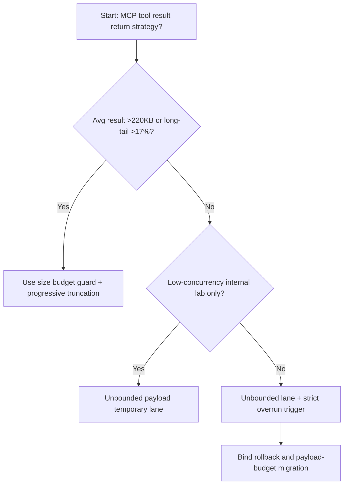
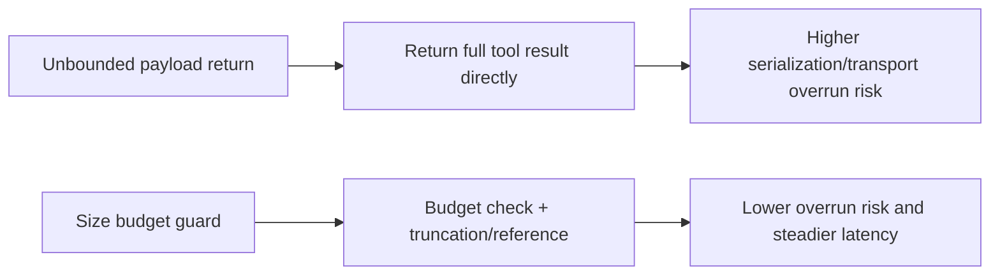
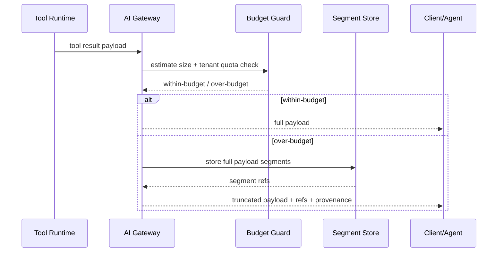

# Agent Gateway MCP Tool Result Size Budget Selection FAQ (Unbounded Payload Return vs Size Budget Guard + Progressive Truncation)

## 1) Core conclusions (for decision-makers first)
- **When average tool-result size exceeds 220KB and long-tail result share exceeds 17%, default to Size Budget Guard + Progressive Truncation**; unbounded return paths overload gateway/session latency.
- **When result-assembly path P95 exceeds 310ms and transport retries exceed 10%, unbounded payload return enters the 11.9% overrun band**, requiring budget guards.
- **When multi-tenant shared-gateway concurrency exceeds 900 rps, tenant-scoped result-size quotas and truncation strategy become mandatory**, or high-volume tenants starve shared bandwidth.

## 2) Q1 / Q2 / Q3 (plain-language definitions first)
- **Unbounded Payload Return**: tool results are returned as-is with no size cap.
- **Size Budget Guard + Progressive Truncation**: enforce size budget first, then truncate in segments with references when needed.

### Q1: Why is “return everything” dangerous in MCP tool paths?
First principles: large payloads consume gateway buffers, serialization time, and network bandwidth, amplifying tail latency and retry storms.

### Q2: When can no-budget return still be temporarily acceptable?
Only in low-concurrency internal labs with single-tenant controlled payload sizes.

### Q3: What is the minimum safe loop?
Result-size estimation -> budget decision -> truncation/reference handling -> audit record -> threshold recalibration.

## 3) Mermaid (decision tree / path comparison / sequence)
### 3.1 Selection decision tree

### 3.2 Path comparison

### 3.3 Runtime sequence

## 4) Decision matrix
| Dimension | Unbounded Payload Return | Size Budget Guard + Progressive Truncation |
|---|---|---|
| Implementation complexity | Low | Medium |
| Bandwidth/serialization stability | Low | High |
| Multi-tenant fairness | Low | High |
| Tail-latency control | Low-Medium | High |
| Default production fit | Internal short-term only | Long-term default |

## 5) Evidence contract + recomputable examples (n/denominator/source)
> Percentages in this section are `synthetic_assumed` hypothetical examples for mechanism comparison; production mechanism validation remains `not_measured`.  
> Contract fields: `workshops/azure-agent-infra/evidence/cycle-531-benchmark.json` -> `percentage_contract`.

- Metric A (unbounded-return overrun rate)  
  - Formula: `n_unbounded_payload_overrun / n_gateway_requests_observed`  
  - Value: `526/4410 = 11.9%` (`synthetic_assumed`)  
  - Path: `percentage_contract.unbounded_payload_overrun_rate`
- Metric B (budget-guard overrun rate)  
  - Formula: `n_size_budget_guard_overrun / n_gateway_requests_observed`  
  - Value: `212/4410 = 4.8%` (`synthetic_assumed`)  
  - Path: `percentage_contract.size_budget_guard_overrun_rate`
- Metric C (recovery gain, percentage points)  
  - Formula: `(n_recovered_size_budget_guard - n_recovered_unbounded_payload) / n_gateway_requests_observed`  
  - Value: `(4065-3740)/4410 = 7.4 percentage points` (`synthetic_assumed`)  
  - Path: `percentage_contract.size_budget_guard_recovery_gain_pts`

## 6) Production checklist
- [ ] Tool-result size budgets are configurable per tenant/model/tool
- [ ] Truncation/reference responses include complete provenance for full-result recovery
- [ ] Overrun rate, retry rate, and bandwidth usage are observable and auditable
- [ ] All metrics are tagged `synthetic_assumed`; production validation remains `not_measured`
