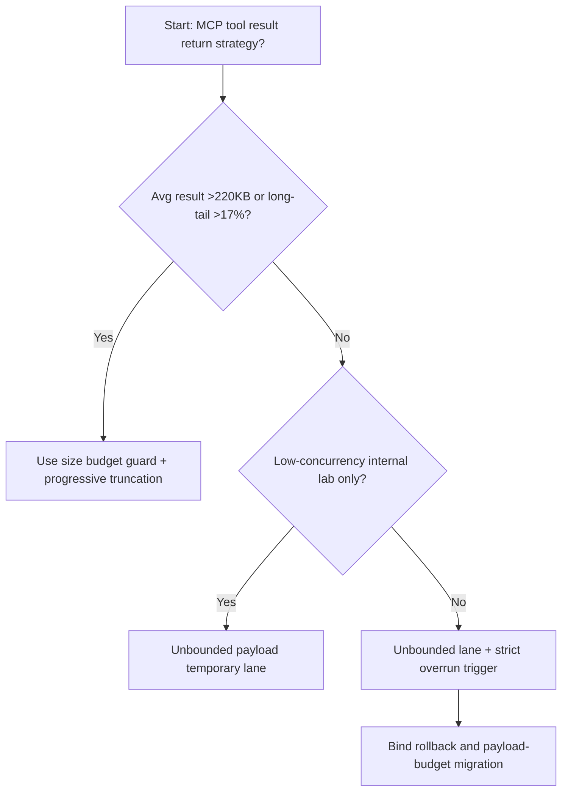
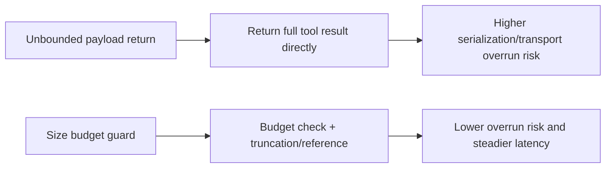
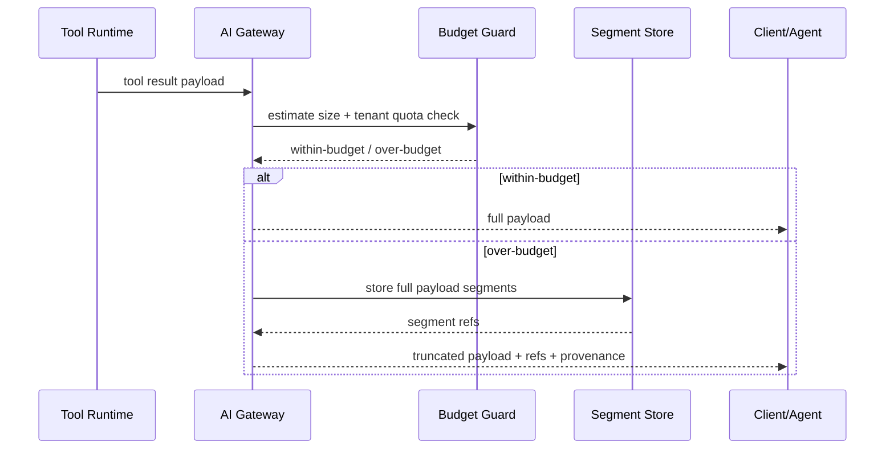

# Agent Gateway MCP Tool Result Size Budget 选型 FAQ（Unbounded Payload Return vs Size Budget Guard + Progressive Truncation）

## 1) 核心结论（先给负责人）
- **当工具结果平均体积 >220KB 且长尾结果占比 >17% 时，生产默认应选 Size Budget Guard + Progressive Truncation**；无限制回传会拖垮网关与会话延迟。
- **当结果拼接路径 P95 >310ms 且传输重试 >10% 时，Unbounded Payload Return 会进入 11.9% 超额档**，需切换预算防护。
- **当多租户共享网关并发 >900 rps 时，必须配置租户级结果体积配额与截断策略**，否则高体积租户会挤占公共带宽。

## 2) Q1 / Q2 / Q3（术语先通俗解释）
- **Unbounded Payload Return**：工具结果原样全部返回，不限制大小。
- **Size Budget Guard + Progressive Truncation**：先做结果大小预算检查，超额按分段截断并附引用指针。

### Q1：为什么“全部返回”在 MCP 工具链路里危险？
第一性原理：大 payload 会占用网关缓冲、序列化时间和网络带宽，放大尾延迟并触发重试风暴。

### Q2：什么时候可以短期不设预算？
仅在低并发内网实验、单租户测试、结果体积稳定且可控时。

### Q3：最小闭环是什么？
结果大小预估 -> 预算判定 -> 分段截断/引用化 -> 审计记录 -> 阈值回归调优。

## 3) Mermaid（决策树 / 路径对比 / 时序）
### 3.1 选型决策树

### 3.2 路径对比图

### 3.3 运行时序图

## 4) 选型决策矩阵
| 维度 | Unbounded Payload Return | Size Budget Guard + Progressive Truncation |
|---|---|---|
| 实现复杂度 | 低 | 中 |
| 带宽与序列化稳定性 | 低 | 高 |
| 多租户公平性 | 低 | 高 |
| 尾延迟控制 | 低-中 | 高 |
| 生产默认建议 | 仅内测短期 | 长期默认 |

## 5) 数据证据与可复算算例（含 n/分母/来源）
> 本节百分比为 `synthetic_assumed` 假设算例（hypothetical），用于机制比较；生产机制认证保持 `not_measured`。  
> 合同字段见：`workshops/azure-agent-infra/evidence/cycle-531-benchmark.json` 的 `percentage_contract`。

- 指标 A（无限制回传超额率）  
  - 定义：`n_unbounded_payload_overrun / n_gateway_requests_observed`  
  - 值：`526/4410 = 11.9%`（`synthetic_assumed`）  
  - 路径：`percentage_contract.unbounded_payload_overrun_rate`
- 指标 B（预算防护超额率）  
  - 定义：`n_size_budget_guard_overrun / n_gateway_requests_observed`  
  - 值：`212/4410 = 4.8%`（`synthetic_assumed`）  
  - 路径：`percentage_contract.size_budget_guard_overrun_rate`
- 指标 C（恢复增益，百分点）  
  - 定义：`(n_recovered_size_budget_guard - n_recovered_unbounded_payload) / n_gateway_requests_observed`  
  - 值：`(4065-3740)/4410 = 7.4` 个百分点（`synthetic_assumed`）  
  - 路径：`percentage_contract.size_budget_guard_recovery_gain_pts`

## 6) 生产 Checklist（上线前必须打勾）
- [ ] 工具结果大小预算可按租户/模型/工具维度配置
- [ ] 截断与引用化返回带完整溯源信息，便于恢复全量结果
- [ ] 超额率、重试率、带宽占用具备可观测与审计链路
- [ ] 指标全部标注 `synthetic_assumed`，生产机制认证保持 `not_measured`
