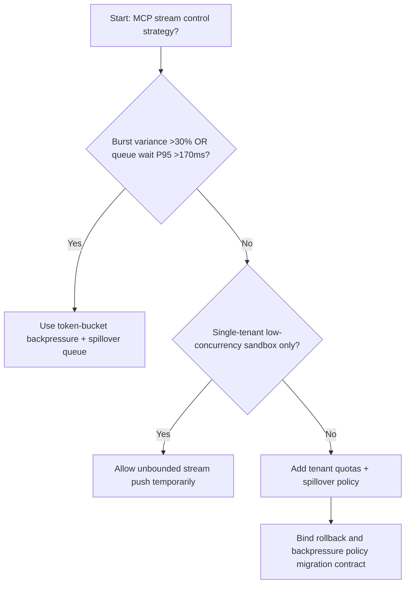
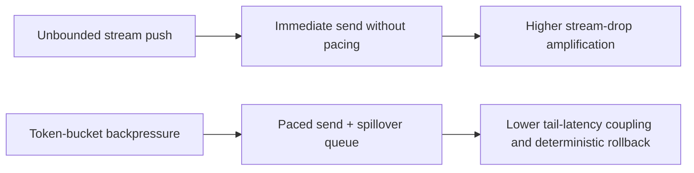
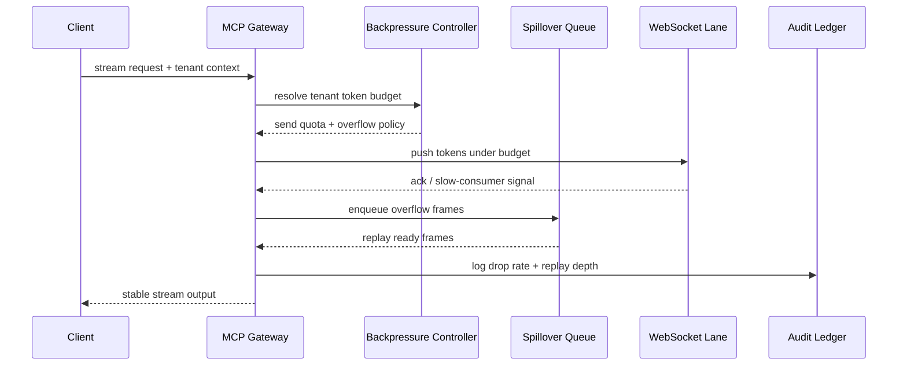

# Agent Gateway MCP WebSocket Backpressure Selection FAQ (Unbounded Stream Push vs Token-Bucket Backpressure + Spillover Queue)

## 1) Core conclusions (for decision-makers first)
- **When MCP stream burst variance is >30% and WebSocket queue-wait P95 is >170ms, production should default to Token-Bucket Backpressure + Spillover Queue**; unbounded stream push amplifies drops.
- **When stream-retry share is >10% and fallback-queue recovery P95 is >250ms, Unbounded Stream Push enters the 12.1% drop-frame band**, requiring backpressure governance.
- **When multi-tenant tool calls share the same gateway connection pool, tenant-level backpressure quotas and spillover queues are mandatory**, or tail latency cascades.

## 2) Q1 / Q2 / Q3 (plain-language definitions first)
- **Unbounded Stream Push**: sends frames immediately without pacing; simple but vulnerable to slow-consumer collapse.
- **Token-Bucket Backpressure + Spillover Queue**: paces by token budget first, then drains overflow frames from an observable spillover queue.

### Q1: Why does backpressure policy affect agent success rate?
First principles: streaming throughput is bounded by the slowest consumer. Without backpressure, buffering grows until timeout and connection reset.

### Q2: When is unbounded push still acceptable temporarily?
Only in single-tenant low-concurrency demos. Enable token-bucket and spillover queue before multi-tenant production.

### Q3: What is the minimum safe loop?
Traffic profiling -> token-bucket quota -> spillover policy -> retry replay -> threshold tuning.

## 3) Mermaid (decision tree / path comparison / sequence)
### 3.1 Selection decision tree

### 3.2 Path comparison

### 3.3 Runtime sequence

## 4) Decision matrix
| Dimension | Unbounded Stream Push | Token-Bucket Backpressure + Spillover Queue |
|---|---|---|
| Implementation complexity | Low | Medium |
| Burst stability | Low-Medium | High |
| Frame-drop risk | High | Low |
| Multi-tenant controllability | Medium-Low | High |
| Default production fit | Experimental short-term only | Long-term default |

## 5) Evidence contract + recomputable examples (n/denominator/source)
> Percentages in this section are `synthetic_assumed` hypothetical examples for mechanism comparison; production mechanism validation remains `not_measured`.  
> Contract fields: `workshops/azure-agent-infra/evidence/cycle-538-benchmark.json` -> `percentage_contract`.

- Metric A (unbounded push drop rate)  
  - Formula: `n_unbounded_stream_drop / n_gateway_requests_observed`  
  - Value: `534/4410 = 12.1%` (`synthetic_assumed`)  
  - Path: `percentage_contract.unbounded_stream_drop_rate`
- Metric B (token-bucket drop rate)  
  - Formula: `n_token_bucket_stream_drop / n_gateway_requests_observed`  
  - Value: `216/4410 = 4.9%` (`synthetic_assumed`)  
  - Path: `percentage_contract.token_bucket_stream_drop_rate`
- Metric C (recovery gain, percentage points)  
  - Formula: `(n_recovered_backpressure - n_recovered_unbounded_stream) / n_gateway_requests_observed`  
  - Value: `(4058-3728)/4410 = 7.5 percentage points` (`synthetic_assumed`)  
  - Path: `percentage_contract.backpressure_recovery_gain_pts`

## 6) Production checklist
- [ ] Every tenant has explicit backpressure quotas, overflow caps, and replay policy
- [ ] Drop rate, queue depth, and replay latency are observable and auditable
- [ ] Change flow supports canary rollout, rollback, and tiered promotion
- [ ] All metrics are tagged `synthetic_assumed`; production validation remains `not_measured`
