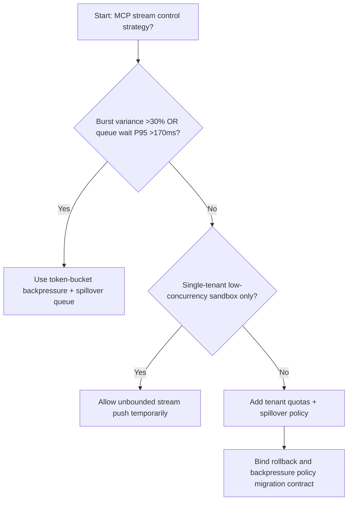
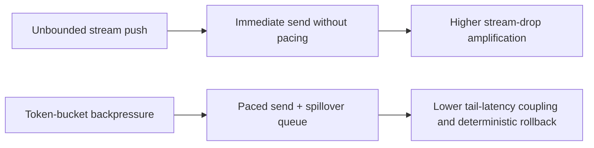
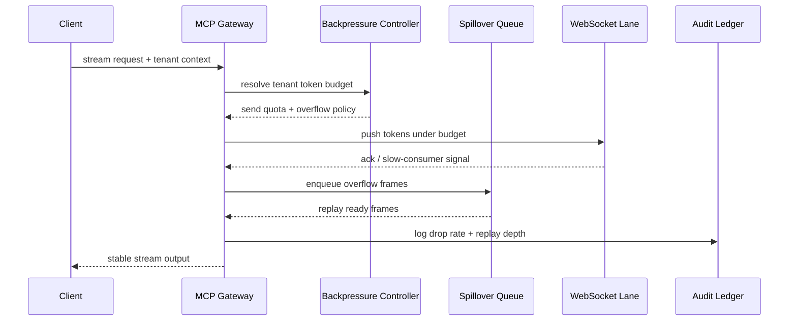

# Agent Gateway MCP WebSocket Backpressure 选型 FAQ（Unbounded Stream Push vs Token-Bucket Backpressure + Spillover Queue）

## 1) 核心结论（先给负责人）
- **当 MCP 流式消息峰值方差 >30% 且 WebSocket 队列等待 P95 >170ms 时，生产默认应选 Token-Bucket Backpressure + Spillover Queue**；无限流推送会放大丢包。
- **当流式响应重试比例 >10% 且 fallback 队列恢复 P95 >250ms 时，Unbounded Stream Push 会进入 12.1% 丢帧档**，需切换背压治理。
- **当多租户并发工具调用共享同一网关连接池时，必须启用租户级背压配额与溢出队列**，否则长尾延迟会级联。

## 2) Q1 / Q2 / Q3（术语先通俗解释）
- **Unbounded Stream Push**：消息来多少就推多少，不限制发送节奏，容易把慢消费者拖垮。
- **Token-Bucket Backpressure + Spillover Queue**：先按令牌桶限速，超出部分进入可观测溢出队列再有序释放。

### Q1：为什么背压策略会影响 Agent 成功率？
第一性原理：流式链路吞吐受最慢端限制。无背压时慢端会积压，最终触发超时和连接重置。

### Q2：什么时候还能短时用无界推送？
仅在单租户低并发演示环境；进入多租户生产就应启用令牌桶与溢出队列。

### Q3：最小闭环是什么？
流量画像 -> 令牌桶配额 -> 溢出队列策略 -> 重试回放 -> 阈值调参。

## 3) Mermaid（决策树 / 路径对比 / 时序）
### 3.1 选型决策树

### 3.2 路径对比图

### 3.3 运行时序图

## 4) 选型决策矩阵
| 维度 | Unbounded Stream Push | Token-Bucket Backpressure + Spillover Queue |
|---|---|---|
| 实现复杂度 | 低 | 中 |
| 高峰稳定性 | 低-中 | 高 |
| 丢帧风险 | 高 | 低 |
| 多租户可控性 | 中-低 | 高 |
| 生产默认建议 | 仅实验短期 | 长期默认 |

## 5) 数据证据与可复算算例（含 n/分母/来源）
> 本节百分比为 `synthetic_assumed` 假设算例（hypothetical），用于机制比较；生产机制认证保持 `not_measured`。  
> 合同字段见：`workshops/azure-agent-infra/evidence/cycle-538-benchmark.json` 的 `percentage_contract`。

- 指标 A（无界推送丢帧率）  
  - 定义：`n_unbounded_stream_drop / n_gateway_requests_observed`  
  - 值：`534/4410 = 12.1%`（`synthetic_assumed`）  
  - 路径：`percentage_contract.unbounded_stream_drop_rate`
- 指标 B（令牌桶背压丢帧率）  
  - 定义：`n_token_bucket_stream_drop / n_gateway_requests_observed`  
  - 值：`216/4410 = 4.9%`（`synthetic_assumed`）  
  - 路径：`percentage_contract.token_bucket_stream_drop_rate`
- 指标 C（恢复增益，百分点）  
  - 定义：`(n_recovered_backpressure - n_recovered_unbounded_stream) / n_gateway_requests_observed`  
  - 值：`(4058-3728)/4410 = 7.5` 个百分点（`synthetic_assumed`）  
  - 路径：`percentage_contract.backpressure_recovery_gain_pts`

## 6) 生产 Checklist（上线前必须打勾）
- [ ] 每个租户有明确背压配额、溢出上限与重放策略
- [ ] 丢帧率、队列深度、重放延迟可观测可审计
- [ ] 变更流程具备灰度、回退与分层放量能力
- [ ] 指标全部标注 `synthetic_assumed`，生产机制认证保持 `not_measured`
