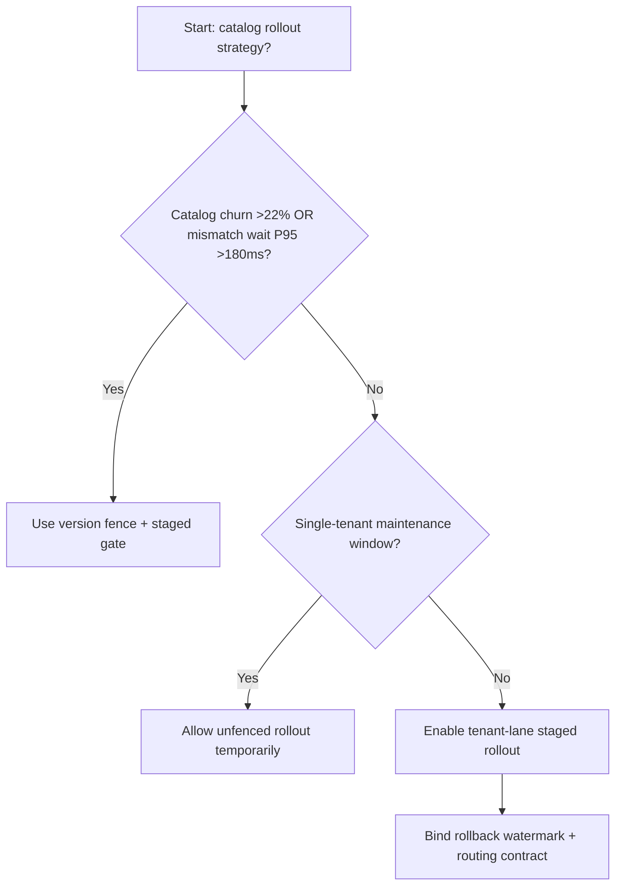
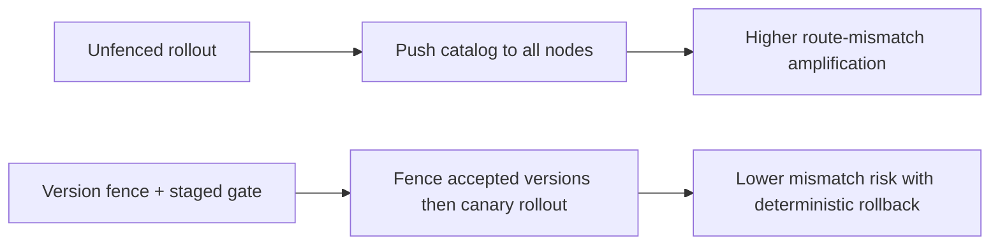
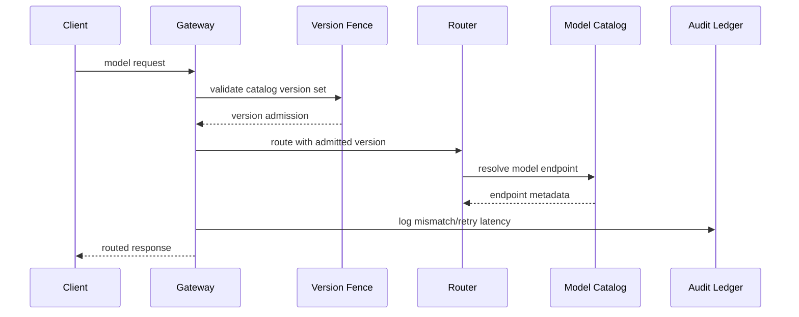

# Agent Gateway Model Catalog Version Fence Selection FAQ (Unfenced Rollout vs Version Fence + Staged Gate)

## 1) Core conclusions (for decision-makers first)
- **When model-catalog churn is >22% and route-version mismatch wait P95 is >180ms, production should default to Version Fence + Staged Gate**.
- **When unfenced-rollout mismatch rate is >12% and rollback-retry P95 is >250ms, Unfenced Rollout enters the 12.4% mismatch amplification band**.
- **Multi-tenant gateway upgrades must bind version fence, rollout batches, and rollback watermarks**, or cross-model routing jitter amplifies.

## 2) Q1 / Q2 / Q3 (plain-language definitions first)
- **Unfenced Rollout**: push the new model catalog directly to all routing nodes; fast but risky.
- **Version Fence + Staged Gate**: admit only approved catalog versions, then shift traffic in controlled batches.

### Q1: Why does catalog versioning affect agent stability?
First principles: routing decisions depend on model metadata. Catalog mismatch makes equivalent requests hit different backends, amplifying retries and latency.

### Q2: When is Unfenced Rollout acceptable temporarily?
Only in single-tenant low-traffic maintenance windows. Multi-tenant production should default to fenced rollout.

### Q3: What is the minimum safe loop?
Version sampling -> fence validation -> staged rollout -> mismatch alerts -> automated rollback.

## 3) Mermaid (decision tree / path comparison / sequence)
### 3.1 Selection decision tree

### 3.2 Path comparison

### 3.3 Runtime sequence

## 4) Decision matrix
| Dimension | Unfenced Rollout | Version Fence + Staged Gate |
|---|---|---|
| Implementation complexity | Low | Medium |
| Version mismatch risk | High | Low |
| Multi-tenant controllability | Low | High |
| Rollback determinism | Medium | High |
| Default production fit | Maintenance windows only | Long-term default |

## 5) Evidence contract + recomputable examples (n/denominator/source)
> Percentages in this section are `synthetic_assumed` hypothetical examples for mechanism comparison; production mechanism validation remains `not_measured`.  
> Contract fields: `workshops/azure-agent-infra/evidence/cycle-542-benchmark.json` -> `percentage_contract`.

- Metric A (unfenced catalog mismatch rate)  
  - Formula: `n_unfenced_catalog_mismatch / n_gateway_requests_observed`  
  - Value: `547/4410 = 12.4%` (`synthetic_assumed`)  
  - Path: `percentage_contract.unfenced_catalog_mismatch_rate`
- Metric B (version-fence mismatch rate)  
  - Formula: `n_version_fence_mismatch / n_gateway_requests_observed`  
  - Value: `225/4410 = 5.1%` (`synthetic_assumed`)  
  - Path: `percentage_contract.version_fence_mismatch_rate`
- Metric C (recovery gain, percentage points)  
  - Formula: `(n_recovered_version_fence - n_recovered_unfenced) / n_gateway_requests_observed`  
  - Value: `(4076-3754)/4410 = 7.3 percentage points` (`synthetic_assumed`)  
  - Path: `percentage_contract.version_fence_recovery_gain_pts`

## 6) Production checklist
- [ ] Every tenant has model-catalog version allow-lists and rollout batches
- [ ] Mismatch rate, retry latency, and rollback success are observable and auditable
- [ ] Change flow supports canary rollout, fast rollback, and tiered promotion
- [ ] All metrics are tagged `synthetic_assumed`; production validation remains `not_measured`
