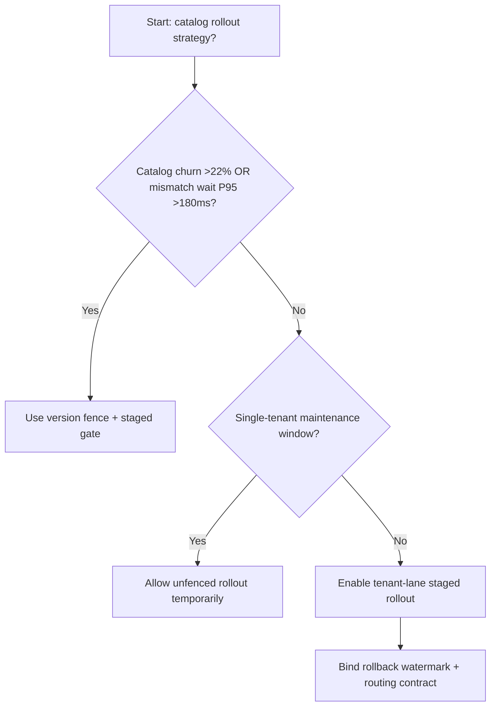
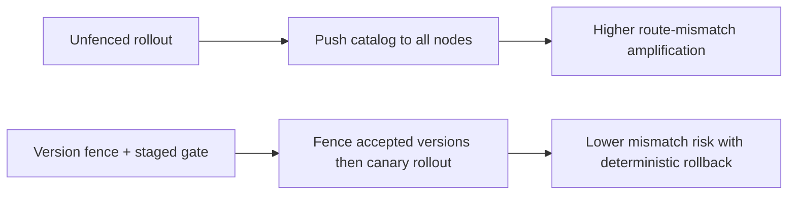
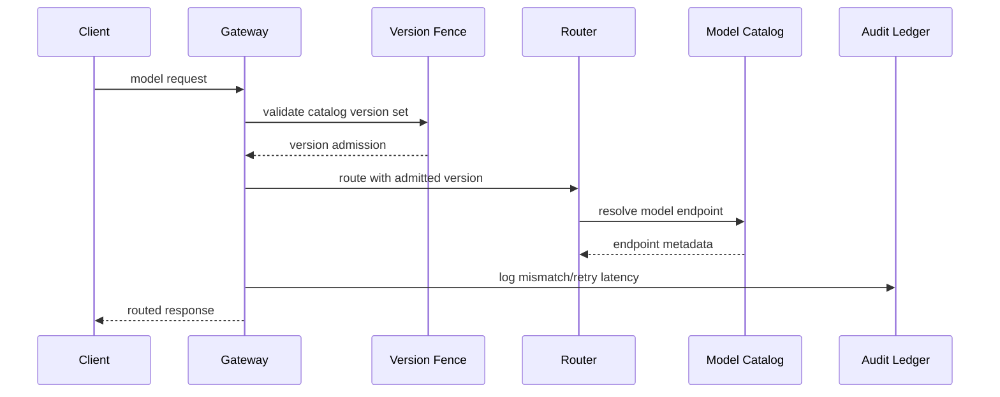

# Agent Gateway Model Catalog Version Fence 选型 FAQ（Unfenced Rollout vs Version Fence + Staged Gate）

## 1) 核心结论（先给负责人）
- **当模型目录变更频率 >22% 且路由版本不一致等待 P95 >180ms 时，生产默认应启用 Version Fence + Staged Gate**。
- **当未围栏发布的不一致率 >12% 且回退重试 P95 >250ms 时，Unfenced Rollout 会进入 12.4% 失配放大区间**。
- **多租户网关升级必须绑定“版本围栏、灰度批次、回滚水位”**，否则跨模型路由会出现放大抖动。

## 2) Q1 / Q2 / Q3（术语先通俗解释）
- **Unfenced Rollout**：直接把新模型目录推到所有路由节点，快但风险高。
- **Version Fence + Staged Gate**：先锁定可接受版本集合，再按批次放量切流。

### Q1：为什么模型目录版本会影响 Agent 稳定性？
第一性原理：路由决策依赖模型元数据。目录失配会导致同请求在不同网关命中不同后端，放大重试与延迟。

### Q2：什么时候可以短时用 Unfenced Rollout？
仅限单租户低流量维护窗；多租户生产场景应默认用版本围栏。

### Q3：最小闭环是什么？
版本采样 -> 围栏比对 -> 分批放量 -> 失配告警 -> 自动回滚。

## 3) Mermaid（决策树 / 路径对比 / 时序）
### 3.1 选型决策树

### 3.2 路径对比图

### 3.3 运行时序图

## 4) 选型决策矩阵
| 维度 | Unfenced Rollout | Version Fence + Staged Gate |
|---|---|---|
| 实现复杂度 | 低 | 中 |
| 版本失配风险 | 高 | 低 |
| 多租户可控性 | 低 | 高 |
| 回滚确定性 | 中 | 高 |
| 生产默认建议 | 仅维护窗 | 长期默认 |

## 5) 数据证据与可复算算例（含 n/分母/来源）
> 本节百分比为 `synthetic_assumed` 假设算例（hypothetical），用于机制比较；生产机制认证保持 `not_measured`。  
> 合同字段见：`workshops/azure-agent-infra/evidence/cycle-542-benchmark.json` 的 `percentage_contract`。

- 指标 A（未围栏目录失配率）  
  - 定义：`n_unfenced_catalog_mismatch / n_gateway_requests_observed`  
  - 值：`547/4410 = 12.4%`（`synthetic_assumed`）  
  - 路径：`percentage_contract.unfenced_catalog_mismatch_rate`
- 指标 B（版本围栏失配率）  
  - 定义：`n_version_fence_mismatch / n_gateway_requests_observed`  
  - 值：`225/4410 = 5.1%`（`synthetic_assumed`）  
  - 路径：`percentage_contract.version_fence_mismatch_rate`
- 指标 C（恢复增益，百分点）  
  - 定义：`(n_recovered_version_fence - n_recovered_unfenced) / n_gateway_requests_observed`  
  - 值：`(4076-3754)/4410 = 7.3` 个百分点（`synthetic_assumed`）  
  - 路径：`percentage_contract.version_fence_recovery_gain_pts`

## 6) 生产 Checklist（上线前必须打勾）
- [ ] 每租户都有模型目录版本白名单与切流批次
- [ ] 失配率、重试时延、回滚成功率可观测可审计
- [ ] 支持灰度、快速回退与分层放量
- [ ] 指标全部标注 `synthetic_assumed`，生产机制认证保持 `not_measured`
