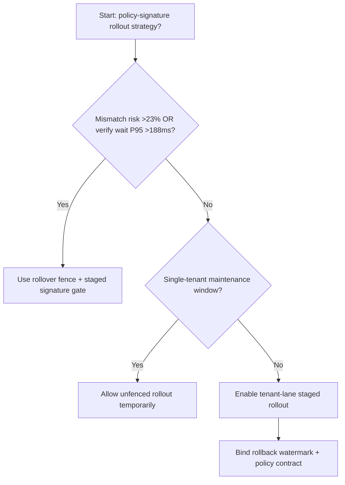
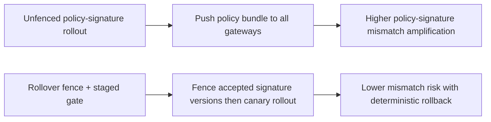
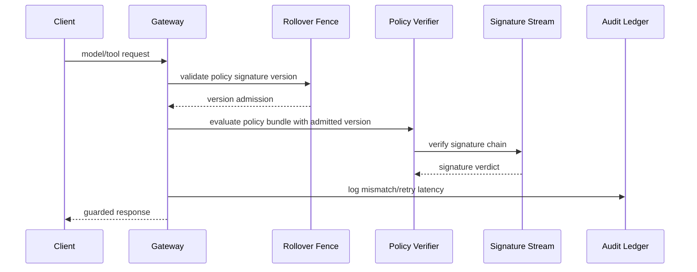

# Agent Gateway Policy Bundle Signature Rollover Selection FAQ (Unfenced Policy-Signature Rollout vs Rollover Fence + Staged Signature Gate)

## 1) Core conclusions (for decision-makers first)
- **When policy-bundle signature mismatch risk exceeds 23% and gateway verification wait P95 exceeds 188ms, production should default to Rollover Fence + Staged Signature Gate**.
- **When unfenced policy-signature rollout mismatch exceeds 12% and rollback retry P95 exceeds 258ms, Unfenced Policy-Signature Rollout enters the 12.8% mismatch amplification band**.
- **Multi-tenant gateway policy upgrades must bind signature-rollover fences, rollout batches, and rollback thresholds**, or routing consistency and audit trust degrade together.

## 2) Q1 / Q2 / Q3 (plain-language definitions first)
- **Unfenced Policy-Signature Rollout**: push new signed policy bundles to all gateways directly; fast but risky.
- **Rollover Fence + Staged Signature Gate**: constrain accepted signature versions first, then shift traffic in batches.

### Q1: Why does signature rollover affect agent stability?
First principles: every routing decision depends on policy-signature verification. Signature-version mismatch causes policy execution divergence across nodes, amplifying retries and tail latency.

### Q2: When is unfenced rollout acceptable temporarily?
Only in single-tenant low-traffic maintenance windows. Multi-tenant production should default to signature-fenced rollover.

### Q3: What is the minimum safe loop?
Version sampling -> fence validation -> staged rollout -> mismatch alerts -> automated rollback.

## 3) Mermaid (decision tree / path comparison / sequence)
### 3.1 Selection decision tree

### 3.2 Path comparison

### 3.3 Runtime sequence

## 4) Decision matrix
| Dimension | Unfenced Policy-Signature Rollout | Rollover Fence + Staged Signature Gate |
|---|---|---|
| Implementation complexity | Low | Medium |
| Signature-mismatch risk | High | Low |
| Multi-tenant controllability | Low | High |
| Rollback determinism | Medium | High |
| Default production fit | Maintenance windows only | Long-term default |

## 5) Evidence contract + recomputable examples (n/denominator/source)
> Percentages in this section are `synthetic_assumed` hypothetical examples for mechanism comparison; production mechanism validation remains `not_measured`.  
> Contract fields: `workshops/azure-agent-infra/evidence/cycle-547-benchmark.json` -> `percentage_contract`.

- Metric A (unfenced policy-signature mismatch rate)  
  - Formula: `n_unfenced_policy_signature_mismatch / n_gateway_requests_observed`  
  - Value: `565/4410 = 12.8%` (`synthetic_assumed`)  
  - Path: `percentage_contract.unfenced_policy_signature_mismatch_rate`
- Metric B (rollover-fence mismatch rate)  
  - Formula: `n_rollover_fence_mismatch / n_gateway_requests_observed`  
  - Value: `218/4410 = 4.9%` (`synthetic_assumed`)  
  - Path: `percentage_contract.rollover_fence_mismatch_rate`
- Metric C (recovery gain, percentage points)  
  - Formula: `(n_recovered_rollover_fence - n_recovered_unfenced) / n_gateway_requests_observed`  
  - Value: `(4120-3779)/4410 = 7.7 percentage points` (`synthetic_assumed`)  
  - Path: `percentage_contract.rollover_fence_recovery_gain_pts`

## 6) Production checklist
- [ ] Every tenant has policy-signature version allow-lists and rollout batches
- [ ] Mismatch rate, retry latency, and rollback success are observable and auditable
- [ ] Change flow supports canary rollout, fast rollback, and tiered promotion
- [ ] All metrics are tagged `synthetic_assumed`; production validation remains `not_measured`
