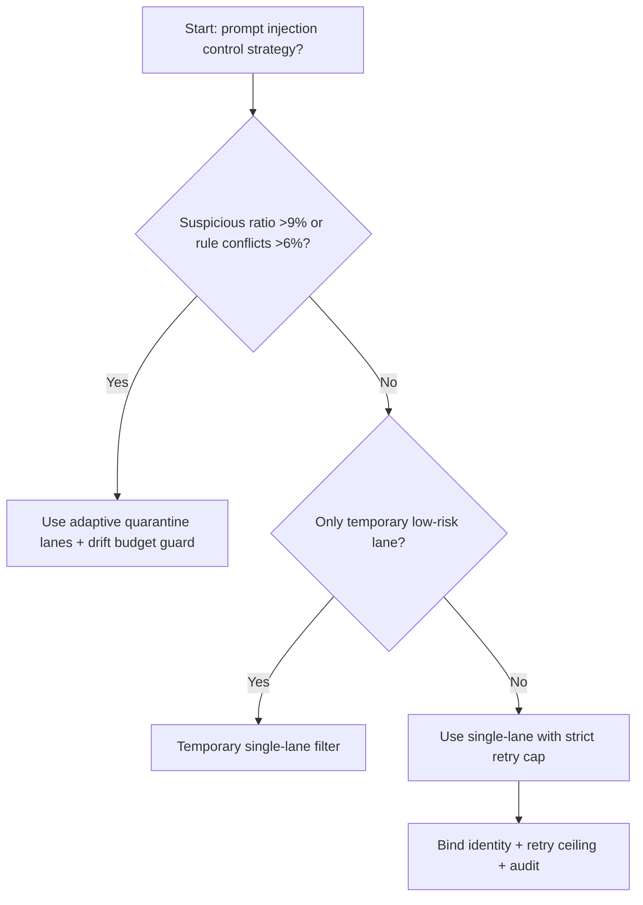
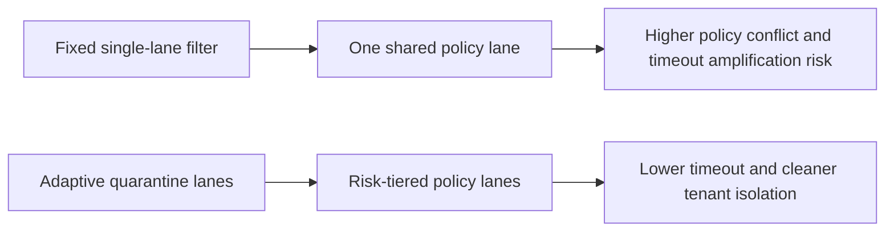
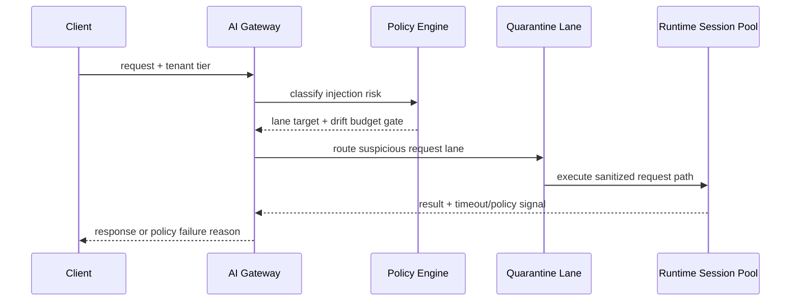

# Agent Gateway Prompt Injection Quarantine Lane Selection FAQ (Fixed Single-Lane Filter vs Adaptive Quarantine Lanes + Drift Budget Guard)

## 1) Core conclusions (for decision-makers first)
- **When suspicious-request ratio exceeds 9% and rule-match conflict exceeds 6%, default to quarantine-lane tiering**; below this boundary, single-lane filtering can remain temporary.
- **When policy-chain retry amplification exceeds 1.4x and prompt-sanitization P95 exceeds 85ms, fixed single-lane filtering enters the 10.3% timeout band**, so quarantine-lane routing becomes mandatory.
- **When cross-tenant false-block rate exceeds 0.9% and human-review returns exceed 3%, enforce drift-budget + replay audit**, or policy explainability becomes non-traceable.

## 2) Q1 / Q2 / Q3 (plain-language definitions first)
- **Fixed Single-Lane Filter**: every request runs through one shared policy lane; simple to operate, but conflict spikes slow all traffic.
- **Adaptive Quarantine Lanes + Drift Budget Guard**: route requests by risk tier into standard/quarantine lanes, then constrain policy drift with budget gates.

### Q1: Why does a single filter lane fail under risk bursts?
First principles: low-risk and high-risk requests sharing one lane means worst-case policy paths dominate everyone’s latency, triggering retry cascades.

### Q2: When is single-lane filtering still acceptable?
Only when suspicious ratio stays <3%, rule conflict stays <2%, and false-block rate stays <0.2% in temporary low-risk lanes.

### Q3: What is the minimum safe control loop?
Risk classification -> lane routing -> policy-budget gate -> timeout/false-block audit -> threshold recalibration.

## 3) Mermaid (decision tree / path comparison / sequence)
### 3.1 Selection decision tree

### 3.2 Path comparison

### 3.3 Runtime sequence

## 4) Decision matrix
| Dimension | Fixed Single-Lane Filter | Adaptive Quarantine Lanes + Drift Budget Guard |
|---|---|---|
| Implementation complexity | Low | Medium |
| Policy-conflict resilience | Medium-Low | High |
| Timeout risk control | Medium-Low | High |
| Multi-tenant stability | Medium | High |
| Default production fit | Temporary low-priority lane only | Long-term default |

## 5) Evidence contract + recomputable examples (n/denominator/source)
> Percentages in this section are `synthetic_assumed` hypothetical examples for mechanism comparison; production mechanism validation remains `not_measured`.  
> Contract fields: `workshops/azure-agent-infra/evidence/cycle-524-benchmark.json` -> `percentage_contract`.

- Metric A (single-lane timeout rate)  
  - Formula: `n_fixed_single_lane_prompt_timeout / n_gateway_requests_observed`  
  - Value: `455/4410 = 10.3%` (`synthetic_assumed`)  
  - Path: `percentage_contract.fixed_single_lane_prompt_timeout_rate`
- Metric B (quarantine-lane timeout rate)  
  - Formula: `n_adaptive_quarantine_lane_prompt_timeout / n_gateway_requests_observed`  
  - Value: `176/4410 = 4.0%` (`synthetic_assumed`)  
  - Path: `percentage_contract.adaptive_quarantine_lane_prompt_timeout_rate`
- Metric C (recovery gain, percentage points)  
  - Formula: `(n_recovered_adaptive_quarantine_lane - n_recovered_fixed_single_lane_prompt) / n_gateway_requests_observed`  
  - Value: `(4122-3812)/4410 = 7.0 percentage points` (`synthetic_assumed`)  
  - Path: `percentage_contract.adaptive_quarantine_lane_recovery_gain_pts`

## 6) Production checklist
- [ ] Risk-tier policy, quarantine-lane routing, and rollback paths are drillable
- [ ] Conflict rate, false-block rate, retry ceilings, and drift budgets are observable and auditable
- [ ] Policy decision chains, human-review returns, and replay traces are tenant-traceable
- [ ] All metrics are tagged `synthetic_assumed` with denominator/unit; production validation remains `not_measured`
