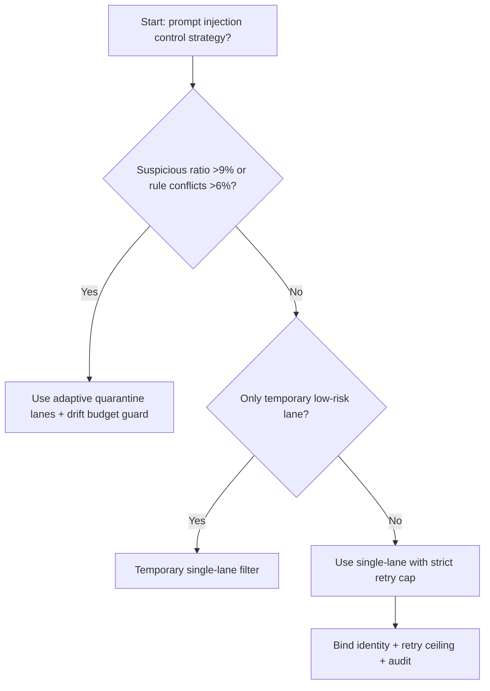
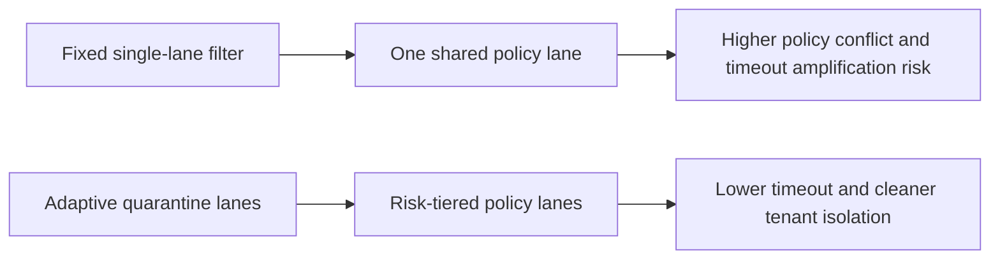
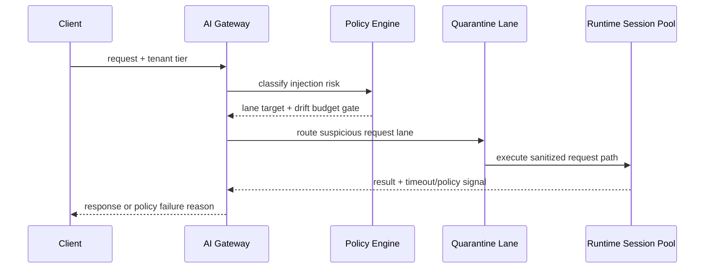

# Agent Gateway Prompt Injection Quarantine Lane 选型 FAQ（Fixed Single-Lane Filter vs Adaptive Quarantine Lanes + Drift Budget Guard）

## 1) 核心结论（先给负责人）
- **当注入可疑请求占比 >9% 且规则匹配冲突 >6% 时，生产默认应选 Quarantine Lane 分层治理**；低于阈值可短期保留单通道过滤。
- **当策略链重试放大 >1.4× 且提示词净化 P95 >85ms 时，Fixed Single-Lane Filter 会进入 10.3% 超时档**，必须切换隔离通道路径。
- **当跨租户误拦截率 >0.9% 且人工复核回流 >3% 时，必须启用 drift budget + replay audit**，否则策略可解释性不可追溯。

## 2) Q1 / Q2 / Q3（术语先通俗解释）
- **Fixed Single-Lane Filter**：所有请求统一走一条过滤链，规则简单但冲突时会拖慢全量流量。
- **Adaptive Quarantine Lanes + Drift Budget Guard**：按风险等级把请求分流到标准/隔离通道，并用漂移预算限制策略抖动。

### Q1：为什么单通道过滤在风险突发时会崩？
第一性原理：高风险与低风险请求混跑时，最慢规则会拖累整条链路，触发连锁重试和整体尾延迟升高。

### Q2：什么时候还可短期使用单通道过滤？
仅在可疑请求占比 <3%、规则冲突 <2%、误拦截率 <0.2% 的短时低风险场景。

### Q3：最小安全闭环是什么？
风险分级 -> 通道路由 -> 策略预算门禁 -> 超时/误拦截审计 -> 阈值回归校准。

## 3) Mermaid（决策树 / 路径对比 / 时序）
### 3.1 选型决策树

### 3.2 路径对比图

### 3.3 运行时序图

## 4) 选型决策矩阵
| 维度 | Fixed Single-Lane Filter | Adaptive Quarantine Lanes + Drift Budget Guard |
|---|---|---|
| 实现复杂度 | 低 | 中 |
| 策略冲突抗压能力 | 中-低 | 高 |
| 超时风险控制 | 中-低 | 高 |
| 多租户稳定性 | 中 | 高 |
| 生产默认建议 | 仅临时低优先级通道 | 长期默认 |

## 5) 数据证据与可复算算例（含 n/分母/来源）
> 本节百分比为 `synthetic_assumed` 假设算例（hypothetical），用于机制比较；生产机制认证保持 `not_measured`。  
> 合同字段见：`workshops/azure-agent-infra/evidence/cycle-524-benchmark.json` 的 `percentage_contract`。

- 指标 A（单通道过滤超时率）  
  - 定义：`n_fixed_single_lane_prompt_timeout / n_gateway_requests_observed`  
  - 值：`455/4410 = 10.3%`（`synthetic_assumed`）  
  - 路径：`percentage_contract.fixed_single_lane_prompt_timeout_rate`
- 指标 B（隔离通道方案超时率）  
  - 定义：`n_adaptive_quarantine_lane_prompt_timeout / n_gateway_requests_observed`  
  - 值：`176/4410 = 4.0%`（`synthetic_assumed`）  
  - 路径：`percentage_contract.adaptive_quarantine_lane_prompt_timeout_rate`
- 指标 C（恢复增益，百分点）  
  - 定义：`(n_recovered_adaptive_quarantine_lane - n_recovered_fixed_single_lane_prompt) / n_gateway_requests_observed`  
  - 值：`(4122-3812)/4410 = 7.0` 个百分点（`synthetic_assumed`）  
  - 路径：`percentage_contract.adaptive_quarantine_lane_recovery_gain_pts`

## 6) 生产 Checklist（上线前必须打勾）
- [ ] 风险分级策略、隔离通道路由和回滚路径可灰度演练
- [ ] 冲突率、误拦截率、重试上限与漂移预算均可观测可审计
- [ ] 策略命中链路、人工复核回流与回放审计可按租户追踪
- [ ] 指标全部标注 `synthetic_assumed`、分母与单位；生产机制认证保持 `not_measured`
