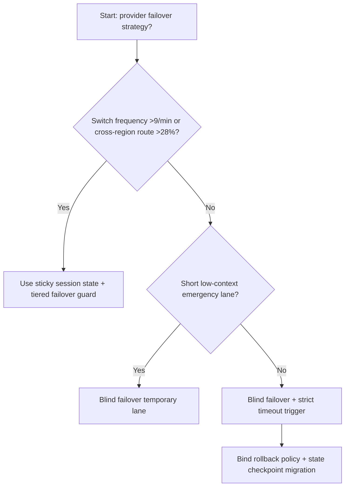
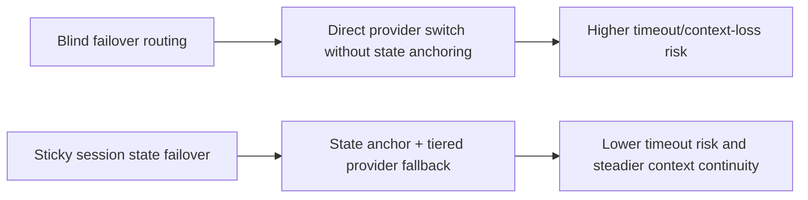
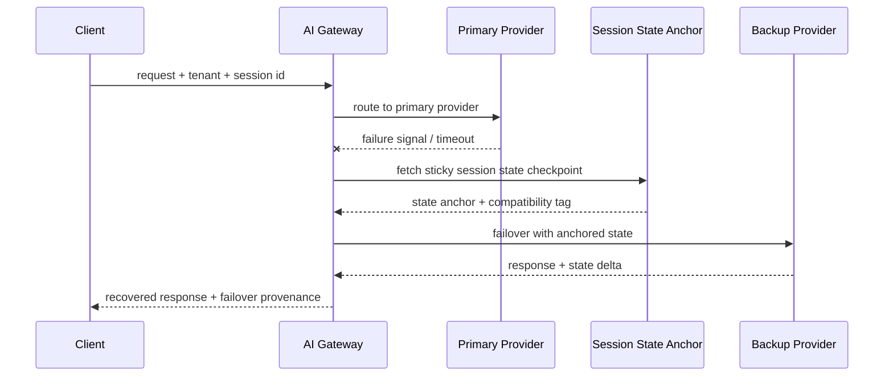

# Agent Gateway Provider Failover State Stickiness Selection FAQ (Blind Failover Routing vs Sticky Session State + Tiered Failover Guard)

## 1) Core conclusions (for decision-makers first)
- **When provider switch frequency exceeds 9/min and cross-region routing share exceeds 28%, default to Sticky Session State + Tiered Failover Guard**; blind failover amplifies session drift.
- **When failover-path recovery timeout P95 exceeds 260ms and session-context loss exceeds 1.2%, blind failover enters the 11.4% timeout band**, requiring sticky-state failover.
- **When primary/backup providers diverge in tokenizer/tool protocol and fallback recompute exceeds 15%, state-stickiness validation plus tiered downgrade is mandatory**, or consistency becomes unstable.

## 2) Q1 / Q2 / Q3 (plain-language definitions first)
- **Blind Failover Routing**: on provider failure, route to backup without validating session-state continuity.
- **Sticky Session State + Tiered Failover Guard**: preserve session anchors across failover and apply tenant/model-tier fallback controls.

### Q1: Why does blind failover fail under real workload?
First principles: agent sessions are not pure stateless calls. Provider differences in tokenizer/tool contract/output shape can break context continuity during blind switching.

### Q2: When can blind failover still be temporarily acceptable?
Only in short-session, low-context-dependency emergency windows with minimal tool calls.

### Q3: What is the minimum safe loop?
Primary health probe -> state-anchor snapshot -> tiered failover -> rollback consistency check -> session recovery audit.

## 3) Mermaid (decision tree / path comparison / sequence)
### 3.1 Selection decision tree

### 3.2 Path comparison

### 3.3 Runtime sequence

## 4) Decision matrix
| Dimension | Blind Failover Routing | Sticky Session State + Tiered Failover Guard |
|---|---|---|
| Implementation complexity | Low | Medium |
| Session continuity | Low-Medium | High |
| Recovery stability | Medium-Low | High |
| Multi-provider consistency | Low | High |
| Default production fit | Short emergency only | Long-term default |

## 5) Evidence contract + recomputable examples (n/denominator/source)
> Percentages in this section are `synthetic_assumed` hypothetical examples for mechanism comparison; production mechanism validation remains `not_measured`.  
> Contract fields: `workshops/azure-agent-infra/evidence/cycle-529-benchmark.json` -> `percentage_contract`.

- Metric A (blind-failover timeout rate)  
  - Formula: `n_blind_failover_timeout / n_gateway_requests_observed`  
  - Value: `503/4410 = 11.4%` (`synthetic_assumed`)  
  - Path: `percentage_contract.blind_failover_timeout_rate`
- Metric B (sticky-failover timeout rate)  
  - Formula: `n_sticky_failover_timeout / n_gateway_requests_observed`  
  - Value: `194/4410 = 4.4%` (`synthetic_assumed`)  
  - Path: `percentage_contract.sticky_failover_timeout_rate`
- Metric C (recovery gain, percentage points)  
  - Formula: `(n_recovered_sticky_failover - n_recovered_blind_failover) / n_gateway_requests_observed`  
  - Value: `(4096-3797)/4410 = 6.8 percentage points` (`synthetic_assumed`)  
  - Path: `percentage_contract.sticky_failover_recovery_gain_pts`

## 6) Production checklist
- [ ] Session-state anchors are replayable and verifiable across provider failovers
- [ ] Tiered failover policy is independently configurable by tenant/model/region
- [ ] Timeout/context-loss/fallback-recompute metrics are observable and auditable
- [ ] All metrics are tagged `synthetic_assumed`; production validation remains `not_measured`
