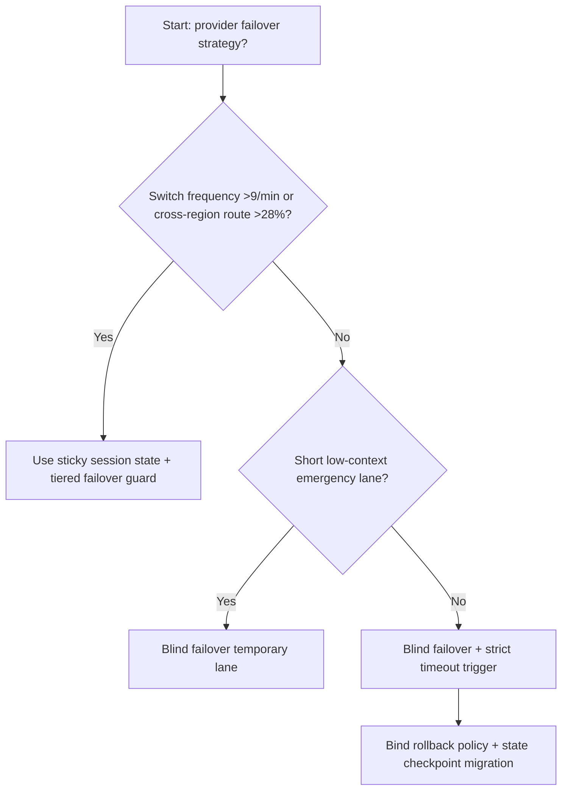
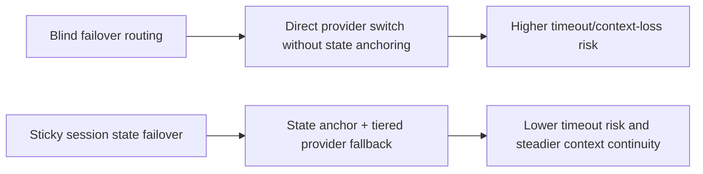
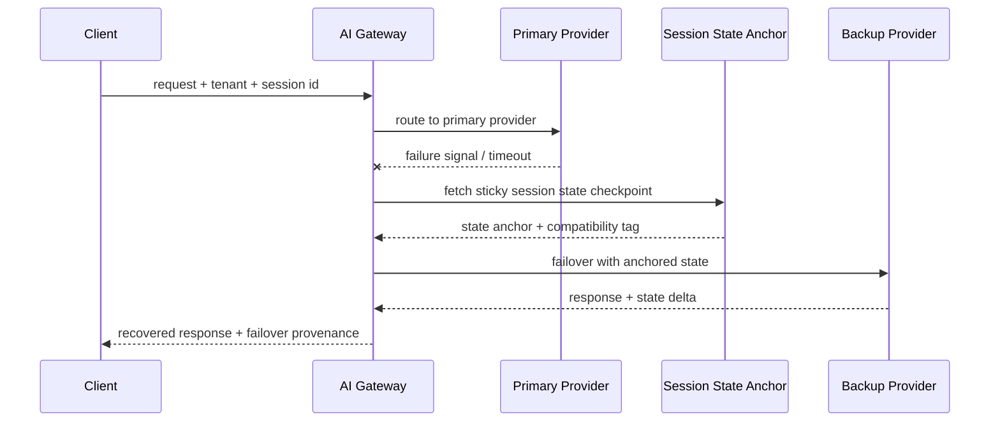

# Agent Gateway Provider Failover State Stickiness 选型 FAQ（Blind Failover Routing vs Sticky Session State + Tiered Failover Guard）

## 1) 核心结论（先给负责人）
- **当多模型提供方切换频次 >9 次/分钟且跨区路由占比 >28% 时，生产默认应选 Sticky Session State + Tiered Failover Guard**；Blind Failover Routing 会放大会话漂移。
- **当切换路径恢复超时 P95 >260ms 且会话上下文丢失 >1.2% 时，Blind Failover 会进入 11.4% 超时档**，需切换粘性状态故障切换。
- **当主备提供方 tokenizer/工具协议存在差异且回退重算 >15% 时，必须引入状态粘性校验与分层降级**，否则一致性不可控。

## 2) Q1 / Q2 / Q3（术语先通俗解释）
- **Blind Failover Routing**：提供方故障后直接切到备用路径，不校验会话状态连续性。
- **Sticky Session State + Tiered Failover Guard**：故障切换前后保持会话状态锚点，按租户/模型层级分级切换和回退。

### Q1：为什么盲切换容易出错？
第一性原理：Agent 会话不是纯无状态请求。不同提供方在 tokenizer、工具调用、输出结构上有差异，盲切换会打断上下文链条。

### Q2：什么时候还能短时用 Blind Failover？
仅在短会话、低上下文依赖、工具调用极少的临时降级窗口。

### Q3：最小闭环是什么？
主路健康探测 -> 状态锚点快照 -> 分级故障切换 -> 回退一致性校验 -> 会话恢复审计。

## 3) Mermaid（决策树 / 路径对比 / 时序）
### 3.1 选型决策树

### 3.2 路径对比图

### 3.3 运行时序图

## 4) 选型决策矩阵
| 维度 | Blind Failover Routing | Sticky Session State + Tiered Failover Guard |
|---|---|---|
| 实现复杂度 | 低 | 中 |
| 会话连续性 | 低-中 | 高 |
| 故障恢复稳定性 | 中-低 | 高 |
| 多提供方一致性 | 低 | 高 |
| 生产默认建议 | 仅应急短时 | 长期默认 |

## 5) 数据证据与可复算算例（含 n/分母/来源）
> 本节百分比为 `synthetic_assumed` 假设算例（hypothetical），用于机制比较；生产机制认证保持 `not_measured`。  
> 合同字段见：`workshops/azure-agent-infra/evidence/cycle-529-benchmark.json` 的 `percentage_contract`。

- 指标 A（Blind Failover 超时率）  
  - 定义：`n_blind_failover_timeout / n_gateway_requests_observed`  
  - 值：`503/4410 = 11.4%`（`synthetic_assumed`）  
  - 路径：`percentage_contract.blind_failover_timeout_rate`
- 指标 B（Sticky Failover 超时率）  
  - 定义：`n_sticky_failover_timeout / n_gateway_requests_observed`  
  - 值：`194/4410 = 4.4%`（`synthetic_assumed`）  
  - 路径：`percentage_contract.sticky_failover_timeout_rate`
- 指标 C（恢复增益，百分点）  
  - 定义：`(n_recovered_sticky_failover - n_recovered_blind_failover) / n_gateway_requests_observed`  
  - 值：`(4096-3797)/4410 = 6.8` 个百分点（`synthetic_assumed`）  
  - 路径：`percentage_contract.sticky_failover_recovery_gain_pts`

## 6) 生产 Checklist（上线前必须打勾）
- [ ] 提供方切换前后会话状态锚点可回放可校验
- [ ] 分级故障切换策略可按租户、模型、区域独立配置
- [ ] 超时、上下文丢失、回退重算均有可观测和审计链路
- [ ] 指标全部标注 `synthetic_assumed`，生产机制认证保持 `not_measured`
