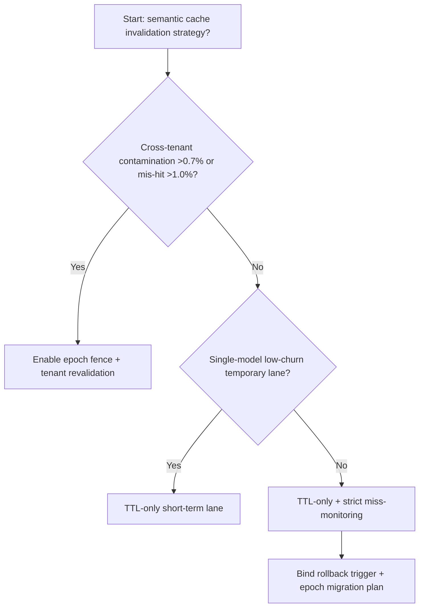
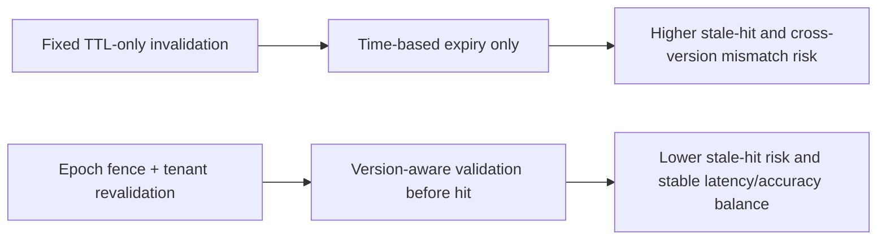
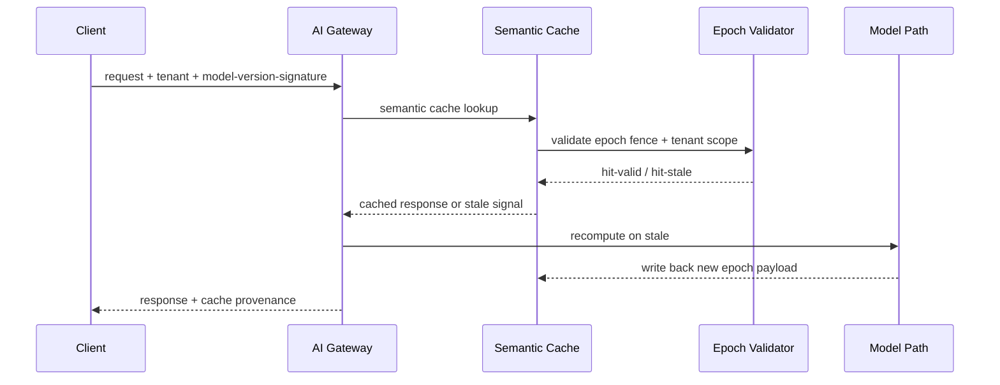

# Agent Gateway Semantic Cache Invalidation Epoch Fence Selection FAQ (Fixed TTL-only Cache Invalidation vs Epoch Fence + Tenant Scope Revalidation)

## 1) Core conclusions (for decision-makers first)
- **When cross-tenant semantic-cache contamination exceeds 0.7% and recompute spikes exceed 14%, default to Epoch Fence + Tenant Scope Revalidation**; TTL-only invalidation is no longer stable.
- **When cache-key drift mis-hit exceeds 1.0% and hot-path P95 exceeds 120ms, fixed TTL-only invalidation enters the 10.2% mismatch band**, requiring an epoch-fence switch.
- **When model versions update daily and prompt-template changes exceed 3/day, invalidation epoch must be part of routing contracts**, or hit rate and answer correctness degrade together.

## 2) Q1 / Q2 / Q3 (plain-language definitions first)
- **Fixed TTL-only Cache Invalidation**: eviction is purely time-based; simple, but blind to model/template version shifts.
- **Epoch Fence + Tenant Scope Revalidation**: each hit is validated against version epoch and tenant scope before reuse.

### Q1: Why does TTL-only drift in multi-version model fleets?
First principles: semantic cache correctness depends on both time freshness and generation lineage. TTL handles time, not lineage, so stale-semantic hits accumulate.

### Q2: When is TTL-only still acceptable?
Only in single-model, single-template, single-tenant low-concurrency windows with short change cycles.

### Q3: What is the minimum safe loop?
Ingress version signature -> cache hit with epoch validation -> stale fallback recompute -> write-back with new epoch -> monitor mis-hit and latency drift.

## 3) Mermaid (decision tree / path comparison / sequence)
### 3.1 Selection decision tree

### 3.2 Path comparison

### 3.3 Runtime sequence

## 4) Decision matrix
| Dimension | Fixed TTL-only Cache Invalidation | Epoch Fence + Tenant Scope Revalidation |
|---|---|---|
| Implementation complexity | Low | Medium |
| Multi-version robustness | Low-Medium | High |
| Mis-hit control | Low | High |
| Multi-tenant isolation consistency | Medium | High |
| Default production fit | Temporary low-churn lane only | Long-term default |

## 5) Evidence contract + recomputable examples (n/denominator/source)
> Percentages in this section are `synthetic_assumed` hypothetical examples for mechanism comparison; production mechanism validation remains `not_measured`.  
> Contract fields: `workshops/azure-agent-infra/evidence/cycle-527-benchmark.json` -> `percentage_contract`.

- Metric A (TTL-only mismatch rate)  
  - Formula: `n_fixed_ttl_invalidation_mismatch / n_gateway_requests_observed`  
  - Value: `452/4410 = 10.2%` (`synthetic_assumed`)  
  - Path: `percentage_contract.fixed_ttl_invalidation_mismatch_rate`
- Metric B (epoch-fence mismatch rate)  
  - Formula: `n_epoch_fence_invalidation_mismatch / n_gateway_requests_observed`  
  - Value: `174/4410 = 3.9%` (`synthetic_assumed`)  
  - Path: `percentage_contract.epoch_fence_invalidation_mismatch_rate`
- Metric C (recovery gain, percentage points)  
  - Formula: `(n_recovered_epoch_fence - n_recovered_fixed_ttl) / n_gateway_requests_observed`  
  - Value: `(4112-3834)/4410 = 6.3 percentage points` (`synthetic_assumed`)  
  - Path: `percentage_contract.epoch_fence_recovery_gain_pts`

## 6) Production checklist
- [ ] Semantic-cache hit chain includes epoch-fence and tenant-scope validation
- [ ] TTL/epoch/template-version linkage is auditable and replayable
- [ ] Mis-hit, recompute fallback, and latency-drift metrics are tenant-observable
- [ ] All metrics are tagged `synthetic_assumed`; production validation remains `not_measured`
