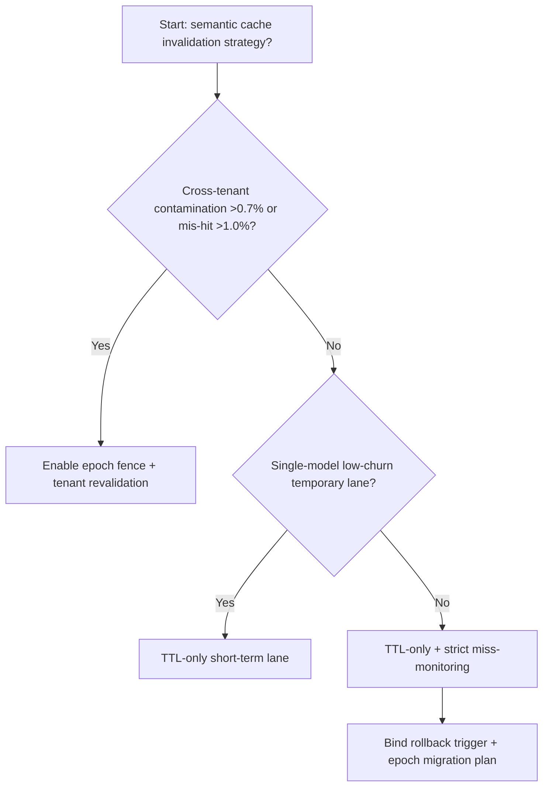
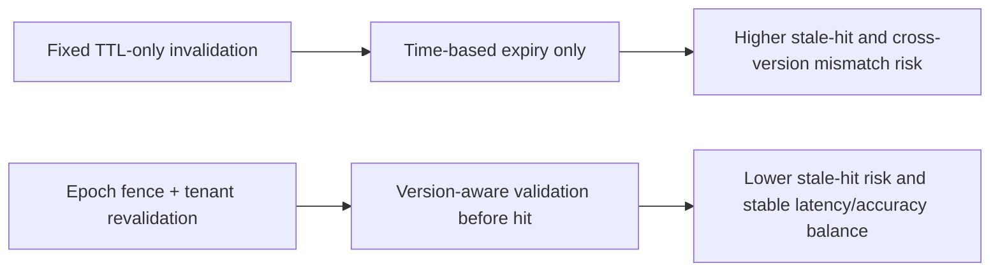
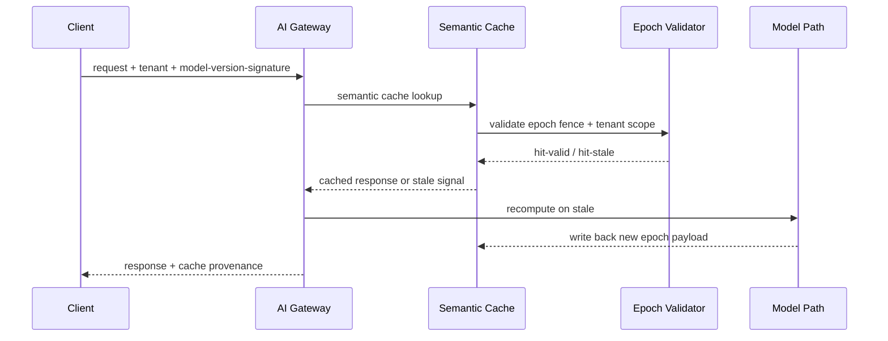

# Agent Gateway Semantic Cache Invalidation Epoch Fence 选型 FAQ（Fixed TTL-only Cache Invalidation vs Epoch Fence + Tenant Scope Revalidation）

## 1) 核心结论（先给负责人）
- **当跨租户语义缓存污染命中 >0.7% 且回源重算尖峰 >14% 时，生产默认应选 Epoch Fence + Tenant Scope Revalidation**；仅 TTL 的方案不再稳定。
- **当缓存键漂移导致误命中 >1.0% 且热路径 P95 >120ms 时，Fixed TTL-only Invalidation 会进入 10.2% 失配档**，需切换 Epoch Fence 机制。
- **当模型版本日更且提示模板变更频次 >3 次/日时，必须把 invalidation epoch 纳入路由契约**，否则命中率和正确率会同时下降。

## 2) Q1 / Q2 / Q3（术语先通俗解释）
- **Fixed TTL-only Cache Invalidation**：只按过期时间清缓存，实现简单但无法感知模型/提示版本变更。
- **Epoch Fence + Tenant Scope Revalidation**：命中前先校验“版本代际栏位（epoch）”和租户作用域，不一致即回源重算并刷新。

### Q1：为什么只看 TTL 会在多版本模型下失真？
第一性原理：语义缓存命中不仅是“时间是否过期”，还取决于“生成逻辑是否还是同一代”。TTL 不懂版本代际，会放大旧结果误命中。

### Q2：何时还可暂时使用 TTL-only？
仅在单模型、单模板、单租户低并发且变更窗口短的场景；一旦进入多租户多版本，就需要 epoch fence。

### Q3：最小闭环怎么做？
请求入站打版本签名 -> 语义缓存命中校验 epoch -> 失配回源重算 -> 回写新 epoch -> 监控误命中与延迟。

## 3) Mermaid（决策树 / 路径对比 / 时序）
### 3.1 选型决策树

### 3.2 路径对比图

### 3.3 运行时序图

## 4) 选型决策矩阵
| 维度 | Fixed TTL-only Cache Invalidation | Epoch Fence + Tenant Scope Revalidation |
|---|---|---|
| 实现复杂度 | 低 | 中 |
| 多版本鲁棒性 | 低-中 | 高 |
| 误命中控制 | 低 | 高 |
| 多租户隔离一致性 | 中 | 高 |
| 生产默认建议 | 仅临时低变更通道 | 长期默认 |

## 5) 数据证据与可复算算例（含 n/分母/来源）
> 本节百分比为 `synthetic_assumed` 假设算例（hypothetical），用于机制比较；生产机制认证保持 `not_measured`。  
> 合同字段见：`workshops/azure-agent-infra/evidence/cycle-527-benchmark.json` 的 `percentage_contract`。

- 指标 A（TTL-only 失配率）  
  - 定义：`n_fixed_ttl_invalidation_mismatch / n_gateway_requests_observed`  
  - 值：`452/4410 = 10.2%`（`synthetic_assumed`）  
  - 路径：`percentage_contract.fixed_ttl_invalidation_mismatch_rate`
- 指标 B（Epoch fence 失配率）  
  - 定义：`n_epoch_fence_invalidation_mismatch / n_gateway_requests_observed`  
  - 值：`174/4410 = 3.9%`（`synthetic_assumed`）  
  - 路径：`percentage_contract.epoch_fence_invalidation_mismatch_rate`
- 指标 C（恢复增益，百分点）  
  - 定义：`(n_recovered_epoch_fence - n_recovered_fixed_ttl) / n_gateway_requests_observed`  
  - 值：`(4112-3834)/4410 = 6.3` 个百分点（`synthetic_assumed`）  
  - 路径：`percentage_contract.epoch_fence_recovery_gain_pts`

## 6) 生产 Checklist（上线前必须打勾）
- [ ] 语义缓存命中链路已接入 epoch fence 与租户作用域校验
- [ ] TTL、epoch、模板版本三者关联关系可审计可回放
- [ ] 误命中、回源重算、延迟抖动指标具备租户级监控
- [ ] 指标全部标注 `synthetic_assumed`，生产机制认证保持 `not_measured`
