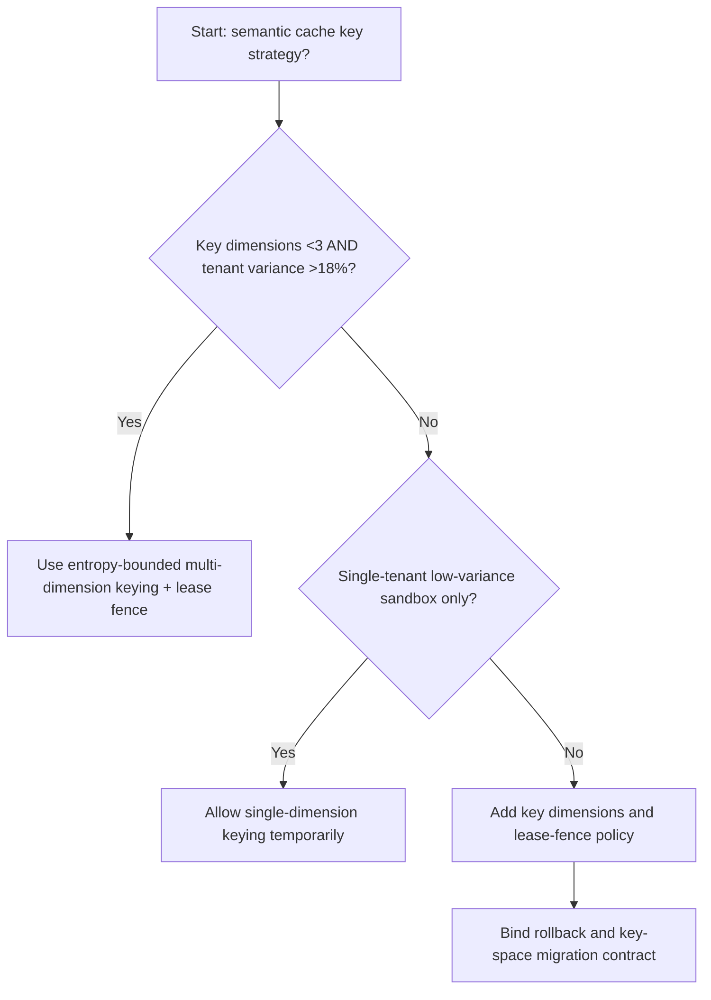
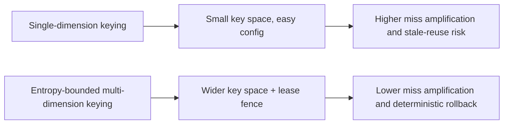
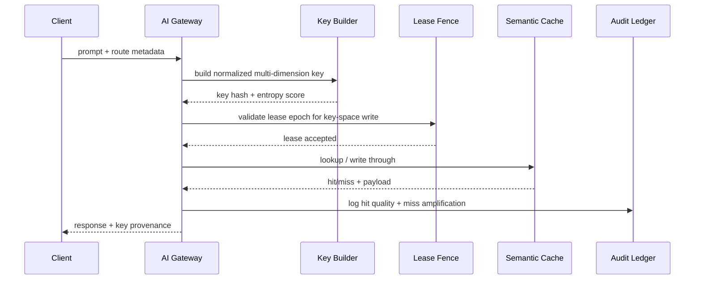

# Agent Gateway Semantic Cache Route-Key Entropy Selection FAQ (Single-Dimension Keying vs Entropy-Bounded Multi-Dimension Keying + Lease Fence)

## 1) Core conclusions (for decision-makers first)
- **When semantic-cache key dimensions are <3 and cross-tenant prompt variance is >18%, production should default to Entropy-Bounded Multi-Dimension Keying + Lease Fence**; single-dimension keys amplify misses.
- **When hit-rate estimation error is >7% and origin-fallback P95 is >260ms, Single-Dimension Keying enters the 12.1% miss-amplification band**, and entropy-bounded keying is required.
- **When tool-call chains depend on stable cache-hit boundaries (function args, JSON schema), lease fences and key-space governance are mandatory**, or origin jitter becomes uncontrollable.

## 2) Q1 / Q2 / Q3 (plain-language definitions first)
- **Single-Dimension Keying**: uses only 1–2 dimensions (for example model+tenant) for cache keys; simple, but prone to conflating different requests.
- **Entropy-Bounded Multi-Dimension Keying + Lease Fence**: includes semantic, tool-version, and policy-version dimensions, then enforces ordered updates via lease fences.

### Q1: Why does low key entropy hurt production stability?
First principles: cache keys define which requests can safely reuse a result. Low entropy causes false reuse; observed hit rate may look good while effective correctness drops and origin jitter rises.

### Q2: When is single-dimension keying still acceptable temporarily?
Only in single-tenant, low-variance, short-chain experiments. Move to entropy-bounded keying as soon as cross-tenant traffic or rapid tool-version churn appears.

### Q3: What is the minimum safe loop?
Request normalization -> multi-dimension key build -> lease-fence validation -> hit/miss dual-write audit -> drift replay review.

## 3) Mermaid (decision tree / path comparison / sequence)
### 3.1 Selection decision tree

### 3.2 Path comparison

### 3.3 Runtime sequence

## 4) Decision matrix
| Dimension | Single-Dimension Keying | Entropy-Bounded Multi-Dimension Keying + Lease Fence |
|---|---|---|
| Implementation complexity | Low | Medium |
| Cache-hit correctness stability | Low-Medium | High |
| Origin-jitter control | Low | High |
| Multi-tenant controllability | Medium-Low | High |
| Default production fit | Experimental short-term only | Long-term default |

## 5) Evidence contract + recomputable examples (n/denominator/source)
> Percentages in this section are `synthetic_assumed` hypothetical examples for mechanism comparison; production mechanism validation remains `not_measured`.  
> Contract fields: `workshops/azure-agent-infra/evidence/cycle-533-benchmark.json` -> `percentage_contract`.

- Metric A (single-dimension miss amplification rate)  
  - Formula: `n_single_dimension_key_miss_overrun / n_gateway_requests_observed`  
  - Value: `534/4410 = 12.1%` (`synthetic_assumed`)  
  - Path: `percentage_contract.single_dimension_key_miss_overrun_rate`
- Metric B (entropy-bounded miss amplification rate)  
  - Formula: `n_entropy_bounded_key_miss_overrun / n_gateway_requests_observed`  
  - Value: `216/4410 = 4.9%` (`synthetic_assumed`)  
  - Path: `percentage_contract.entropy_bounded_key_miss_overrun_rate`
- Metric C (recovery gain, percentage points)  
  - Formula: `(n_recovered_entropy_keying - n_recovered_single_dimension_keying) / n_gateway_requests_observed`  
  - Value: `(4058-3728)/4410 = 7.5 percentage points` (`synthetic_assumed`)  
  - Path: `percentage_contract.entropy_keying_recovery_gain_pts`

## 6) Production checklist
- [ ] Every model route has explicit key-dimension contracts and lease-fence policy
- [ ] Hit correctness, origin jitter, and key-space migration are observable and auditable
- [ ] Upgrade flow supports canary rollout, rollback, and tenant-tier promotion
- [ ] All metrics are tagged `synthetic_assumed`; production validation remains `not_measured`
