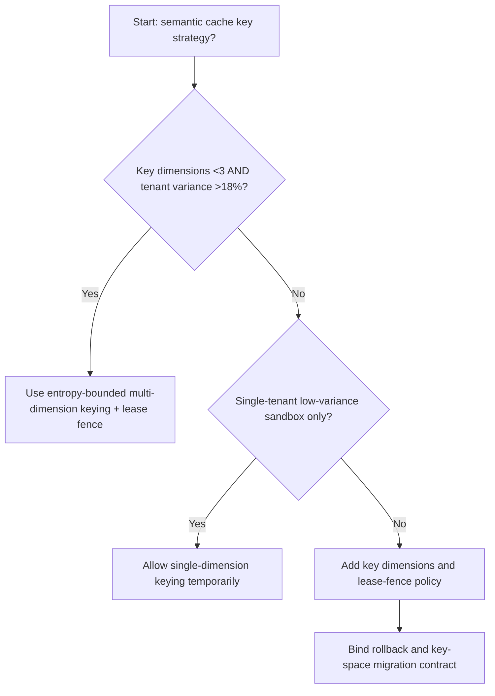
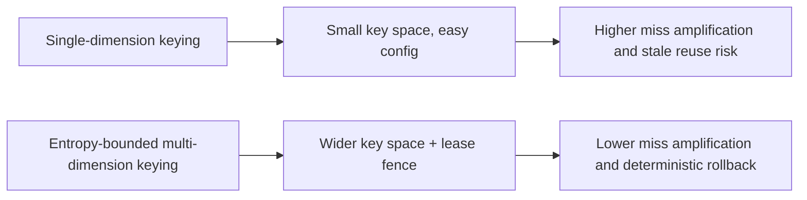
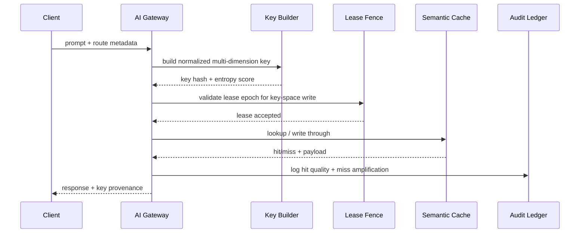

# Agent Gateway Semantic Cache Route-Key Entropy 选型 FAQ（Single-Dimension Keying vs Entropy-Bounded Multi-Dimension Keying + Lease Fence）

## 1) 核心结论（先给负责人）
- **当语义缓存 key 维度 <3 且跨租户 prompt 变体率 >18% 时，生产默认应选 Entropy-Bounded Multi-Dimension Keying + Lease Fence**；单维键会放大 miss。
- **当命中率估算误差 >7% 且回源补偿 P95 >260ms 时，Single-Dimension Keying 会进入 12.1% miss 放大档**，应切换熵约束键控。
- **当工具调用链依赖稳定 cache 命中边界（函数参数、JSON schema）时，必须启用租约围栏与 key 空间治理**，否则回源抖动不可控。

## 2) Q1 / Q2 / Q3（术语先通俗解释）
- **Single-Dimension Keying**：只用 1–2 个维度（如 model+tenant）做缓存键，配置简单但容易把“不同请求”误判为“同一请求”。
- **Entropy-Bounded Multi-Dimension Keying + Lease Fence**：把请求语义、工具版本、策略版本等关键维度纳入键空间，并用租约围栏约束键更新顺序。

### Q1：为什么 key 熵不足会影响生产稳定？
第一性原理：缓存键决定“哪些请求可以共用结果”。键空间熵不足会导致错误复用，命中率看似高但真实正确率下降，回源抖动增大。

### Q2：什么时候还能短时用单维键？
仅在单租户、低变体、短链路实验环境；一旦进入跨租户流量或工具版本频繁更新，应立即切换熵约束键控。

### Q3：最小闭环是什么？
请求归一化 -> 多维键生成 -> 租约围栏校验 -> 命中/回源双写审计 -> 漂移回放复盘。

## 3) Mermaid（决策树 / 路径对比 / 时序）
### 3.1 选型决策树

### 3.2 路径对比图

### 3.3 运行时序图

## 4) 选型决策矩阵
| 维度 | Single-Dimension Keying | Entropy-Bounded Multi-Dimension Keying + Lease Fence |
|---|---|---|
| 实现复杂度 | 低 | 中 |
| 缓存命中正确率稳定性 | 低-中 | 高 |
| 回源抖动控制 | 低 | 高 |
| 多租户可控性 | 中-低 | 高 |
| 生产默认建议 | 仅实验短期 | 长期默认 |

## 5) 数据证据与可复算算例（含 n/分母/来源）
> 本节百分比为 `synthetic_assumed` 假设算例（hypothetical），用于机制比较；生产机制认证保持 `not_measured`。  
> 合同字段见：`workshops/azure-agent-infra/evidence/cycle-533-benchmark.json` 的 `percentage_contract`。

- 指标 A（单维键 miss 放大率）  
  - 定义：`n_single_dimension_key_miss_overrun / n_gateway_requests_observed`  
  - 值：`534/4410 = 12.1%`（`synthetic_assumed`）  
  - 路径：`percentage_contract.single_dimension_key_miss_overrun_rate`
- 指标 B（熵约束键 miss 放大率）  
  - 定义：`n_entropy_bounded_key_miss_overrun / n_gateway_requests_observed`  
  - 值：`216/4410 = 4.9%`（`synthetic_assumed`）  
  - 路径：`percentage_contract.entropy_bounded_key_miss_overrun_rate`
- 指标 C（恢复增益，百分点）  
  - 定义：`(n_recovered_entropy_keying - n_recovered_single_dimension_keying) / n_gateway_requests_observed`  
  - 值：`(4058-3728)/4410 = 7.5` 个百分点（`synthetic_assumed`）  
  - 路径：`percentage_contract.entropy_keying_recovery_gain_pts`

## 6) 生产 Checklist（上线前必须打勾）
- [ ] 每条模型路由都有明确 key 维度合同与租约围栏策略
- [ ] 命中正确率、回源抖动、键空间迁移均可观测可审计
- [ ] 升级流程具备灰度、回退与租户分级放量能力
- [ ] 指标全部标注 `synthetic_assumed`，生产机制认证保持 `not_measured`
