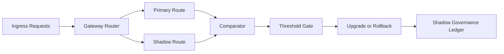

# Agent Gateway Shadow Route Governance Selection FAQ (Cycle 1832)

## 1) Three-minute decision
- **Core tension:** direct route cutover is risky, while long-running shadow traffic can waste resources and hide real issues.
- **Recommendation:** tiered shadow governance plus drift-threshold gates plus auto-convergence shutdown.
- **Goal:** validate new routing safely without impacting production traffic and keep trial windows within budget.

## 2) Q1 / Q2 / Q3
### Q1: Why is "enable shadow traffic" not automatically safe?
1) no baseline comparison means hidden quality drift,
2) long-lived shadow traffic burns resources,
3) missing gates can promote high-risk divergence.

### Q2: What production-ready governance strategy should be used?
- **Tiered shadow rollout:** tenant, task, and region-based progression,
- **Drift gates:** compare latency, hit ratio, and policy consistency,
- **Auto convergence:** promote on pass; rollback and disable on threshold breach,
- **Ledger audit:** record rollout path, divergence snapshots, and decisions.

### Q3: How do we validate effective and bounded trials?
- measurable and converging divergence between primary and shadow routes,
- no regression of critical SLO post-switch,
- shadow cost share remains inside budget.

## 3) Reference architecture

## 4) Decision matrix
| Dimension | Ungoverned shadow route | Gate-governed shadow route (Recommended) |
|---|---:|---:|
| Cutover risk controllability | Low | High |
| Divergence observability | Medium | High |
| Resource cost control | Low | High |
| Implementation complexity | Low | Medium |
| Operational explainability | Medium | High |

## 5) Evidence and reproducibility
- Evidence files:
  - `workshops/azure-agent-infra/evidence/cycle-1832-benchmark.json`
  - `workshops/azure-agent-infra/evidence/cycle-1832-latency.csv`
  - `workshops/azure-agent-infra/evidence/cycle-1832-throughput.csv`
  - `workshops/azure-agent-infra/evidence/cycle-1832-policy.csv`
- Labels: `measured / synthetic / anonymized_reported`.
- validation7 enforces bilingual six-part structure, CSP self-contained 7-card output, strict cycle-evidence alignment, and replayability.

## 6) Production checklist
- [ ] Shadow rollout tiers and entry switches are released.
- [ ] Divergence thresholds (latency/consistency/success) are integrated.
- [ ] Auto promote/rollback/shutdown flows are validated.
- [ ] Shadow ledger and cost alerts are traceable.
- [ ] FAQ/H5/SVG/7-card align with cycle evidence.
