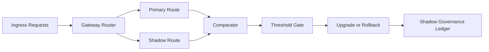

# Agent 网关影子路由治理选型 FAQ（Cycle 1832）

## 1) 3 分钟结论
- **核心矛盾：** 直接切换新路由风险高，长期影子流量又会增加成本并掩盖真实问题。
- **推荐：** 影子路由分层治理 + 偏差阈值门禁 + 自动收敛关停。
- **目标：** 在不影响线上流量的前提下验证新路由效果，并把试运行窗口控制在预算内。

## 2) Q1 / Q2 / Q3
### Q1：为什么“开影子流量”本身不等于安全？
1) 无比较基线时看不到结果偏差；
2) 影子流量长期不关会造成资源浪费；
3) 缺少门禁会把高风险差异带入正式切换。

### Q2：可落地的影子路由治理策略是什么？
- **分层影子**：按租户、任务和区域逐级放量；
- **偏差门禁**：比较延迟、命中率、策略一致性并设阈值；
- **自动收敛**：通过门禁即升级，超阈值即回退并关停；
- **账本审计**：记录放量轨迹、偏差快照与决策依据。

### Q3：如何验证“试运行有效且不失控”？
- 影子与主路由偏差可量化并收敛；
- 切换后关键 SLO 无回退；
- 影子资源成本占比在预算线内。

## 3) 架构图

## 4) 选型矩阵
| 维度 | 无治理影子路由 | 门禁治理影子路由（推荐） |
|---|---:|---:|
| 切换风险可控性 | 低 | 高 |
| 偏差可观测性 | 中 | 高 |
| 资源成本可控性 | 低 | 高 |
| 实施复杂度 | 低 | 中 |
| 运营可解释性 | 中 | 高 |

## 5) 证据与复算口径
- 证据文件：
  - `workshops/azure-agent-infra/evidence/cycle-1832-benchmark.json`
  - `workshops/azure-agent-infra/evidence/cycle-1832-latency.csv`
  - `workshops/azure-agent-infra/evidence/cycle-1832-throughput.csv`
  - `workshops/azure-agent-infra/evidence/cycle-1832-policy.csv`
- 标签：`measured / synthetic / anonymized_reported`。
- validation7：双语六段结构、7-card CSP 自包含、轮次与 evidence 一致、可回放链路通过。

## 6) 生产检查清单
- [ ] 影子放量层级与入口开关已发布。
- [ ] 偏差阈值（延迟/一致性/成功率）已联调。
- [ ] 自动升级/回退/关停链路已演练。
- [ ] 影子账本与成本告警可追溯。
- [ ] FAQ/H5/SVG/7-card 与 evidence 轮次一致。
