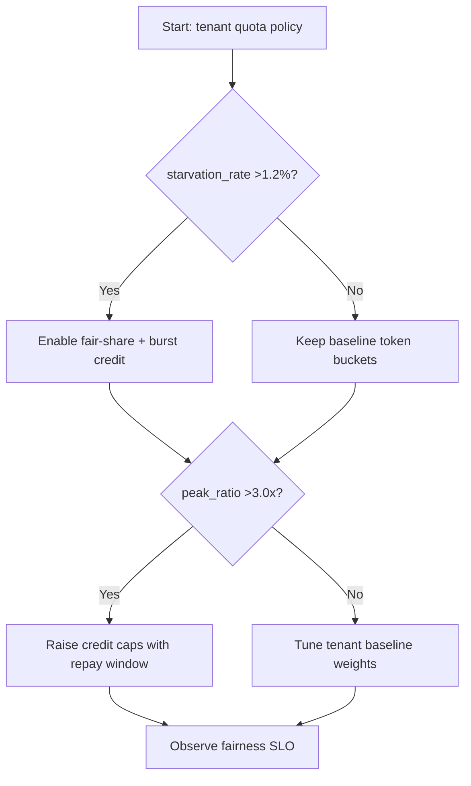
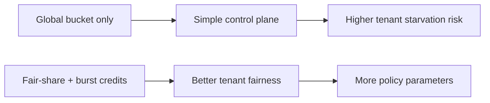
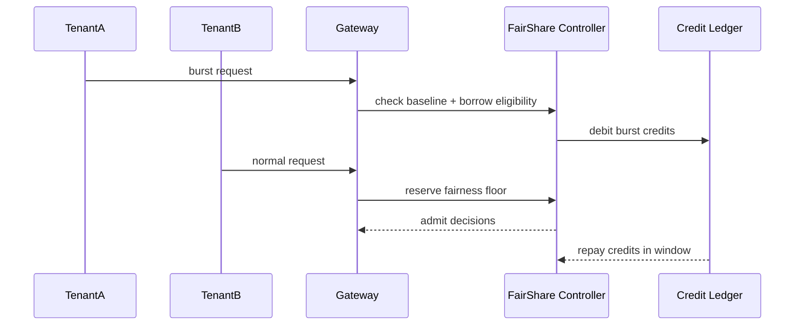

# Agent Gateway Tenant Fair-Share Burst Credit Selection FAQ (Azure AI Agent Infra)

## 1) 3-minute conclusions
- **If multi-tenant burst ratio exceeds 3.0x and tail-tenant starvation exceeds 1.2%, enforce fair-share plus burst-credit controls.**
- **A global token bucket alone lets large tenants crowd out others; combine tenant baselines with borrowable burst pools.**
- **Targets: `starvation_rate <0.4%`, `credit_repay_window <=5min`, and `P95 latency jitter <18%`.**

## 2) Q1 / Q2 / Q3
- **Why do small tenants timeout when total quota seems enough?** Large-tenant spikes consume the shared bucket.
- **Why burst credits?** They preserve fairness floors while allowing short-demand spikes.
- **Minimum viable loop?** Tenant baselines, burst credits, repayment windows, and fallback priorities.

### Q1: When is burst credit mandatory?
When tenant peak/valley ratio exceeds 2.5 and fair-share violation alerts persist.

### Q2: When is static share sufficient?
Stable demand, similarly sized tenants, and minimal burst behavior.

### Q3: How to evaluate benefit?
Compare starvation reduction versus incremental burst-credit cost.

## 3) Mermaid diagrams
### 3.1 Decision tree

### 3.2 Path comparison

### 3.3 Sequence

## 4) Decision matrix
| Dimension | Global bucket | Fair-share + burst credits (Recommended) |
|---|---:|---:|
| Tail-tenant starvation | 0.9%–2.6% | 0.1%–0.6% |
| Peak handling | Medium | High |
| Policy complexity (1-10) | 4 | 8 |
| Cost explainability | Medium | High |
| Multi-tenant fairness | Medium-low | High |

## 5) Quant model + 7-card insights
- Starvation rate: `StarvationRate = StarvedReq / TotalReq`
- Credit cost: `CreditCost = BorrowedTokens * UnitTokenCost`
- Example (`synthetic_assumed`):
  - `StarvedReq=420, TotalReq=180,000`
  - `StarvationRate=0.233%`
  - `BorrowedTokens=9.6M/day, UnitTokenCost=$0.00000052`
  - `CreditCost=$4.99/day`
- Evidence:
  - `workshops/azure-agent-infra/evidence/cycle-1463-benchmark.json`
  - `workshops/azure-agent-infra/evidence/cycle-1463-sources.json`
- Labels: `official/synthetic_assumed/not_measured`.

## 6) Production verification checklist
- [ ] Tenant baseline quotas and burst-credit caps are configured
- [ ] Borrow/repay windows and alert policies are active
- [ ] Starvation, jitter, and cost curves are fully observable
- [ ] Fallback path can safely degrade during peak bursts
- [ ] FAQ/7-card source timestamps and labels are complete
