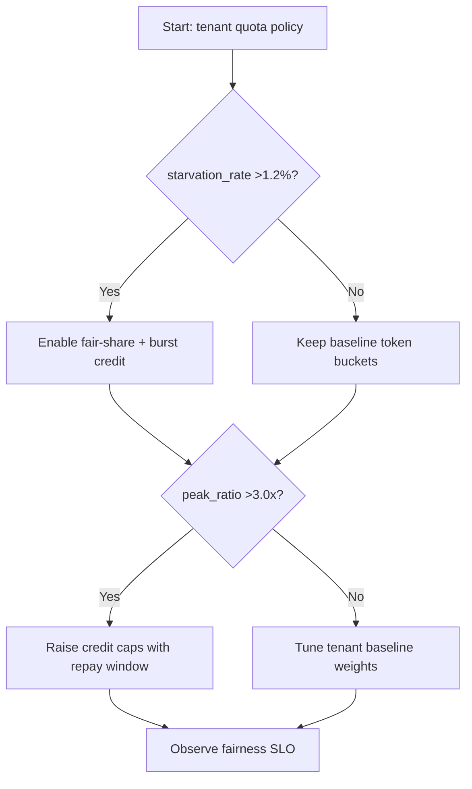
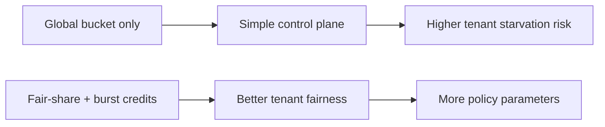
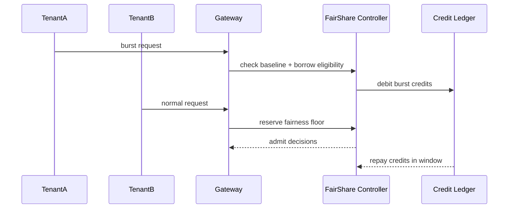

# Agent Gateway Tenant Fair-Share Burst Credit 选型 FAQ（Azure AI Agent Infra）

## 1) 3 分钟结论
- **当多租户请求峰值抖动 >3.0x 且尾租户饥饿率 >1.2% 时，必须启用“公平份额 + 突发积分（burst credit）”双机制。**
- **仅靠全局令牌桶会让大租户长期挤占额度；需要租户基线配额与可借用突发池并存。**
- **生产阈值：`starvation_rate <0.4%`、`credit_repay_window <=5min`、`P95 延迟抖动 <18%`。**

## 2) Q1 / Q2 / Q3
- **为什么会出现“总配额够但小租户超时”？**：大租户短时洪峰吞噬公共桶。
- **为什么要突发积分？**：保证公平基础上允许短时借量，防止硬限流过早触发。
- **最小闭环？**：租户基线、突发积分、还款窗口、优先级回退。

### Q1：何时必须打开 burst credit？
当租户流量峰谷比 >2.5 且公平份额违规告警持续出现。

### Q2：何时只用静态份额？
负载平稳、租户规模接近且无明显突发。

### Q3：如何衡量策略收益？
比较饥饿率下降与因突发借量产生的成本增量。

## 3) Mermaid 图
### 3.1 决策树

### 3.2 路径对比

### 3.3 时序

## 4) 决策矩阵
| 维度 | 全局桶 | 公平份额+突发积分（推荐） |
|---|---:|---:|
| 尾租户饥饿率 | 0.9%–2.6% | 0.1%–0.6% |
| 峰值可承载性 | 中 | 高 |
| 策略复杂度（1-10） | 4 | 8 |
| 成本可解释性 | 中 | 高 |
| 多租户公平性 | 中低 | 高 |

## 5) 定量算例与 7-Card 洞察
- 饥饿率：`StarvationRate = StarvedReq / TotalReq`
- 积分成本：`CreditCost = BorrowedTokens * UnitTokenCost`
- 示例（`synthetic_assumed`）：
  - `StarvedReq=420, TotalReq=180,000`
  - `StarvationRate=0.233%`
  - `BorrowedTokens=9.6M/day, UnitTokenCost=$0.00000052`
  - `CreditCost=$4.99/day`
- 证据：
  - `workshops/azure-agent-infra/evidence/cycle-1463-benchmark.json`
  - `workshops/azure-agent-infra/evidence/cycle-1463-sources.json`
- 标签：`official/synthetic_assumed/not_measured`。

## 6) 生产核验 Checklist
- [ ] 租户基线配额与突发积分上限已配置
- [ ] 积分借用/归还窗口与告警策略生效
- [ ] 饥饿率、抖动率、成本曲线观测完整
- [ ] 回退策略可在高峰期快速降级
- [ ] FAQ/7-Card 来源与时间戳完整
