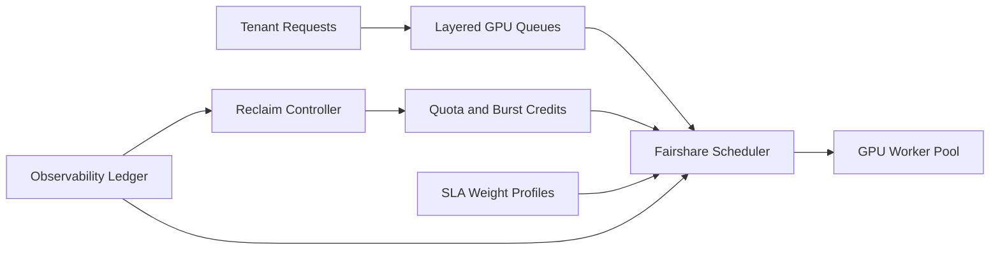

# GPU Pool Fair-Share Scheduling Selection FAQ (Cycle 1847)

## 1) Three-minute decision
- **Core tradeoff:** shared GPU pools seek high utilization, but bursty large jobs can starve small tenants and low-latency sessions.
- **Recommendation:** layered queues, fair-share quotas, reclaimable burst credits, and SLA-weighted priorities.
- **Goal:** keep utilization high while reducing tenant starvation and tail-latency drift.

## 2) Q1 / Q2 / Q3
### Q1: Why does first-come-first-served scheduling fail?
1) long jobs monopolize GPUs and inflate queue latency,
2) one tenant burst can suppress others,
3) without weights, high-priority workloads miss latency targets.

### Q2: What is a production-grade fair-share GPU scheduling model?
- **Layered queues:** interactive sessions, batch jobs, and training lanes,
- **Fair quotas:** per-tenant base share plus burst credits,
- **Burst reclaim:** borrowed shares reclaimed after a window,
- **SLA weights:** dynamic priority adjustment by business tier.

### Q3: How do we validate fair-share effectiveness?
- reduced variance in tenant GPU occupancy,
- lower P95 latency for high-priority sessions,
- sustained high GPU utilization with fewer starvation events.

## 3) Reference architecture

## 4) Decision matrix
| Dimension | FCFS scheduling | Fair-share + weighted scheduling (Recommended) |
|---|---:|---:|
| Multi-tenant fairness | Low | High |
| SLA enforceability | Low | High |
| Resource utilization | Medium | High |
| Implementation complexity | Low | Medium |
| Operational explainability | Low | High |

## 5) Evidence and reproducibility
- Evidence files:
  - `workshops/azure-agent-infra/evidence/cycle-1847-benchmark.json`
  - `workshops/azure-agent-infra/evidence/cycle-1847-latency.csv`
  - `workshops/azure-agent-infra/evidence/cycle-1847-throughput.csv`
  - `workshops/azure-agent-infra/evidence/cycle-1847-policy.csv`
- Labels: `measured / synthetic / anonymized_reported`.
- validation7 enforces bilingual six-part structure, CSP self-contained 7-card output, strict cycle-evidence alignment, and replayability.

## 6) Production checklist
- [ ] Layered queues and tenant quotas are active.
- [ ] Burst-credit reclaim windows are validated.
- [ ] SLA weights and priority behavior are observable.
- [ ] Starvation alerts and mitigation replay are in place.
- [ ] FAQ/H5/SVG/7-card align with cycle evidence.
