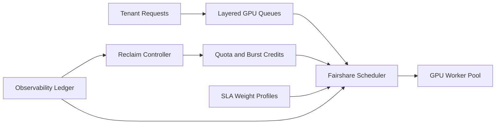

# GPU 资源池公平份额调度选型 FAQ（Cycle 1847）

## 1) 3 分钟结论
- **核心矛盾：** 共享 GPU 池追求高利用率，但抢占式大作业会挤压小租户与低时延会话，导致公平性与 SLA 冲突。
- **推荐：** 分层队列 + 公平份额配额 + 可回收突发额度 + SLA 优先级权重。
- **目标：** 在维持高利用率的同时控制租户饥饿和尾延迟漂移。

## 2) Q1 / Q2 / Q3
### Q1：为什么“先到先得”会失效？
1) 长作业占满 GPU 后小请求排队失控；
2) 单租户突发可压制其他租户，违背多租户公平；
3) 无权重策略时高优先级业务无法保障时延。

### Q2：生产级 GPU 公平份额调度怎么做？
- **分层队列：** 交互式会话、批处理、训练作业分层；
- **公平配额：** 每租户基础份额 + 峰值借用额度；
- **突发回收：** 超过回收窗口自动归还借用份额；
- **SLA 权重：** 按业务等级动态调整调度优先级。

### Q3：如何验证公平份额策略有效？
- 租户资源占用方差下降；
- 高优先级会话 P95 延迟下降；
- GPU 利用率保持高位且饥饿事件减少。

## 3) 架构图

## 4) 选型矩阵
| 维度 | 先到先得调度 | 公平份额 + 权重调度（推荐） |
|---|---:|---:|
| 多租户公平性 | 低 | 高 |
| SLA 可保障性 | 低 | 高 |
| 资源利用率 | 中 | 高 |
| 实施复杂度 | 低 | 中 |
| 运维可解释性 | 低 | 高 |

## 5) 证据与复算口径
- 证据文件：
  - `workshops/azure-agent-infra/evidence/cycle-1847-benchmark.json`
  - `workshops/azure-agent-infra/evidence/cycle-1847-latency.csv`
  - `workshops/azure-agent-infra/evidence/cycle-1847-throughput.csv`
  - `workshops/azure-agent-infra/evidence/cycle-1847-policy.csv`
- 标签：`measured / synthetic / anonymized_reported`。
- validation7：双语六段结构、7-card CSP 自包含、轮次与 evidence 一致、可回放链路通过。

## 6) 生产检查清单
- [ ] 分层队列与租户配额策略生效。
- [ ] 峰值借用与回收窗口参数验证通过。
- [ ] SLA 权重与调度优先级联动可观测。
- [ ] 饥饿保护告警与自动缓解流程可回放。
- [ ] FAQ/H5/SVG/7-card 与 evidence 轮次一致。
