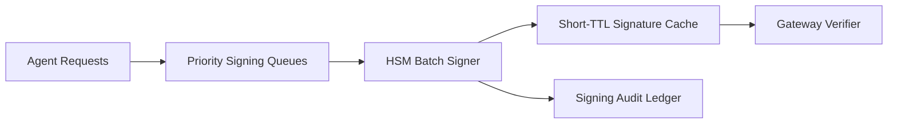

# Agent HSM Signing Latency Selection FAQ (Cycle 1797)

## 1) Three-minute decision
- **The signing path bottleneck is usually the tradeoff between key-protection strength and online latency budget, not raw throughput alone.**
- **Recommendation:** HSM batch signing on critical paths + short-lived signature cache + pre-sign queue shaping.
- **Goal:** keep signing latency within service SLO without weakening key-security boundaries.

## 2) Core questions (Q1/Q2/Q3)
### Q1: Why does per-request direct HSM signing destabilize?
1) signing queues expand at burst peaks,
2) cold-jitter raises tail latency,
3) no channel isolation for high-priority requests.

### Q2: What production strategy is practical?
- layer 1: priority-based signing queues,
- layer 2: short-window batch signing with strict-TTL cache,
- layer 3: pre-signed tickets for lower-risk fallback paths,
- always: ledger every signing decision.

### Q3: How to validate effectiveness?
- lower and steadier P95 signing latency,
- reduced signing-retry failures,
- bounded per-session signing-cost volatility.

## 3) Reference architecture

## 4) Decision matrix
| Dimension | Per-request direct HSM | Batch + cache (Recommended) |
|---|---:|---:|
| Tail-latency stability | Low | High |
| Peak elasticity | Low | High |
| Security-boundary integrity | High | High |
| Cost controllability | Medium | High |
| Implementation complexity | Low | Medium |

## 5) Evidence and reproducibility
- Evidence files:
  - `workshops/azure-agent-infra/evidence/cycle-1797-benchmark.json`
  - `workshops/azure-agent-infra/evidence/cycle-1797-latency.csv`
  - `workshops/azure-agent-infra/evidence/cycle-1797-throughput.csv`
  - `workshops/azure-agent-infra/evidence/cycle-1797-policy.csv`
- Labels: `measured / synthetic / anonymized_reported`.
- validation7 requires bilingual structure fidelity, CSP self-contained cards, cycle-consistent evidence, and replayability checks.

## 6) Production checklist
- [ ] Priority signing queues and quotas are configured.
- [ ] Batch window and cache TTL are load-tested.
- [ ] Retry/circuit-breaker behavior is observable.
- [ ] Signing audit ledger is request-traceable.
- [ ] FAQ/H5/SVG/7-card align with cycle evidence.
