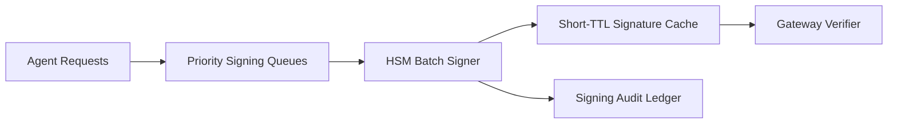

# Agent HSM 签名延迟选型 FAQ（Cycle 1797）

## 1) 3 分钟结论
- **安全签名链路的瓶颈常在“密钥保护强度 vs 在线时延预算”之间，而非单点吞吐。**
- **推荐：** 关键路径采用 HSM 批签 + 短期签名缓存 + 签名前置队列整形。
- **目标：** 在不弱化密钥安全边界前提下，把签名延迟稳定在服务 SLO 内。

## 2) 关键问题（Q1/Q2/Q3）
### Q1：为什么直接逐请求 HSM 签名会失稳？
1) 峰值并发下签名队列膨胀；
2) 冷启动/抖动时尾延迟上升；
3) 高优先级请求缺少通道隔离。

### Q2：生产可落地方案？
- 一级：按请求优先级分队列；
- 二级：短窗批签与结果缓存（带严格 TTL）；
- 三级：低风险路径用预签名票据兜底；
- 全程：签名事件入审计账本。

### Q3：如何验证策略有效？
- P95 签名延迟下降并稳定；
- 签名失败重试率降低；
- 单会话签名成本波动受控。

## 3) 架构图

## 4) 选型矩阵
| 维度 | 逐请求直连 HSM | 批签+缓存（推荐） |
|---|---:|---:|
| 签名尾延迟稳定性 | 低 | 高 |
| 峰值弹性 | 低 | 高 |
| 安全边界完整性 | 高 | 高 |
| 成本可控性 | 中 | 高 |
| 实施复杂度 | 低 | 中 |

## 5) 证据与复算口径
- 证据文件：
  - `workshops/azure-agent-infra/evidence/cycle-1797-benchmark.json`
  - `workshops/azure-agent-infra/evidence/cycle-1797-latency.csv`
  - `workshops/azure-agent-infra/evidence/cycle-1797-throughput.csv`
  - `workshops/azure-agent-infra/evidence/cycle-1797-policy.csv`
- 标签：`measured / synthetic / anonymized_reported`。
- validation7：双语结构、CSP、自包含卡组、证据轮次一致与回放链路全部通过。

## 6) 生产检查清单
- [ ] 优先级签名队列与配额已配置。
- [ ] 批签窗口和缓存 TTL 已压测。
- [ ] 失败重试与熔断策略可观测。
- [ ] 签名审计账本可追溯到请求。
- [ ] FAQ/H5/SVG/7-card 与 evidence 轮次一致。
