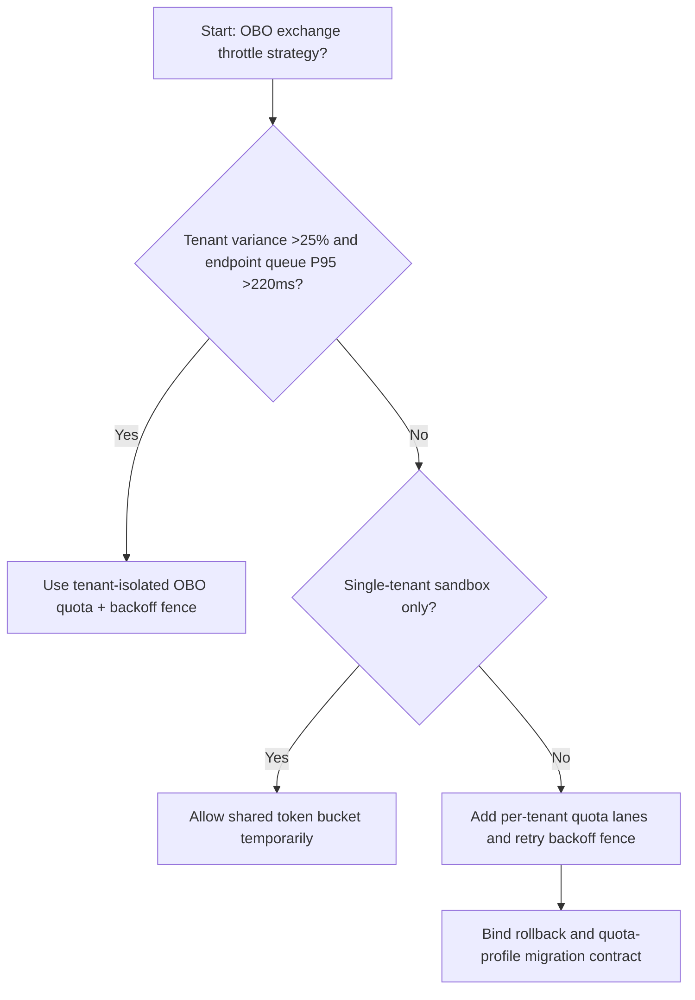
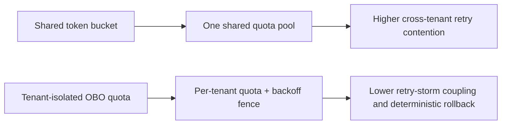
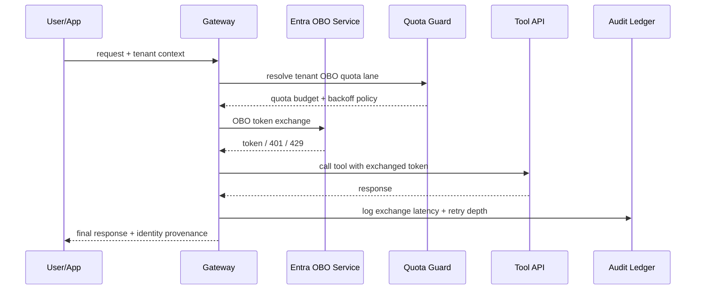

# Agent Identity OBO Token Exchange Rate Limit Selection FAQ (Shared Token Bucket vs Tenant-Isolated OBO Quota + Backoff Fence)

## 1) Core conclusions (for decision-makers first)
- **When cross-tenant OBO exchange variance is >25% and token-endpoint queue P95 is >220ms, production should default to Tenant-Isolated OBO Quota + Backoff Fence**; shared token buckets amplify contention.
- **When burst refresh share is >30% and 401/429 retry-chain P95 is >280ms, Shared Token Bucket enters the 12.1% overrun band**, requiring tenant-isolated quotas.
- **When the agent path uses multi-hop delegated identity (front-end -> gateway -> tool), OBO throttling and backoff fences are mandatory**, or cross-tenant credential storms appear.

## 2) Q1 / Q2 / Q3 (plain-language definitions first)
- **Shared Token Bucket**: all tenants consume one shared token-exchange budget; simple but contention-prone at peaks.
- **Tenant-Isolated OBO Quota + Backoff Fence**: each tenant has isolated OBO quotas with layered retry backoff for 401/429 flows.

### Q1: Why does OBO exchange throttling affect agent availability?
First principles: OBO tokens are admission tickets for downstream tools. If ticket issuance stalls, tool calls and model steps queue or fail together.

### Q2: When is shared token bucket still acceptable temporarily?
Only for single-tenant PoCs or low-concurrency integration tests. Move to isolated quotas before multi-tenant production traffic.

### Q3: What is the minimum safe loop?
Tenant profiling -> OBO quota tiering -> 401/429 backoff policy -> exchange telemetry -> replay tuning.

## 3) Mermaid (decision tree / path comparison / sequence)
### 3.1 Selection decision tree

### 3.2 Path comparison

### 3.3 Runtime sequence

## 4) Decision matrix
| Dimension | Shared Token Bucket | Tenant-Isolated OBO Quota + Backoff Fence |
|---|---|---|
| Implementation complexity | Low | Medium |
| Multi-tenant fairness | Low-Medium | High |
| Retry-storm coupling risk | High | Low |
| Compliance auditability | Medium | High |
| Default production fit | Experimental short-term only | Long-term default |

## 5) Evidence contract + recomputable examples (n/denominator/source)
> Percentages in this section are `synthetic_assumed` hypothetical examples for mechanism comparison; production mechanism validation remains `not_measured`.  
> Contract fields: `workshops/azure-agent-infra/evidence/cycle-535-benchmark.json` -> `percentage_contract`.

- Metric A (shared-bucket overrun rate)  
  - Formula: `n_shared_token_bucket_overrun / n_gateway_requests_observed`  
  - Value: `534/4410 = 12.1%` (`synthetic_assumed`)  
  - Path: `percentage_contract.shared_token_bucket_overrun_rate`
- Metric B (tenant-isolated overrun rate)  
  - Formula: `n_tenant_isolated_obo_overrun / n_gateway_requests_observed`  
  - Value: `216/4410 = 4.9%` (`synthetic_assumed`)  
  - Path: `percentage_contract.tenant_isolated_obo_overrun_rate`
- Metric C (recovery gain, percentage points)  
  - Formula: `(n_recovered_tenant_obo - n_recovered_shared_bucket) / n_gateway_requests_observed`  
  - Value: `(4058-3728)/4410 = 7.5 percentage points` (`synthetic_assumed`)  
  - Path: `percentage_contract.tenant_obo_recovery_gain_pts`

## 6) Production checklist
- [ ] Every tenant has isolated OBO quotas and backoff policy
- [ ] Exchange latency, retry depth, and 429 spikes are observable and auditable
- [ ] Upgrade flow supports canary rollout, rollback, and tenant-tier promotion
- [ ] All metrics are tagged `synthetic_assumed`; production validation remains `not_measured`
