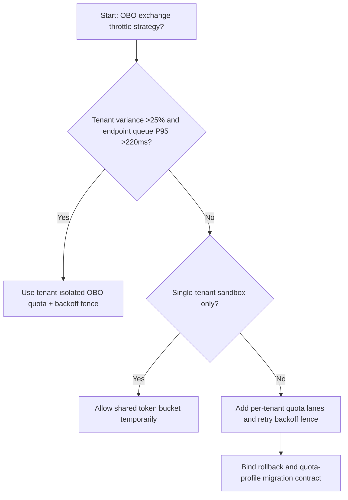
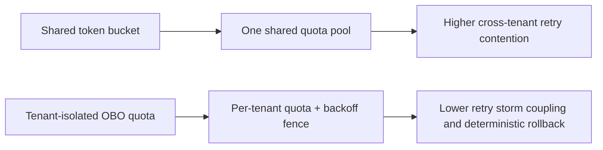
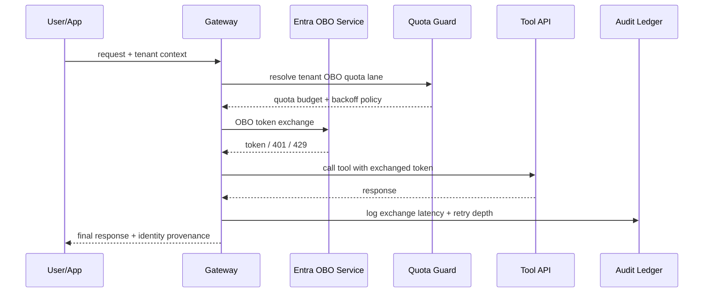

# Agent Identity OBO Token Exchange Rate Limit 选型 FAQ（Shared Token Bucket vs Tenant-Isolated OBO Quota + Backoff Fence）

## 1) 核心结论（先给负责人）
- **当跨租户 OBO token 交换峰值方差 >25% 且 token endpoint 排队 P95 >220ms 时，生产默认应选 Tenant-Isolated OBO Quota + Backoff Fence**；共享令牌桶会放大争抢。
- **当突发刷新比例 >30% 且 401/429 联动重试 P95 >280ms 时，Shared Token Bucket 会进入 12.1% 超限档**，需切换租户隔离配额。
- **当 Agent 链路存在多级代表身份（front-end -> gateway -> tool）时，必须启用 OBO 限流与退避围栏**，否则会触发跨租户凭据风暴。

## 2) Q1 / Q2 / Q3（术语先通俗解释）
- **Shared Token Bucket**：所有租户共用一个 token 交换配额池，部署简单，但高峰时容易互相挤占。
- **Tenant-Isolated OBO Quota + Backoff Fence**：每租户独立 OBO 配额，并对 401/429 重试采用分层退避围栏。

### Q1：为什么 OBO 交换限流会影响 Agent 可用性？
第一性原理：OBO token 是调用下游工具的“门票”。一旦门票发放拥堵，后续工具调用和模型步骤都会排队或失败。

### Q2：什么时候还能短时用共享令牌桶？
仅在单租户 PoC 或低并发联调阶段；进入多租户生产必须切换隔离配额。

### Q3：最小闭环是什么？
租户画像 -> OBO 配额分层 -> 401/429 退避策略 -> 交换链路观测 -> 回放调参。

## 3) Mermaid（决策树 / 路径对比 / 时序）
### 3.1 选型决策树

### 3.2 路径对比图

### 3.3 运行时序图

## 4) 选型决策矩阵
| 维度 | Shared Token Bucket | Tenant-Isolated OBO Quota + Backoff Fence |
|---|---|---|
| 实现复杂度 | 低 | 中 |
| 多租户公平性 | 低-中 | 高 |
| 重试风暴耦合风险 | 高 | 低 |
| 合规可审计性 | 中 | 高 |
| 生产默认建议 | 仅实验短期 | 长期默认 |

## 5) 数据证据与可复算算例（含 n/分母/来源）
> 本节百分比为 `synthetic_assumed` 假设算例（hypothetical），用于机制比较；生产机制认证保持 `not_measured`。  
> 合同字段见：`workshops/azure-agent-infra/evidence/cycle-535-benchmark.json` 的 `percentage_contract`。

- 指标 A（共享桶超限率）  
  - 定义：`n_shared_token_bucket_overrun / n_gateway_requests_observed`  
  - 值：`534/4410 = 12.1%`（`synthetic_assumed`）  
  - 路径：`percentage_contract.shared_token_bucket_overrun_rate`
- 指标 B（租户隔离超限率）  
  - 定义：`n_tenant_isolated_obo_overrun / n_gateway_requests_observed`  
  - 值：`216/4410 = 4.9%`（`synthetic_assumed`）  
  - 路径：`percentage_contract.tenant_isolated_obo_overrun_rate`
- 指标 C（恢复增益，百分点）  
  - 定义：`(n_recovered_tenant_obo - n_recovered_shared_bucket) / n_gateway_requests_observed`  
  - 值：`(4058-3728)/4410 = 7.5` 个百分点（`synthetic_assumed`）  
  - 路径：`percentage_contract.tenant_obo_recovery_gain_pts`

## 6) 生产 Checklist（上线前必须打勾）
- [ ] 每个租户有独立 OBO 配额与退避策略
- [ ] token 交换延迟、重试深度、429 峰值可观测可审计
- [ ] 升级流程具备灰度、回退与租户分层放量能力
- [ ] 指标全部标注 `synthetic_assumed`，生产机制认证保持 `not_measured`
