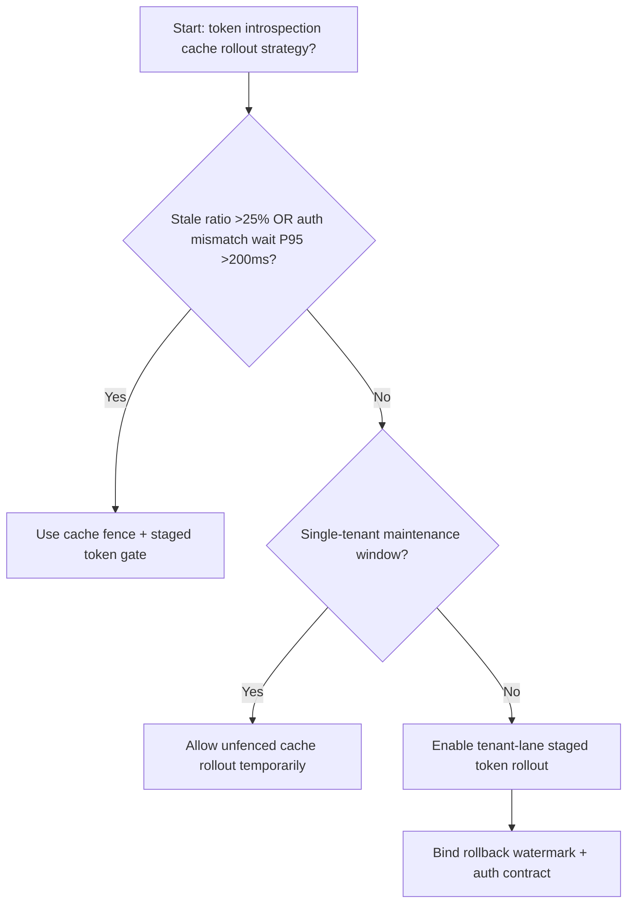
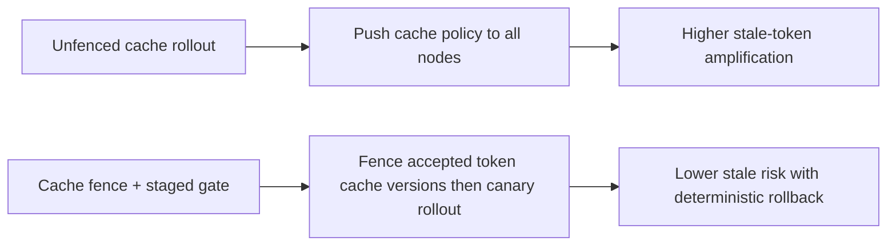
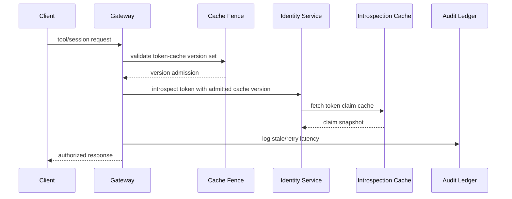

# Agent Identity Token Introspection Cache Fence Selection FAQ (Unfenced Introspection Cache Rollout vs Cache Fence + Staged Token Gate)

## 1) Core conclusions (for decision-makers first)
- **When token-introspection cache staleness exceeds 25% and auth-mismatch wait P95 exceeds 200ms, production should default to Cache Fence + Staged Token Gate**.
- **When unfenced introspection-cache staleness exceeds 13% and rollback retry P95 exceeds 270ms, Unfenced Introspection Cache Rollout enters the 13.2% staleness amplification band**.
- **Cross-tenant identity planes must bind cache fences, rollout batches, and rollback watermarks**, or authorization consistency and throughput degrade together.

## 2) Q1 / Q2 / Q3 (plain-language definitions first)
- **Unfenced Introspection Cache Rollout**: push new introspection-cache policy everywhere directly; fast but high mismatch risk.
- **Cache Fence + Staged Token Gate**: constrain accepted token-cache versions first, then shift traffic in batches.

### Q1: Why does token-introspection caching directly affect agent stability?
First principles: identity authorization is the entry point for each tool call and route decision. Stale cache versions split auth outcomes, amplifying retries and tail latency.

### Q2: When is unfenced rollout acceptable temporarily?
Only in single-tenant low-traffic maintenance windows. Multi-tenant production should default to fenced cache rollout.

### Q3: What is the minimum safe loop?
Version sampling -> fence validation -> staged rollout -> staleness alerts -> automated rollback.

## 3) Mermaid (decision tree / path comparison / sequence)
### 3.1 Selection decision tree

### 3.2 Path comparison

### 3.3 Runtime sequence

## 4) Decision matrix
| Dimension | Unfenced Introspection Cache Rollout | Cache Fence + Staged Token Gate |
|---|---|---|
| Implementation complexity | Low | Medium |
| Stale-token risk | High | Low |
| Multi-tenant controllability | Low | High |
| Rollback determinism | Medium | High |
| Default production fit | Maintenance windows only | Long-term default |

## 5) Evidence contract + recomputable examples (n/denominator/source)
> Percentages in this section are `synthetic_assumed` hypothetical examples for mechanism comparison; production mechanism validation remains `not_measured`.  
> Contract fields: `workshops/azure-agent-infra/evidence/cycle-544-benchmark.json` -> `percentage_contract`.

- Metric A (unfenced introspection staleness rate)  
  - Formula: `n_unfenced_introspection_stale / n_gateway_requests_observed`  
  - Value: `582/4410 = 13.2%` (`synthetic_assumed`)  
  - Path: `percentage_contract.unfenced_introspection_stale_rate`
- Metric B (cache-fence staleness rate)  
  - Formula: `n_cache_fence_stale / n_gateway_requests_observed`  
  - Value: `251/4410 = 5.7%` (`synthetic_assumed`)  
  - Path: `percentage_contract.cache_fence_stale_rate`
- Metric C (recovery gain, percentage points)  
  - Formula: `(n_recovered_cache_fence - n_recovered_unfenced) / n_gateway_requests_observed`  
  - Value: `(4088-3762)/4410 = 7.4 percentage points` (`synthetic_assumed`)  
  - Path: `percentage_contract.cache_fence_recovery_gain_pts`

## 6) Production checklist
- [ ] Every tenant has token-introspection cache version allow-lists and rollout batches
- [ ] Staleness rate, retry latency, and rollback success are observable and auditable
- [ ] Change flow supports canary rollout, fast rollback, and tiered promotion
- [ ] All metrics are tagged `synthetic_assumed`; production validation remains `not_measured`
