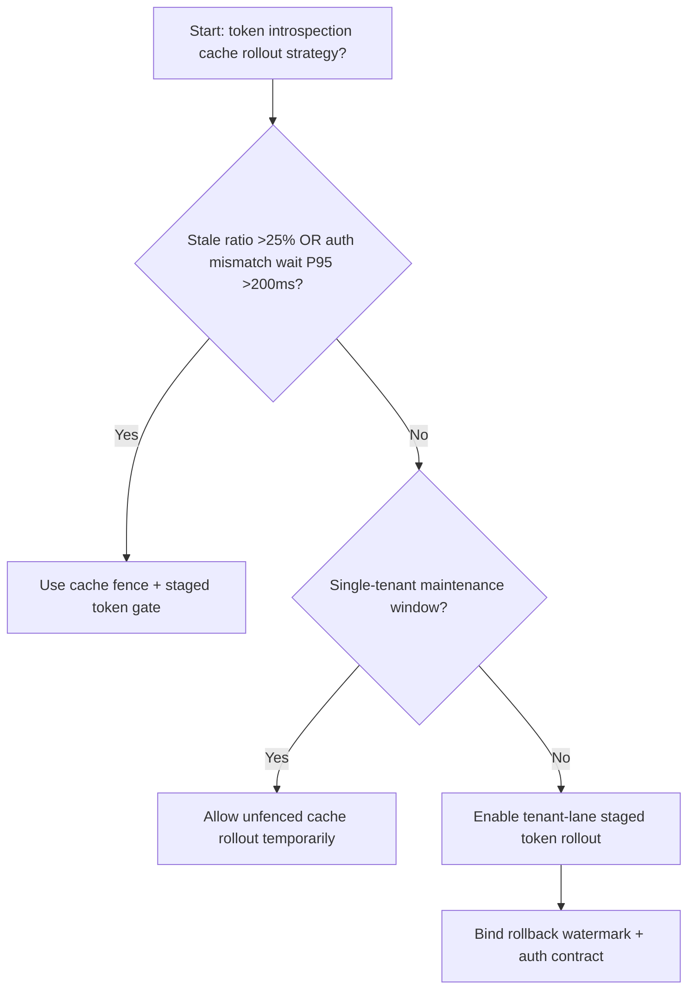
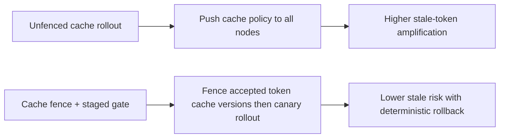
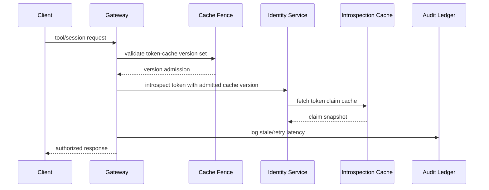

# Agent Identity Token Introspection Cache Fence 选型 FAQ（Unfenced Introspection Cache Rollout vs Cache Fence + Staged Token Gate）

## 1) 核心结论（先给负责人）
- **当令牌内省缓存陈旧比例 >25% 且鉴权失配等待 P95 >200ms 时，生产默认应启用 Cache Fence + Staged Token Gate**。
- **当未围栏内省缓存陈旧率 >13% 且回退重试 P95 >270ms 时，Unfenced Introspection Cache Rollout 会进入 13.2% 陈旧放大区间**。
- **跨租户身份面必须绑定“缓存围栏、批次放量、回滚水位”**，否则授权一致性与吞吐会同步恶化。

## 2) Q1 / Q2 / Q3（术语先通俗解释）
- **Unfenced Introspection Cache Rollout**：直接把新内省缓存策略推全网，快但失配风险高。
- **Cache Fence + Staged Token Gate**：先限定允许的 token 缓存版本，再按批次放量。

### Q1：为什么 token 内省缓存会直接影响 Agent 稳定性？
第一性原理：身份鉴权是每次工具调用与路由的入口。缓存版本陈旧会导致鉴权结果分叉，放大重试与尾时延。

### Q2：什么时候可以短时用 Unfenced 方案？
仅限单租户低流量维护窗；多租户生产应默认开启缓存围栏。

### Q3：最小闭环是什么？
版本采样 -> 围栏校验 -> 分批放量 -> 陈旧告警 -> 自动回滚。

## 3) Mermaid（决策树 / 路径对比 / 时序）
### 3.1 选型决策树

### 3.2 路径对比图

### 3.3 运行时序图

## 4) 选型决策矩阵
| 维度 | Unfenced Introspection Cache Rollout | Cache Fence + Staged Token Gate |
|---|---|---|
| 实现复杂度 | 低 | 中 |
| 陈旧令牌风险 | 高 | 低 |
| 多租户可控性 | 低 | 高 |
| 回滚确定性 | 中 | 高 |
| 生产默认建议 | 仅维护窗 | 长期默认 |

## 5) 数据证据与可复算算例（含 n/分母/来源）
> 本节百分比为 `synthetic_assumed` 假设算例（hypothetical），用于机制比较；生产机制认证保持 `not_measured`。  
> 合同字段见：`workshops/azure-agent-infra/evidence/cycle-544-benchmark.json` 的 `percentage_contract`。

- 指标 A（未围栏内省缓存陈旧率）  
  - 定义：`n_unfenced_introspection_stale / n_gateway_requests_observed`  
  - 值：`582/4410 = 13.2%`（`synthetic_assumed`）  
  - 路径：`percentage_contract.unfenced_introspection_stale_rate`
- 指标 B（缓存围栏陈旧率）  
  - 定义：`n_cache_fence_stale / n_gateway_requests_observed`  
  - 值：`251/4410 = 5.7%`（`synthetic_assumed`）  
  - 路径：`percentage_contract.cache_fence_stale_rate`
- 指标 C（恢复增益，百分点）  
  - 定义：`(n_recovered_cache_fence - n_recovered_unfenced) / n_gateway_requests_observed`  
  - 值：`(4088-3762)/4410 = 7.4` 个百分点（`synthetic_assumed`）  
  - 路径：`percentage_contract.cache_fence_recovery_gain_pts`

## 6) 生产 Checklist（上线前必须打勾）
- [ ] 每租户都有 token 内省缓存版本白名单与切流批次
- [ ] 陈旧率、重试时延、回滚成功率可观测可审计
- [ ] 支持灰度、快速回退与分层放量
- [ ] 指标全部标注 `synthetic_assumed`，生产机制认证保持 `not_measured`
