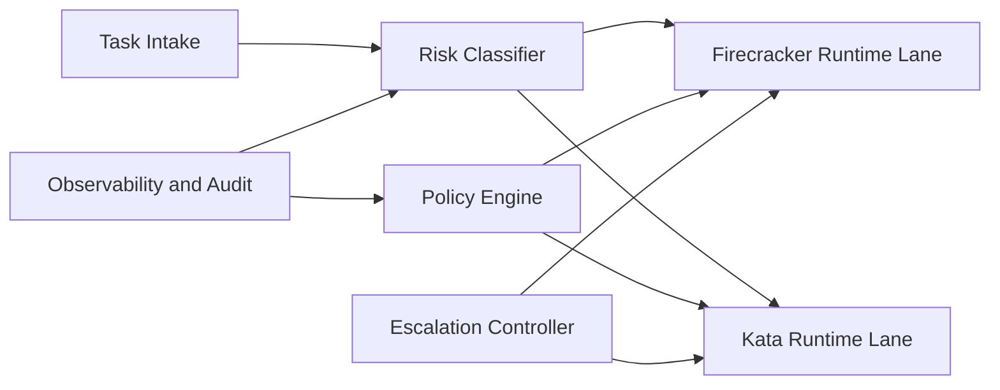

# Kata vs Firecracker Isolation-Boundary Selection FAQ (Cycle 1852)

## 1) Three-minute decision
- **Core tradeoff:** container elasticity and microVM-grade isolation are hard to maximize simultaneously; wrong boundary choices create security-latency-ops imbalance.
- **Recommendation:** risk-tiered mapping: Firecracker for high-risk paths, Kata with hardened policy baselines for medium-risk paths.
- **Goal:** meet strict isolation requirements without excessive startup or operational overhead.

## 2) Q1 / Q2 / Q3
### Q1: Why is single-boundary standardization often suboptimal?
1) universal high-isolation rollout increases cost and startup latency,
2) universal low-isolation rollout under-protects high-risk tasks,
3) workload I/O, network, and lifecycle patterns differ materially.

### Q2: What production-grade boundary-selection model should be used?
- **Risk tiering:** classify by data sensitivity, privilege risk, and egress complexity,
- **Runtime mapping:** high-risk to Firecracker, standard-risk to Kata,
- **Unified policy plane:** common network/file/syscall guardrails,
- **Escalation fallback:** raise isolation tier and rebuild runtime on anomaly.

### Q3: How do we validate selection success?
- lower isolation-alert rate on high-risk workloads,
- cold-start P95 and throughput remain in target bands,
- controlled change complexity and recovery time.

## 3) Reference architecture

## 4) Decision matrix
| Dimension | Single Kata path | Tiered Kata+Firecracker (Recommended) |
|---|---:|---:|
| Isolation strength | Medium | High |
| Cold-start overhead | Low | Medium |
| Ops complexity | Low | Medium |
| Risk-adaptation capability | Low | High |
| Cost efficiency | Medium | Medium-high |

## 5) Evidence and reproducibility
- Evidence files:
  - `workshops/azure-agent-infra/evidence/cycle-1852-benchmark.json`
  - `workshops/azure-agent-infra/evidence/cycle-1852-latency.csv`
  - `workshops/azure-agent-infra/evidence/cycle-1852-throughput.csv`
  - `workshops/azure-agent-infra/evidence/cycle-1852-policy.csv`
- Labels: `measured / synthetic / anonymized_reported`.
- validation7 enforces bilingual six-part structure, CSP self-contained 7-card output, strict cycle-evidence alignment, and replayability.

## 6) Production checklist
- [ ] Task risk-tier rules are frozen.
- [ ] Kata/Firecracker mapping and policy baselines are integrated.
- [ ] Isolation-escalation rebuild path is replay-validated.
- [ ] Cold-start, throughput, and isolation-alert metrics pass targets.
- [ ] FAQ/H5/SVG/7-card align with cycle evidence.
