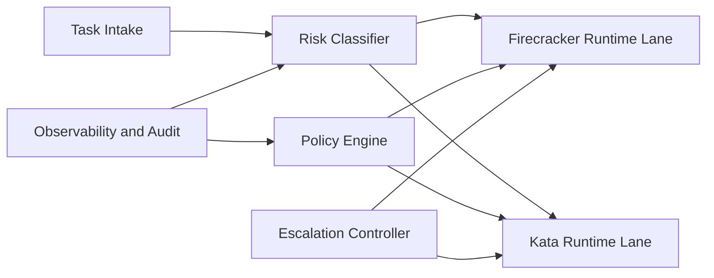

# Kata 与 Firecracker 隔离边界选型 FAQ（Cycle 1852）

## 1) 3 分钟结论
- **核心矛盾：** 容器级弹性与微虚机级隔离通常难兼得，边界选错会在安全、时延与运维成本间失衡。
- **推荐：** 按任务风险分层：高风险路径优先 Firecracker 边界，中风险路径采用 Kata + 策略加固。
- **目标：** 在不牺牲关键隔离要求的前提下控制冷启动与运维复杂度。

## 2) Q1 / Q2 / Q3
### Q1：为什么“全量统一一种隔离”往往不优？
1) 高隔离方案全量铺开会抬高成本与启动时延；
2) 低隔离方案面对高风险任务时安全裕度不足；
3) 不同任务的 I/O、网络与生命周期差异明显。

### Q2：生产级边界选型策略如何落地？
- **风险分层：** 按数据敏感度、越权风险、外联复杂度划级；
- **执行映射：** 高风险任务映射 Firecracker，常规任务映射 Kata；
- **统一策略面：** 通过同一策略引擎管理网络、文件、系统调用基线；
- **回退机制：** 发现异常时可提升隔离等级并强制重建执行环境。

### Q3：如何验证选型是否成功？
- 高风险任务的隔离告警率下降；
- 冷启动 P95 与吞吐在目标区间；
- 运维变更复杂度与故障恢复时间可控。

## 3) 架构图

## 4) 选型矩阵
| 维度 | 单一 Kata 路径 | 分层 Kata+Firecracker（推荐） |
|---|---:|---:|
| 隔离强度 | 中 | 高 |
| 冷启动开销 | 低 | 中 |
| 运维复杂度 | 低 | 中 |
| 风险适配能力 | 低 | 高 |
| 成本效率 | 中 | 中高 |

## 5) 证据与复算口径
- 证据文件：
  - `workshops/azure-agent-infra/evidence/cycle-1852-benchmark.json`
  - `workshops/azure-agent-infra/evidence/cycle-1852-latency.csv`
  - `workshops/azure-agent-infra/evidence/cycle-1852-throughput.csv`
  - `workshops/azure-agent-infra/evidence/cycle-1852-policy.csv`
- 标签：`measured / synthetic / anonymized_reported`。
- validation7：双语六段结构、7-card CSP 自包含、轮次与 evidence 一致、可回放链路通过。

## 6) 生产检查清单
- [ ] 任务风险分级规则已冻结。
- [ ] Kata/Firecracker 映射与策略基线联调通过。
- [ ] 异常升级隔离与强制重建链路可回放。
- [ ] 冷启动、吞吐、隔离告警指标达标。
- [ ] FAQ/H5/SVG/7-card 与 evidence 轮次一致。
